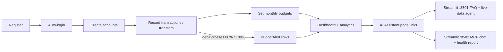
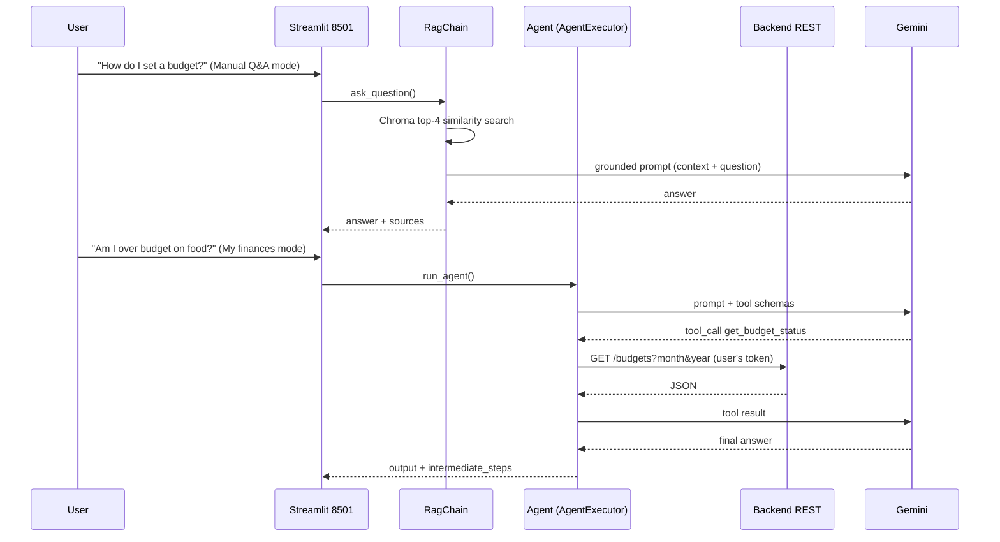

# Application Flow

Part of the [Finance Tracker documentation library](../Finance%20Tracker.md). This file follows a user through the app end-to-end. Deeper per-layer detail: [End_to_End_Data_Flow](../09_Data_Flow_and_Reference/End_to_End_Data_Flow.md) and [Request_Response_Lifecycle](../09_Data_Flow_and_Reference/Request_Response_Lifecycle.md).

## 1. Journey overview

## 2. Step-by-step

### 2.1 Registration and login

1. `Register` page (`pages/AuthPages.jsx`) validates on submit and calls `AuthContext.register(payload)`.
2. `register` → `api.register` → `POST /api/v1/auth/register` (JSON). Backend `auth_service.register_user` lower-cases the email (schema validator), rejects duplicates with **409**, hashes the password with bcrypt, commits, returns `UserOut`.
3. `register` then calls `login(email, password)`: `POST /api/v1/auth/login` with a **form-encoded** body (`username=<email>&password=…`) as required by `OAuth2PasswordRequestForm`.
4. Backend returns `{"access_token": "<JWT>", "token_type": "bearer"}`. `services/api.js::setToken` stores it in memory and in `localStorage['ft_token']`.
5. `GET /users/me` populates `AuthContext.user`; `Protected` in `App.jsx` now lets the user into `AppLayout`.
6. On page reload, `AuthProvider`'s `useEffect` finds the stored token, calls `api.me()`, and either restores the session or calls `logout()` (and shows a "Restoring session…" spinner meanwhile).

### 2.2 Accounts

`Accounts` page → `useAsync(() => api.accounts())` → `GET /accounts`. Creating (`AccountForm`), renaming (`RenameForm`, `PATCH` — name only) and deleting (`window.confirm`, then `DELETE`, which also deletes the account's transactions) all reload the list. A *credit* account's `balance` means **amount owed**.

### 2.3 Transactions

`Transactions` page → `TransactionForm` → `POST /transactions`. In `transaction_service.create_transaction`, in one DB transaction:

1. ownership check (`get_owned_account`);
2. rule checks (amount > 0; salary must be a credit);
3. guarded atomic `UPDATE accounts SET balance = balance ± amount` (fails with 400 *Insufficient balance* for savings/checking going below zero);
4. insert the `transactions` row;
5. if it is a debit: `check_and_create_alerts` for the budget of that category/month;
6. commit (or roll back everything).

`Transfers` (`TransferForm` → `POST /transfers`) create two linked transactions (`is_transfer=True`, same `transfer_group`) atomically; they are excluded from income/expense figures.

### 2.4 Budgets and alerts

`Budgets` page → `BudgetForm` → `POST /budgets` (409 if one already exists for user+category+month+year; `salary` rejected). `GET /budgets` returns computed `spent`, `remaining`, `utilization_percent`, `has_alert`. Alerts are created **only when a debit is recorded** (not when a budget is created afterwards). UI colour: green < 80 %, orange 80–99 %, red ≥ 100 %.

### 2.5 Dashboard and analytics

`Dashboard` fires four parallel `useAsync` loaders: `/dashboard`, `/analytics/income-vs-expense?months=6`, `/analytics/spending-by-category`, `/accounts`. `Analytics` uses the same analytics endpoints with a selectable range (6/12/24 months) and period.

### 2.6 AI Assistant

The `Assistant` page (`pages/Assistant.jsx`) is only a launch page: two links to separate Streamlit apps (`VITE_FAQ_URL` default `http://localhost:8501`, `VITE_ASSISTANT_URL` default `http://localhost:8502`). They are **not** embedded and the user signs in again inside Streamlit (the SPA's token is not shared).

## 3. AI flows at a glance

* **RAG details:** [RAG_Architecture](../04_RAG/RAG_Architecture.md)
* **Agent details:** [Tool_Execution_Flow](../05_AI_Agent/Tool_Execution_Flow.md)
* **MCP chat with confirmation:** [Confirmation_and_Execution_Flow](../06_MCP/Confirmation_and_Execution_Flow.md)
* **Health report:** [Graph_State_and_Workflow](../07_LangGraph_Multi_Agent/Graph_State_and_Workflow.md)

## 4. Failure behaviour a user would notice

| Situation | Behaviour |
|---|---|
| Backend down | SPA shows "Cannot reach the server. Is the backend running?" (`ApiError` status 0); AI layer returns "Finance API service unavailable…" |
| Expired/invalid JWT | Backend 401 → `api.js` calls the unauthorized handler → `logout()` → redirect to `/login` |
| Spend more than a savings balance | 400 `Insufficient balance`, balance unchanged |
| Duplicate budget | 409 conflict message in the form |
| No `GOOGLE_API_KEY` | App works; chatbot shows a configuration message; report CLI still works |
| Chroma collection empty | `RuntimeError("The knowledge base is empty. Run python ai/rag/ingest.py first.")` |
