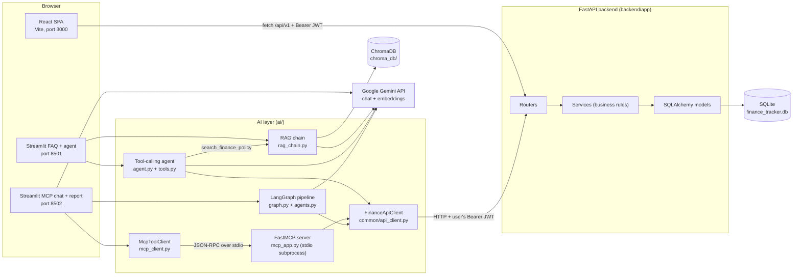
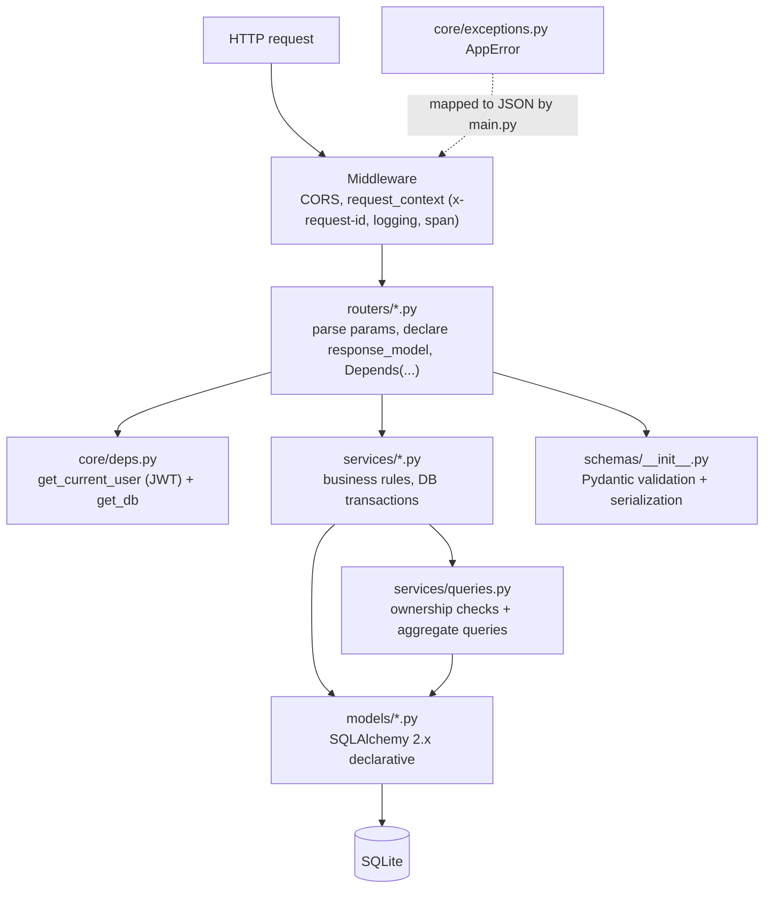
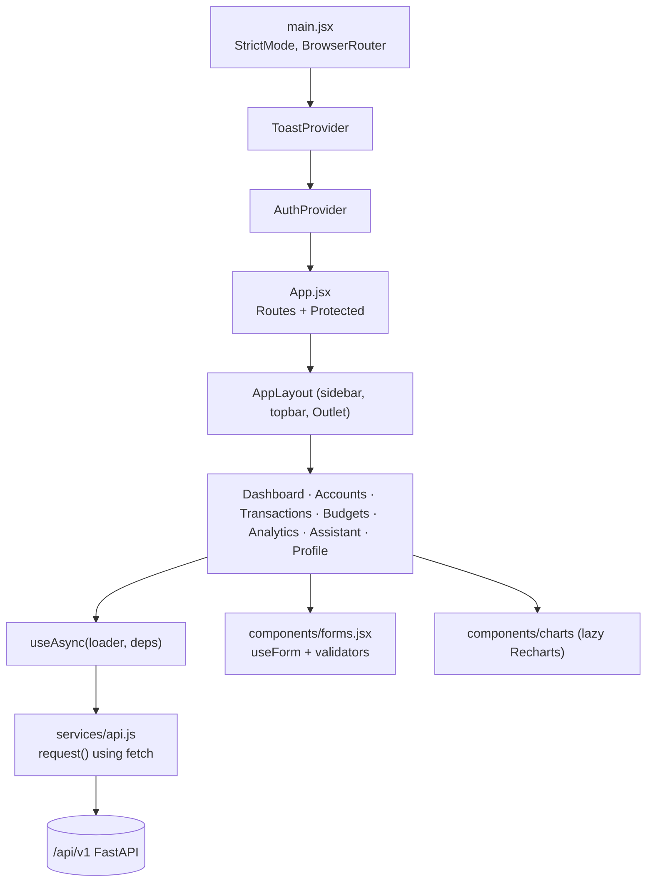
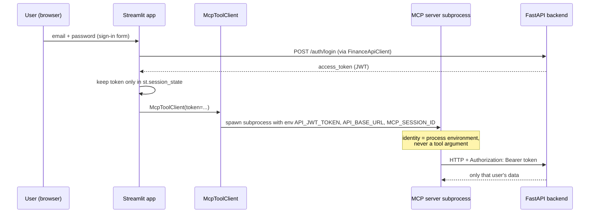

# System Architecture

Part of the [Finance Tracker documentation library](../Finance%20Tracker.md). Previous: [Project_Overview](Project_Overview.md) · Next: [Technology_Stack](Technology_Stack.md).

## 1. Process model

The system is **not** one process. At runtime there are up to five cooperating processes:

| # | Process | Started by | Port | Purpose |
|---|---|---|---|---|
| 1 | FastAPI backend (uvicorn) | `python backend/run.py` | 8000 (`PORT`) | REST API, SQLite, all business rules |
| 2 | Vite dev server (or static `dist/`) | `npm run dev` | 3000 | React SPA; proxies `/api` to the backend |
| 3 | Streamlit "RAG chatbot + live-data agent" | `streamlit run ai/rag/chatbot.py --server.port 8501` | 8501 | Phase 2 + 3 UI |
| 4 | Streamlit "MCP chat + report page" | `streamlit run ai/mcp_server/chat_interface.py --server.port 8502` | 8502 | Phase 4 + 5 UI |
| 5 | FastMCP server (stdio subprocess) | spawned by `McpToolClient` inside process 4 | none (stdin/stdout) | MCP tools, one subprocess per signed-in chat session |

The CLI `ai/multi_agent/report_runner.py` is a sixth, short-lived entry point for Phase 5.

## 2. High-level architecture

### The single most important architectural rule

`FinanceApiClient` ([`ai/common/api_client.py`](../../ai/common/api_client.py)) is the **only** way the AI layer reads or writes finance data. It issues HTTP calls with the signed-in user's bearer token. Consequences:

* the agent, MCP server and LangGraph nodes cannot see other users' data (the backend returns 403/404);
* business rules (insufficient balance, one-budget-per-month, alert creation) are enforced once, in the backend;
* no AI component imports SQLAlchemy models or opens the database. This is consistent with the project rule *"AI agents must not independently invent or modify financial records."*

## 3. Layering inside the backend

| Layer | Files | Responsibility |
|---|---|---|
| Entry/wiring | `backend/run.py`, `app/main.py` | create app, middleware, handlers, routers |
| Routers | `app/routers/*.py` | HTTP surface only; delegate to services |
| Schemas | `app/schemas/__init__.py` | request validation and response shaping |
| Services | `app/services/*.py` | business rules; own `commit`/`rollback` |
| Query helpers | `app/services/queries.py` | ownership checks, month ranges, aggregations |
| Models | `app/models/*.py` | tables, constraints, relationships |
| Core | `app/core/*.py` | settings, JWT/bcrypt, money type, logging, tracing, clock, exceptions |

Details: [Backend_Architecture](../02_Backend/Backend_Architecture.md).

## 4. Frontend architecture in one picture

Details: [React_Architecture](../03_Frontend/React_Architecture.md).

## 5. Trust boundaries and identity propagation

The token is placed in the **server subprocess environment**, so an LLM cannot choose another user by passing a different `user_id`/token as a tool argument. The Phase 3 agent achieves the same with a `ToolContext` holding the token, and Phase 5 verifies `GET /users/me` id equals the requested `user_id` (otherwise it refuses; see [Transaction_Analyzer](../07_LangGraph_Multi_Agent/Transaction_Analyzer.md)).

## 6. Data stores

| Store | Technology | Location (default) | Written by | Notes |
|---|---|---|---|---|
| Relational | SQLite via SQLAlchemy | `DATABASE_URL=sqlite:///./finance_tracker.db` (relative to the **working directory**) | backend only | WAL mode + `PRAGMA foreign_keys=ON` for file DBs. The repo contains `finance_tracker.db` at root and `backend/finance_tracker.db`, depending on where the backend was started |
| Vector | ChromaDB `PersistentClient` | `CHROMA_DIR` or `<repo>/chroma_db` | `ai/rag/ingest.py` | collection `finance_manual`; `chroma_db/` is in `.gitignore`, yet `chroma_db/chroma.sqlite3` is currently tracked by git |
| Browser | `localStorage` key `ft_token` | browser | `services/api.js` | JWT for the React SPA |
| Streamlit | `st.session_state` | server memory | Streamlit apps | token, messages, executor, pending action |

## 7. Cross-cutting concerns

* **Observability.** Backend and AI layer both use structlog JSON logs carrying `poc_id`, `phase`, `associate_id`; the backend adds `request_id`. Minimal OpenTelemetry spans (console exporter only). Optional LangSmith tracing via environment variables. See [Validation_and_Error_Handling](../02_Backend/Validation_and_Error_Handling.md) and [Security_and_Configuration](../08_Deployment_and_DevOps/Security_and_Configuration.md).
* **Time.** `app/core/clock.py` is the single source of "today" so tests can freeze it.
* **Configuration.** Environment variables / `.env` only; see [Environment_Variables](../09_Data_Flow_and_Reference/Environment_Variables.md).
