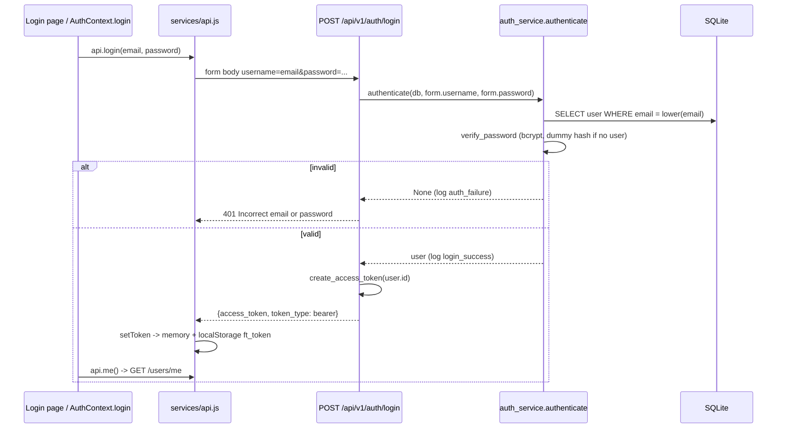

# Authentication and JWT

Part of the [Finance Tracker documentation library](../Finance%20Tracker.md). Sources: [`core/security.py`](../../backend/app/core/security.py), [`core/deps.py`](../../backend/app/core/deps.py), [`services/auth_service.py`](../../backend/app/services/auth_service.py), [`routers/auth.py`](../../backend/app/routers/auth.py), frontend [`services/api.js`](../../frontend/src/services/api.js) and [`contexts/AuthContext.jsx`](../../frontend/src/contexts/AuthContext.jsx).

## 1. Concepts first

* **Authentication** = proving who you are (email + password → token).
* **Authorization** = deciding what you may access (your own accounts/budgets only).
* **JWT (JSON Web Token)** = a signed string `header.payload.signature`. The server can verify it without a session table, so the SPA, Streamlit apps and the MCP subprocess can all reuse the same token.
* **Bearer scheme** = the client sends `Authorization: Bearer <token>` on every request.
* **bcrypt** = a deliberately slow, salted password hash; the plaintext password is never stored.

## 2. Password handling

| Step | Code | Detail |
|---|---|---|
| Schema check | `UserCreate` | `password` ≥ 8 chars; custom validator rejects > 72 **bytes** (bcrypt's input limit) |
| Hash | `security.hash_password` | `bcrypt.hashpw(password.encode("utf-8"), bcrypt.gensalt())`, stored as ASCII string in `users.password_hash` (VARCHAR(128)) |
| Verify | `security.verify_password(password, hash \| None)` | truncates to 72 bytes, `bcrypt.checkpw`; if the user does not exist it checks against a module-level `_DUMMY_HASH` so unknown-user and wrong-password take similar time, and returns `ok and password_hash is not None` |

No password complexity rule beyond length is enforced by the backend.

## 3. Token structure

`create_access_token(user_id)`:

```python
payload = {"sub": str(user_id), "iat": now_utc, "exp": now_utc + timedelta(minutes=ACCESS_TOKEN_EXPIRE_MINUTES)}
jwt.encode(payload, settings.secret_key, algorithm="HS256")
```

* Algorithm **HS256** (symmetric); the key is `SECRET_KEY` from the environment (never hard-coded; startup fails without it).
* Default lifetime **1440 min (24 h)**; asserted by `tests/phase1/test_auth.py::test_token_lifetime_is_24_hours`.
* Claims: `sub` (user id as string), `iat`, `exp`. No roles/scopes. No refresh token; no revocation list (a token is valid until `exp` unless the user row is deleted).

`decode_access_token(token)` calls `jwt.decode(..., algorithms=["HS256"], options={"require": ["exp","sub"]})`, opens an `auth.validate` span, and returns `int(payload["sub"])`. Expired/forged/malformed tokens raise `jwt.PyJWTError`; a non-numeric `sub` raises `ValueError`.

## 4. Login flow



## 5. Protecting a route

```python
oauth2_scheme = OAuth2PasswordBearer(tokenUrl="/api/v1/auth/login")

def get_current_user(request, token = Depends(oauth2_scheme), db = Depends(get_db)) -> User:
    try:
        user_id = decode_access_token(token)
    except (jwt.PyJWTError, ValueError):   # log auth_failure reason=invalid_token
        raise 401 "Could not validate credentials"
    user = db.get(User, user_id)           # None -> log reason=unknown_user -> 401
```

Any handler that lists `user: User = Depends(get_current_user)` is protected. Outcomes:

| Situation | Status | `detail` |
|---|---|---|
| No `Authorization` header | 401 | `Not authenticated` (from `OAuth2PasswordBearer`) |
| Bad signature / expired / malformed | 401 | `Could not validate credentials` + `WWW-Authenticate: Bearer` |
| Token for a deleted user | 401 | same |

Public routes: `/auth/register`, `/auth/login`, `/health` (and the docs pages).

## 6. Authorization (cross-user isolation)

The user id comes **only** from the token; no endpoint accepts a `user_id` from the client. Every account/budget/transaction access goes through `queries.get_owned_*`:

* resource missing → **404**;
* resource belongs to another user → **403**;
* list endpoints filter by `Account.user_id == user.id` / `Budget.user_id == user.id` (transactions are scoped through the user's account ids).

Transactions "belong to accounts, not users" (project rule): `Transaction` has `account_id` only; ownership is derived via `Transaction.account.user_id`.

> Observation: returning 403 for someone else's id vs 404 for a non-existent id lets a caller learn that an id exists. Whether this matters depends on threat model; it is the documented/tested behaviour (`test_cross_user_access_is_blocked`).

## 7. Frontend token handling

* `services/api.js` keeps `token` in a module variable, initialised from `localStorage.getItem('ft_token')`; `setToken(null)` removes it.
* `request()` adds the header only when `auth !== false` and a token exists.
* On a **401 for an authenticated request**, `onUnauthorized()` runs — `AuthProvider` registers `logout` there (`setUnauthorizedHandler(logout)`), which clears the token and user, and `Protected` redirects to `/login`.
* Login/register calls pass `auth: false` so a wrong password does not trigger the global logout handler.
* `localStorage` is readable by any script on the origin (XSS exposure) — a conscious simplicity trade-off, not mitigated here.

## 8. Token reuse by the AI layer

| Consumer | How it gets a token | Where it lives |
|---|---|---|
| Streamlit apps | `FinanceApiClient().login(email, password)` | `st.session_state.token` |
| Agent | `build_agent(token=...)` → `ToolContext.token` | in-process object |
| MCP server | `McpToolClient(token=...)` → subprocess env `API_JWT_TOKEN` | server process environment |
| LangGraph / CLI | `generate_financial_report(..., token=...)`, or `API_JWT_TOKEN` env | `ReportContext.token` |

Tests assert that tokens never appear in logs (`test_logs_have_session_id_and_never_contain_the_token`, `test_mcp_tools_log_session_and_never_log_token`).

## 8.1 Security properties and limits

| Property | Status |
|---|---|
| Passwords hashed with salt | ✅ bcrypt |
| Secret from environment | ✅ `SECRET_KEY` |
| Constant-ish time for unknown email | ✅ dummy hash |
| Token expiry | ✅ 24 h default |
| Rate limiting / lockout | ❌ not implemented |
| Refresh / revoke tokens | ❌ not implemented |
| HTTPS | ❌ not handled by the app (no TLS config in repo) |
| Token storage in `localStorage` | ⚠️ XSS-exposed |
