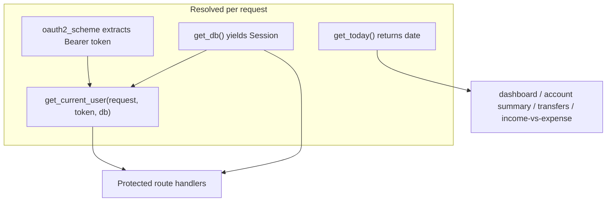

# Backend Architecture

Part of the [Finance Tracker documentation library](../Finance%20Tracker.md). The layer diagram is in [System_Architecture §3](../01_Project_Architecture/System_Architecture.md); this file explains *how the layers cooperate* and the conventions that hold them together.

## 1. File map (every backend module)

| File | Role |
|---|---|
| [`backend/run.py`](../../backend/run.py) | Adds `backend/` to `sys.path`, runs `uvicorn.run("app.main:app", host="127.0.0.1", port=$PORT or 8000, reload=False)` |
| [`app/main.py`](../../backend/app/main.py) | `create_app()`; module-level `app = create_app()` |
| [`app/core/config.py`](../../backend/app/core/config.py) | frozen `Settings` dataclass, cached by `get_settings()` |
| [`app/core/deps.py`](../../backend/app/core/deps.py) | `oauth2_scheme`, `get_current_user` |
| [`app/core/security.py`](../../backend/app/core/security.py) | bcrypt + JWT helpers |
| [`app/core/money.py`](../../backend/app/core/money.py) | `to_decimal`, `Money` SQLAlchemy type |
| [`app/core/logging.py`](../../backend/app/core/logging.py) | structlog configuration |
| [`app/core/telemetry.py`](../../backend/app/core/telemetry.py) | OpenTelemetry `span()` helper |
| [`app/core/clock.py`](../../backend/app/core/clock.py) | `get_today()` |
| [`app/core/exceptions.py`](../../backend/app/core/exceptions.py) | `AppError` hierarchy |
| [`app/database/__init__.py`](../../backend/app/database/__init__.py) | `Base`, `engine`, `SessionLocal`, `get_db`, `init_db` |
| `app/models/*.py` | 5 ORM models |
| [`app/schemas/__init__.py`](../../backend/app/schemas/__init__.py) | all Pydantic models |
| `app/services/*.py` | business logic (7 modules) |
| `app/routers/*.py` | 5 routers |

## 2. Conventions

1. **Routers are thin.** A route declares its parameters/`response_model`, resolves `Depends(get_current_user)` and `Depends(get_db)`, calls exactly one service function, and returns. The exceptions are `users/me` (profile update done inline in `routers/auth.py::update_me`) and the analytics query-parameter checks in `routers/dashboard.py`.
2. **Services own transactions.** Service functions call `db.commit()` / `db.rollback()` themselves. The session is created per request by `get_db` and closed in `finally`.
3. **Ownership is enforced in one helper family** in `services/queries.py`: `get_owned_account`, `get_owned_budget`, `get_owned_transaction`. Missing → `NotFoundError` (404); owned by someone else → `ForbiddenError` (403).
4. **Domain errors are exceptions**, not HTTP objects: `AppError` subclasses carry a `status_code` and `detail`; `main.py` turns them into JSON `{"detail": "..."}`.
5. **Money is `Decimal`** from the service layer down; Pydantic serialises it to JSON numbers (`MoneyOut` → `float`) only at the edge.
6. **"Today" is injected** via `Depends(get_today)` so dashboards/summaries are testable.
7. **Every successful or failed request is logged once** by the `request_context` middleware (see [FastAPI_Application](FastAPI_Application.md)).

## 3. Dependency injection map

`app.dependency_overrides[get_db]` is used by the tests (`tests/conftest.py`) to share one in-memory SQLite session.

## 4. Where each rule lives

| Rule | Location |
|---|---|
| Password ≤ 72 bytes, ≥ 8 chars, email lower-cased | `schemas.UserCreate` validators |
| Duplicate email → 409 | `auth_service.register_user` (pre-check + `IntegrityError` fallback) |
| Debit/credit → balance delta, account-type aware | `transaction_service.signed_delta` |
| No negative asset balance | `transaction_service.apply_balance_delta` (guarded `UPDATE … WHERE balance + delta >= 0`) |
| Salary is credit-only | `transaction_service.create_transaction` |
| Budget uniqueness | `budget_service.create_budget` + DB `UniqueConstraint` |
| Salary cannot have a budget | `schemas.BudgetCreate._no_salary` |
| 80 % / 100 % alerts, once per type per budget | `budget_alert_service.check_and_create_alerts` + DB `UniqueConstraint` |
| Income/expense/transfer exclusion | `services/queries.py` (`income_in_range`, `expenses_in_range`, `spent_in_month`, `spending_by_category`) |
| Cross-user isolation | `queries.get_owned_*` |

## 5. Synchronous by design

All route handlers and DB calls are plain `def` (not `async def`). FastAPI runs them in its thread pool. The SQLite engine uses `check_same_thread=False` so a connection can be used from those worker threads. The only `async` code is the middleware and exception handlers.

## 6. Extending the backend (pattern to follow)

1. Add/extend a model in `app/models` and import it in `app/models/__init__.py` (so `init_db()` creates it).
2. Add schemas in `app/schemas/__init__.py`.
3. Put rules in a new/existing `app/services/*.py`; use `get_owned_*` for any user-owned resource.
4. Add a thin route in `app/routers/*.py`; register new router modules in the `for module in (...)` loop in `main.py`.
5. Add tests under `tests/phase1/` using the `client` / `auth_headers` fixtures.

> There is **no migration tool** (no Alembic). Schema changes to an existing SQLite file are not applied automatically because `create_all` only creates missing tables.
