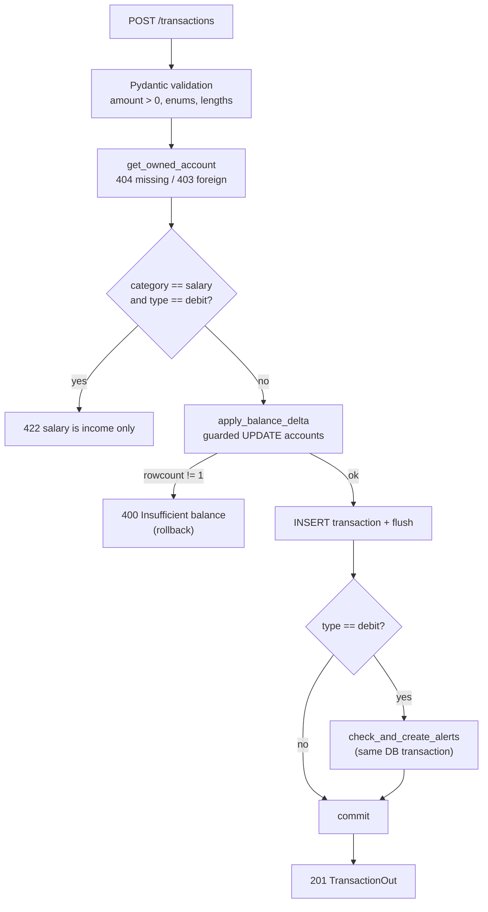

# Business Logic

Part of the [Finance Tracker documentation library](../Finance%20Tracker.md). Sources: [`services/transaction_service.py`](../../backend/app/services/transaction_service.py), [`account_service.py`](../../backend/app/services/account_service.py), [`budget_service.py`](../../backend/app/services/budget_service.py), [`budget_alert_service.py`](../../backend/app/services/budget_alert_service.py), [`dashboard_service.py`](../../backend/app/services/dashboard_service.py), [`queries.py`](../../backend/app/services/queries.py). Every rule below was checked against the code; where the code differs from the simple POC wording it is called out.

## 1. Rule register (verified)

| # | Rule | Verified in |
|---|---|---|
| 1 | **No transaction edit/delete** — there is no `PUT/PATCH/DELETE` route for transactions; the only way to remove one is deleting its account | `routers/transactions.py` |
| 2 | **No budget edit** — only create, read, delete | `routers/budgets.py` |
| 3 | **`PATCH /accounts/{id}` changes the name only** (`AccountUpdate` has only `account_name`) | `schemas.AccountUpdate`, `account_service.rename_account` |
| 4 | **Deleting an account deletes its transactions** (ORM cascade, atomic). Budgets/alerts untouched. The other leg of a transfer survives | `models/account.py`, `account_service.delete_account` |
| 5 | Debit decreases / credit increases balance **for savings & checking**; for **credit** accounts it is reversed because balance = amount owed | `transaction_service.signed_delta` |
| 6 | Savings/checking cannot go below zero → 400 `Insufficient balance` | `apply_balance_delta` |
| 7 | Salary category is credit-only | `create_transaction` |
| 8 | One budget per user + category + month + year | `budget_service.create_budget` + UNIQUE |
| 9 | Warning alert at ≥ 80 %, exceeded alert at ≥ 100 %, each once per budget | `budget_alert_service` |
| 10 | Alerts are evaluated **only when a debit is recorded** | `create_transaction` (debit branch) |
| 11 | Dashboard `total_balance = assets − liabilities` | `dashboard_service.dashboard` |
| 12 | Income = non-transfer credits on savings/checking; Expenses = non-transfer debits on all accounts | `queries.income_in_range/expenses_in_range` |
| 13 | Transfers never count as income or expense | `is_transfer` filters |
| 14 | Cross-user access forbidden (403/404) | `queries.get_owned_*` |

## 2. Recording a transaction



### `signed_delta(account_type, tx_type, amount)`

| Account type | Debit | Credit |
|---|---|---|
| savings / checking | balance **−** amount | balance **+** amount |
| credit | balance **+** amount (owed grows) | balance **−** amount (payment) |

Only savings/checking get the "must stay ≥ 0" guard. A **credit** account has no lower bound, so an overpayment makes the owed amount negative (the code does not prevent it). The POC overview states the simple rule "debit decreases, credit increases"; the implementation adds this account-type-aware exception and documents it in the module docstring.

### Worked example (all amounts ₹)

| Step | Action | Result |
|---|---|---|
| 1 | Savings account created with 10,000 | balance 10,000 |
| 2 | Debit 2,500 food | balance 7,500 |
| 3 | Debit 8,000 | **400 Insufficient balance**; balance still 7,500, no row inserted |
| 4 | Credit card account (balance 0): debit 6,500 food | owed 6,500 |
| 5 | Transfer 3,000 savings → card | savings 4,500; owed 3,500; two `is_transfer` rows with the same `transfer_group` |

## 3. Transfers (`create_transfer`)

1. Reject same source/destination (422) and non-positive amount.
2. `get_owned_account` for both accounts (403/404).
3. `apply_balance_delta(source, debit)` then `apply_balance_delta(destination, credit)`.
4. Insert two `Transaction` rows: category `other`, `is_transfer=True`, same new UUID `transfer_group`, same description/date.
5. One commit; any exception rolls back everything.

Transfers show in the transaction list and in the **raw** `total_credit/total_debit` of an account summary, but are excluded from `spending_by_category`, monthly trends, budget "spent", income and expenses.

## 4. Budgets and alerts

* `utilization_percent = round(spent / limit × 100, 2)`; `0.00` if `limit <= 0`.
* `spent` (`queries.spent_in_month`) = SUM of **non-transfer debits** of the budget's category dated within the calendar month, across **all the user's accounts** (including credit-card purchases).
* `remaining = limit − spent` (may be negative).

`check_and_create_alerts(db, user_id, category, transaction_date)` (called only for debits):

```python
budget = Budget for (user, category, transaction_date.month, transaction_date.year)   # none -> return
spent  = spent_in_month(...)   # includes the pending row because the caller flushed
wanted = []
if spent >= limit * 0.8: wanted.append(warning_80)
if spent >= limit:       wanted.append(exceeded)
create rows for types not already present (UNIQUE budget_id+alert_type)
```

Consequences (all covered by tests): thresholds are inclusive (exactly 80 % and exactly 100 % fire); one big debit can create **both** alerts; further debits never create duplicates; credits never alert; the alert uses the **transaction's** month (back-dating a debit alerts the right month); a budget created *after* the spending does not retroactively fire (progress doc: "Known issues"); deleting a budget deletes its alerts.

Responses expose `has_alert = len(alerts) > 0`. The frontend colours: `< 80` ok (green), `80–99` warn (orange), `≥ 100` danger (red).

## 5. Dashboard and analytics

`dashboard_service.dashboard(db, user_id, today, month, year)`:

| Field | Computation |
|---|---|
| `month`, `year` | `month or today.month`, `year or today.year` (independently) |
| `total_assets` | SUM(balance) of savings + checking accounts |
| `total_liabilities` | SUM(balance) of credit accounts (amount owed) |
| `total_balance` | `total_assets − total_liabilities` (**net position**, not simply the sum of balances) |
| `monthly_income` | `income_in_range`: credits, **asset accounts only**, `is_transfer=false`, in `[first, next_first)` |
| `monthly_expenses` | `expenses_in_range`: debits, **all** accounts, `is_transfer=false` (accrual: a card purchase counts when made) |
| `net_cash_flow` | `income − expenses` |
| `savings_rate` | `(income − expenses) / income × 100`, 2 dp; `0` when income ≤ 0 (can be negative) |
| `top_3_categories` | first 3 of `spending_by_category` sorted by amount desc |
| `budget_alerts_count` | count of `BudgetAlert` joined to the user's budgets for that month/year |
| `recent_transactions` | latest 5 transactions of the user (any month, transfers included), `date DESC, id DESC` |
| `budget_utilization` | each budget of that month: `monthly_limit, spent, utilization_percent, has_alert, category` |

Edge rules: a **credit** posted to a credit-card account is a payment, not income; a **debit** on a credit card is an expense. Credit-card repayment via `/transfers` is neither.

`income_vs_expense(months)`: loops from `months−1` months ago to now with `shift_month` and `month_range`, calling the same two helpers → consistent with the dashboard.

`account_summary`: described in [API_Endpoints §10](API_Endpoints.md); note the intentional difference that `total_credit/total_debit` include transfer legs while category/trend data exclude them (asserted by `test_transfers_excluded_from_summary_categories_but_included_in_raw_totals`).

## 6. Date helpers (`queries.py`)

* `month_range(year, month)` → `[first day, first day of next month)` (half-open, handles December).
* `shift_month(year, month, delta)` → uses `year*12 + month−1 + delta` arithmetic.
* `core/clock.get_today()` → real `date.today()`; tests monkey-patch `_real_today` (frozen to 2026-06-18 for `tests/phase1/` only because spec test TC-API-08 was written for June 2026).

## 7. Logging of business events

`balance_updated` (account, old/new balance as floats), `transaction_created`, `transfer_created`, `budget_alert_triggered` (warning), `budget_created/deleted`, `account_created/deleted`. Amounts are logged; passwords/tokens never are.

## 8. Known limitations (from the code)

* No transaction correction path: a mistaken entry cannot be edited or reversed except by deleting the account or adding an offsetting transaction.
* Alerts do not re-evaluate on budget creation or on account deletion; deleting an account lowers "spent" but leaves previously created alerts.
* Credit-account balance can go negative via overpayment.
* `savings_rate` uses *income on asset accounts* as the denominator; income received directly on a credit account is ignored by design.
