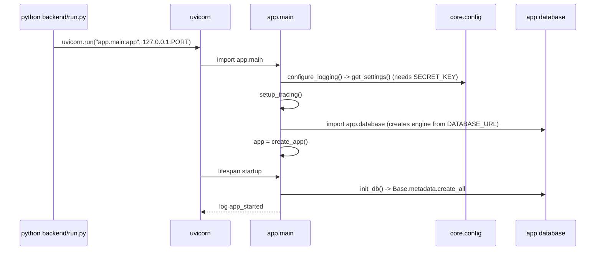

# FastAPI Application

Part of the [Finance Tracker documentation library](../Finance%20Tracker.md). Source: [`backend/app/main.py`](../../backend/app/main.py), [`backend/run.py`](../../backend/run.py), [`app/core/config.py`](../../backend/app/core/config.py).

## 1. Entry point and startup sequence



* `run.py` binds to **127.0.0.1** only (not `0.0.0.0`) and disables reload. Port = `PORT` env var (default 8000). Alternative from its docstring: `uvicorn app.main:app --app-dir backend --port 8000`.
* **`get_settings()` raises `RuntimeError` if `SECRET_KEY` is empty**, so the process will not start without it.
* Tables are created by `init_db()` in the FastAPI `lifespan` startup handler. There are no migrations.

## 2. `create_app()` step by step

1. `FastAPI(title="Personal Finance Tracker & Analytics (POC-02)", version="1.0.0", lifespan=lifespan)`.
2. **CORS**: `CORSMiddleware(allow_origins=settings.cors_origins, allow_credentials=True, allow_methods=["*"], allow_headers=["*"])`. `cors_origins` comes from `CORS_ORIGINS` (comma-separated, default `http://localhost:3000`).
3. **HTTP middleware `request_context`** (see §3).
4. **Exception handlers** for `AppError` and `RequestValidationError` (see [Validation_and_Error_Handling](Validation_and_Error_Handling.md)).
5. **Routers**: for each of `auth, accounts, transactions, budgets, dashboard` → `app.include_router(module.router, prefix="/api/v1")`.
6. `GET /api/v1/health` → `{"status": "ok"}` (tag `ops`, no auth).

Interactive docs are FastAPI defaults: `/docs` (Swagger UI), `/redoc`, `/openapi.json`. Swagger "Authorize" works because `OAuth2PasswordBearer(tokenUrl="/api/v1/auth/login")`.

## 3. The `request_context` middleware

For every request:

1. `request_id = x-request-id header or "req_" + 12 hex chars`.
2. `structlog.contextvars.clear_contextvars()` then `bind_contextvars(request_id=...)` so **every** log line emitted while handling the request carries `request_id`.
3. Starts an OpenTelemetry span `http.request` with `http.method` and `http.route`.
4. Awaits the downstream app. If an unhandled exception escapes, logs `unhandled_exception` with traceback and re-raises.
5. Sets `http.status_code` on the span, logs one `http_request` event: `method, path, status_code, duration_ms, status ("success" if < 400 else "failure")`.
6. Adds the `x-request-id` header to the response.

Example log line (shape; values illustrative):

```json
{"event":"http_request","operation":"http_request","method":"POST","path":"/api/v1/transactions","status_code":201,"duration_ms":12,"status":"success","request_id":"req_3fa9c0d1e2b4","level":"info","timestamp":"…Z","poc_id":"POC-02","phase":1,"associate_id":"unknown"}
```

Tokens, passwords and request bodies are **not** logged by this middleware.

## 4. Settings (`core/config.py`)

`Settings` is a frozen dataclass, cached with `lru_cache`. `load_dotenv()` runs at import time.

| Field | Env var | Default | Notes |
|---|---|---|---|
| `app_env` | `APP_ENV` | `development` | `test` turns the OTel console exporter off by default |
| `poc_id` | `POC_ID` | `POC-02` | log field |
| `associate_id` | `ASSOCIATE_ID` | `unknown` | log field |
| `phase` | `PHASE` | `1` | log field |
| `database_url` | `DATABASE_URL` | `sqlite:///./finance_tracker.db` | relative path = relative to current working directory |
| `secret_key` | `SECRET_KEY` | *(required)* | JWT signing key; startup fails if empty |
| `access_token_expire_minutes` | `ACCESS_TOKEN_EXPIRE_MINUTES` | `1440` | 24 h |
| `cors_origins` | `CORS_ORIGINS` | `http://localhost:3000` | comma-separated |
| `otel_console` | `OTEL_CONSOLE` | `true` unless `APP_ENV=test` | prints spans to the console |

## 5. Logging (`core/logging.py`)

`configure_logging()` sets structlog processors: `merge_contextvars` → `add_log_level` → ISO UTC `TimeStamper` → `add_static` (adds `poc_id`, `phase`, `associate_id` with `setdefault`) → `StackInfoRenderer` → `format_exc_info` → `JSONRenderer`. Output goes to **stdout** via `PrintLoggerFactory`; level filter INFO. `get_logger(name)` binds `phase` lazily so module-level loggers created before `configure_logging()` still pick up the processors (`cache_logger_on_first_use=False`).

Domain events logged by services: `user_registered`, `login_success`, `auth_failure` (reason: `invalid_credentials` / `invalid_token` / `unknown_user`), `account_created`, `account_deleted`, `balance_updated` (old/new), `transaction_created`, `transfer_created`, `budget_created`, `budget_deleted`, `budget_alert_triggered` (warning level).

## 5.1 Tracing (`core/telemetry.py`)

`span(name, **attrs)` wraps `start_as_current_span`. Provider is an SDK `TracerProvider` with a `ConsoleSpanExporter` only when `otel_console` is true. No collector/OTLP export is configured (the project docs note `opentelemetry-instrumentation-fastapi` is unusable due to `pkg_resources`; spans are manual). Spans used: `http.request`, `auth.validate`, `db.query` (around the balance `UPDATE` and the transaction `INSERT`).

## 6. Running

```bash
.venv/bin/python backend/run.py          # http://127.0.0.1:8000/docs
```

Environment must provide `SECRET_KEY` (e.g. via the repo-root `.env`: `load_dotenv()` with no argument uses python-dotenv's `find_dotenv()`, which walks up the directory tree from the calling module's location). See [Environment_Setup](../08_Deployment_and_DevOps/Environment_Setup.md).
