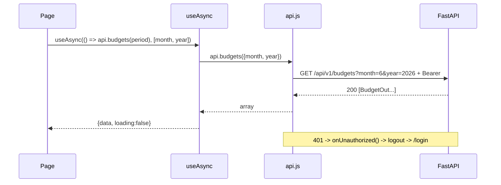

# API Integration

Part of the [Finance Tracker documentation library](../Finance%20Tracker.md). Source: [`frontend/src/services/api.js`](../../frontend/src/services/api.js). The HTTP client is the browser's native **`fetch`** (Axios is *not* used). Endpoint contracts: [API_Endpoints](../02_Backend/API_Endpoints.md).

## 1. Design

One module exposes:

* low-level `request(path, options)`;
* token helpers `setToken`, `getToken`, `setUnauthorizedHandler`;
* `ApiError` class (`status`, `message`);
* the `api` object — one function per backend operation.

```js
const BASE = import.meta.env.VITE_API_BASE_URL || '/api/v1'
const TOKEN_KEY = 'ft_token'
let token = localStorage.getItem(TOKEN_KEY)
```

## 2. `request()` in detail

```js
async function request(path, { method='GET', body, form, params, auth=true } = {}) {
  const url = new URL(BASE + path, window.location.origin)
  Object.entries(params || {}).forEach(([k, v]) => { if (v !== undefined && v !== null && v !== '') url.searchParams.set(k, v) })
  ...
  if (form) payload = new URLSearchParams(form)                 // login: application/x-www-form-urlencoded
  else if (body !== undefined) { headers['Content-Type']='application/json'; payload = JSON.stringify(body) }
  if (auth && token) headers.Authorization = `Bearer ${token}`
  try { res = await fetch(url, { method, headers, body: payload }) }
  catch { throw new ApiError(0, 'Cannot reach the server. Is the backend running?') }
  if (res.status === 204) return null
  const data = await res.json().catch(() => null)
  if (!res.ok) { if (res.status === 401 && auth) onUnauthorized(); throw new ApiError(res.status, describe(data?.detail)) }
  return data
}
```

| Aspect | Behaviour |
|---|---|
| URL building | `new URL(BASE + path, origin)` + query params; empty/`null`/`undefined` params are dropped (so `account_id: ''` is not sent) |
| Content types | JSON for bodies; `URLSearchParams` for the login form (OAuth2 password flow expects a form) |
| Auth header | `Authorization: Bearer <token>` if `auth !== false` and a token exists |
| Network failure | `ApiError(0, "Cannot reach the server. Is the backend running?")` |
| 204 | returns `null` (account/budget delete) |
| Error mapping | `describe(detail)`: array → `"field: msg; field2: msg2"` (drops the `body` prefix from `loc`), string → as is, otherwise `"Request failed"` |
| 401 | when `auth` is true → calls the registered `onUnauthorized` (logout) before throwing |
| Timeouts / retries / cancellation | **none** (no `AbortController`, no retry) |

## 3. The `api` surface

| Function | HTTP |
|---|---|
| `register(body)` | `POST /auth/register` (no auth) |
| `login(email, password)` | `POST /auth/login` form `{username, password}` (no auth) |
| `me()` / `updateMe(body)` | `GET` / `PATCH /users/me` |
| `accounts()` / `createAccount(body)` | `GET` / `POST /accounts` |
| `renameAccount(id, account_name)` | `PATCH /accounts/{id}` |
| `deleteAccount(id)` | `DELETE /accounts/{id}` |
| `accountSummary(id)` | `GET /accounts/{id}/summary` (defined; **not used by any page**) |
| `transactions(params)` / `createTransaction(body)` | `GET` / `POST /transactions` |
| `createTransfer(body)` | `POST /transfers` |
| `budgets(params)` / `createBudget(body)` / `deleteBudget(id)` | `GET` / `POST /budgets`, `DELETE /budgets/{id}` |
| `budgetAlerts(params)` | `GET /budget-alerts` |
| `dashboard(params)` | `GET /dashboard` |
| `spendingByCategory(params)` / `incomeVsExpense(params)` | `GET /analytics/...` |

Not exposed by the client (and not available on the backend): update/delete transaction, update budget. `GET /accounts/{id}`, `GET /transactions/{id}`, `GET /budgets/{id}` and `GET /health` have no client wrapper.

## 4. Dev proxy and CORS

* Default base `/api/v1` is **relative**; with `npm run dev`, Vite proxies `/api` → `http://127.0.0.1:8000` (override `VITE_BACKEND_URL`). Browser and API share an origin → no CORS needed.
* To point a built SPA at another origin set `VITE_API_BASE_URL` at **build** time (e.g. `https://api.example.com/api/v1`) and include that SPA origin in the backend `CORS_ORIGINS`.

## 5. Typical integration lifecycle



## 6. Numeric handling

Backend money is serialised as JSON numbers (floats). The frontend does simple arithmetic on them for display (e.g. totals in `Accounts`, `Analytics` percentage shares) and formats via `Intl.NumberFormat('en-IN', {style:'currency', currency:'INR'})`. It never sends computed monetary results back; amounts are sent as `Number(string)` after regex validation. Authoritative calculations stay server-side.
