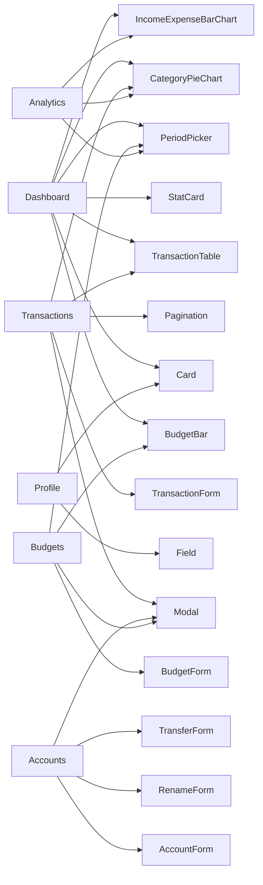

# Components and Pages

Part of the [Finance Tracker documentation library](../Finance%20Tracker.md). All paths under [`frontend/src/`](../../frontend/src).

## 1. Pages

| Route | Component (file) | Data loaded (`useAsync`) | Main actions |
|---|---|---|---|
| `/login` | `Login` (`pages/AuthPages.jsx`) | — | `AuthContext.login` |
| `/register` | `Register` (`pages/AuthPages.jsx`) | — | `AuthContext.register` (register then login) |
| `/` | `Dashboard` | `api.dashboard(period)`, `api.incomeVsExpense({months:6})`, `api.spendingByCategory(period)`, `api.accounts()` | change period |
| `/accounts` | `Accounts` | `api.accounts()` | create, rename, delete, transfer |
| `/transactions` | `Transactions` | `api.accounts()`, `api.transactions({...filters,page,page_size:15})`, `api.spendingByCategory(...)` | filter, paginate, add transaction |
| `/budgets` | `Budgets` | `api.budgets(period)`, `api.budgetAlerts(period)` | create, delete, change period |
| `/analytics` | `Analytics` | `api.spendingByCategory(period)`, `api.incomeVsExpense({months})` | change period / range |
| `/assistant` | `Assistant` | — | links to Streamlit apps (`target="_blank"`) |
| `/profile` | `Profile` | uses `user` from context | `api.updateMe`, logout |

### Page notes

* **Dashboard** — header with `PeriodPicker`; a warning banner when `budget_alerts_count > 0`; five `StatCard`s (Net balance, Income, Expenses, Net cash flow, Savings rate; tones from `rateTone`: ≥ 20 % good, < 0 bad); two chart cards; budget utilization (`BudgetBar` per budget) and top-3 categories; recent transactions (`TransactionTable`). Shows a spinner only when there is no data yet, and an `ErrorState` with retry on failure.
* **Accounts** — a `modal` state object `{kind: 'create'|'rename'|'transfer', account?}` selects which modal form to show. Deleting uses `window.confirm` ("…also deletes ALL of its transactions and cannot be undone"). The Transfer button is disabled unless there are ≥ 2 accounts. Summary line: Assets / Credit owed / Net.
* **Transactions** — filter card (account, category, type, from, to). Changing any filter resets `page` to 1. Table + pagination on the left, spending pie on the right. Client-side `pieData` additionally filters by the selected category. `invalidRange` shows an inline message if `date_from > date_to` (does not block the request).
* **Budgets** — period picker; left card lists budgets (`BudgetBar` with delete), right card lists alerts (🚨 exceeded, ⚠️ warning).
* **Analytics** — "Income vs expenses" (6/12/24 months) and "Spending by category" (pie + ranked list with percentage share).
* **Assistant** — two cards linking to the Streamlit apps; explains that they run separately.
* **Profile** — editable name/phone/monthly income; email is displayed disabled; member-since date; logout button.

## 2. Layout

`layouts/AppLayout.jsx` renders the shell used by every protected page:

* `<aside className="sidebar">` — brand, `NAV` array of `[path, label, icon]` rendered with `NavLink` (`end` only for `/`), footer with user email and **Log out**;
* `.scrim` overlay (mobile) closes the drawer;
* `<header className="topbar">` — hamburger button (`menu-btn`, visible ≤ 800 px) and `Hello, {first name}`;
* `<main className="content"><Outlet/></main>` — the active page.

## 3. Reusable components

### `components/ui.jsx`
| Component | Props | Purpose |
|---|---|---|
| `Spinner` | `label` | loading indicator (`role="status"`) |
| `EmptyState` | `icon, title, children, action` | empty list placeholder with optional call-to-action |
| `ErrorState` | `error, onRetry` | `role="alert"` box with "Try again" |
| `Card` | `title, actions, children, className` | titled panel |
| `StatCard` | `label, value, sub, tone` | KPI tile (`tone` good/bad → coloured border) |
| `Modal` | `title, onClose, children` | dialog (`role="dialog" aria-modal`), closes on Escape, backdrop click or ×; uses `useEffect` to add/remove the keydown listener |
| `Field` | `label, error, hint, children` | `<label>` wrapper: shows `error` message (red) or `hint` |
| `ProgressBar` | `percent, tone` | clamps width to 0–100 %, `role="progressbar"` |
| `Pagination` | `page, pages, onChange` | Prev/Next; renders nothing when `pages <= 1` |
| `PeriodPicker` | `month, year, onChange, months` | month `<select>` + year `<select>` (current year −3 … +3) |

### `components/forms.jsx`
`useForm` (shared hook) and five forms: `AccountForm`, `RenameForm`, `TransactionForm`, `TransferForm`, `BudgetForm`. Helper components `Actions` (Cancel + submit with "Saving…") and `FormError`. See [Forms_and_User_Interactions](Forms_and_User_Interactions.md) and [Client_Side_Validation](Client_Side_Validation.md).

### Others
| Component | Purpose |
|---|---|
| `BudgetBar` | category dot, utilization % (with 🚨/⚠️ icon if `hasAlert`), `ProgressBar` (tone from `utilizationTone`), "₹spent of ₹limit", "₹x left / ₹x over", optional Delete |
| `TransactionTable` | table of Date, Description (+ "transfer" badge), Category dot, Merchant, Account name (from `accountNames` map or `#id`), signed amount (− red for debit, + green for credit), type badge |
| `charts/index.jsx` | lazy wrappers `CategoryPieChart`, `IncomeExpenseBarChart` |
| `charts/CategoryPie.jsx`, `charts/IncomeExpenseChart.jsx` | Recharts implementations ([Charts_and_Analytics](Charts_and_Analytics.md)) |

## 4. Context providers and hooks

| Name | File | Provides |
|---|---|---|
| `AuthProvider` / `useAuth` | `contexts/AuthContext.jsx` | `{user, setUser, loading, login, register, logout}` |
| `ToastProvider` / `useToast` | `contexts/ToastContext.jsx` | `{success(msg), error(msg)}`; toasts auto-dismiss after 4.5 s or on click |
| `useAsync(loader, deps)` | `hooks/useAsync.js` | `{data, loading, error, reload}` |
| `useForm(initial, validate, onSubmit)` | `components/forms.jsx` (internal) | `{values, errors, busy, formError, set, submit}` |

Details: [State_Management](State_Management.md).

## 5. Component reuse map

## 6. Accessibility touches (as implemented)

`role="status"` (spinner, toast container with `aria-live="polite"`), `role="alert"` (errors), `role="dialog" aria-modal`, `aria-label` on icon buttons and selects, `role="progressbar"` with `aria-valuenow`, visible focus outlines in CSS. There is no focus trap in `Modal` and no skip-link.
