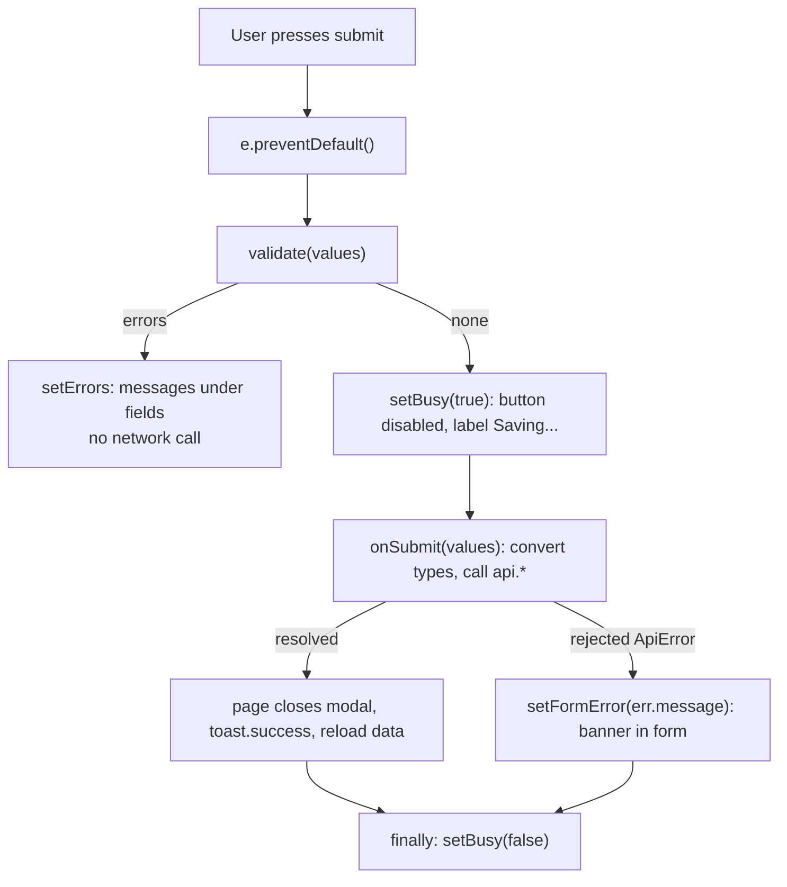

# Forms and User Interactions

Part of the [Finance Tracker documentation library](../Finance%20Tracker.md). Sources: [`components/forms.jsx`](../../frontend/src/components/forms.jsx), [`components/ui.jsx`](../../frontend/src/components/ui.jsx), pages. Validation rules per field live in [Client_Side_Validation](Client_Side_Validation.md); this file explains the *interaction mechanics*.

## 1. The `useForm` hook

```jsx
function useForm(initial, validate, onSubmit) {
  const [values, setValues] = useState(initial)
  const [errors, setErrors] = useState({})
  const [busy, setBusy] = useState(false)
  const [formError, setFormError] = useState('')

  const set = (name) => (e) => setValues((v) => ({ ...v, [name]: e.target.value }))
  const submit = async (e) => {
    e.preventDefault()
    const found = validate(values)
    setErrors(found); setFormError('')
    if (Object.keys(found).length) return
    setBusy(true)
    try { await onSubmit(values) } catch (err) { setFormError(err.message) } finally { setBusy(false) }
  }
  return { values, errors, busy, formError, set, submit }
}
```

* All inputs are **controlled** (`value` + `onChange={f.set('field')}`); every field value is kept as a **string**, converted (`Number(...)`, `.trim()`) only inside the `onSubmit` adapter.
* `validate` is a pure function returning `{field: message}`.
* `onSubmit` is supplied by the page and must return a promise; thrown `ApiError`s become `formError`.

## 2. Lifecycle of one submission



Note the ordering detail in the success path: the page's `onSubmit` closes the modal (unmounting the form) before `finally { setBusy(false) }` runs; React 18 ignores the state update on an unmounted component without warning.

## 3. Forms and their callers

| Form | Opened from | `onSubmit` in page | Success side-effects |
|---|---|---|---|
| `AccountForm` | Accounts → "+ Add account" | `api.createAccount(b)` | `done('Account created')` = close, toast, reload |
| `RenameForm` | Accounts → "Rename" | `api.renameAccount(id, name)` | `done('Account renamed')` |
| `TransferForm` | Accounts → "⇄ Transfer / pay card" | `api.createTransfer(b)` | `done('Transfer completed')` |
| `TransactionForm` | Transactions → "+ Add transaction" | `api.createTransaction(body)` | close, toast, `list.reload(); pie.reload(); accounts.reload()` |
| `BudgetForm` | Budgets → "+ Set budget" | `api.createBudget(body)` | close, toast, `budgets.reload(); alerts.reload()` |
| Login / Register / Profile | own pages | hand-written `submit` (same pattern, no `useForm`) | login navigates by state change; Profile calls `setUser` + toast |

Defaults: `TransactionForm` starts as a debit/food on the first account with today's local date (`todayISO()` builds `YYYY-MM-DD` from local date parts to avoid UTC off-by-one); `TransferForm` pre-selects the first non-credit account as source and the first credit account as destination (the "pay my card" case); `BudgetForm` defaults to the page's current period.

## 4. Other interactions

| Interaction | Implementation |
|---|---|
| Confirmations | `window.confirm` before deleting an account or a budget (messages explain cascading effects) |
| Modal dismissal | Escape key, backdrop `onMouseDown` (only when the click target is the backdrop), × button, Cancel |
| Toasts | `useToast().success/error`; click to dismiss or auto-dismiss after 4.5 s |
| Pagination | `Pagination` calls `setPage`; `useAsync` deps `[f, page]` trigger refetch |
| Filters | native `<select>`/`<input type="date">`; "Clear" button appears when any filter is set |
| Period pickers | `PeriodPicker.onChange(month, year)` → `setPeriod` → loaders re-run |
| Mobile menu | `AppLayout` `open` state; scrim and link clicks close it |
| Disabled actions | "+ Add transaction" disabled with no accounts (plus a banner); "Transfer" disabled with < 2 accounts |
| External links | Assistant page: `<a target="_blank" rel="noreferrer">` |

## 5. Loading, empty, success and error states

| State | Component / mechanism |
|---|---|
| Loading | `Spinner` (page blocks), button label "Saving…"/"Signing in…"/"Creating…", lazy chart `Suspense` fallback "Loading chart…" |
| Empty | `EmptyState` with a hint and often an action button (e.g. "Create your first account") |
| Success | toast (✓), modal closes, lists refresh |
| Error | `ErrorState` + "Try again" (`reload`), form banner, toast (✕/⚠) |
