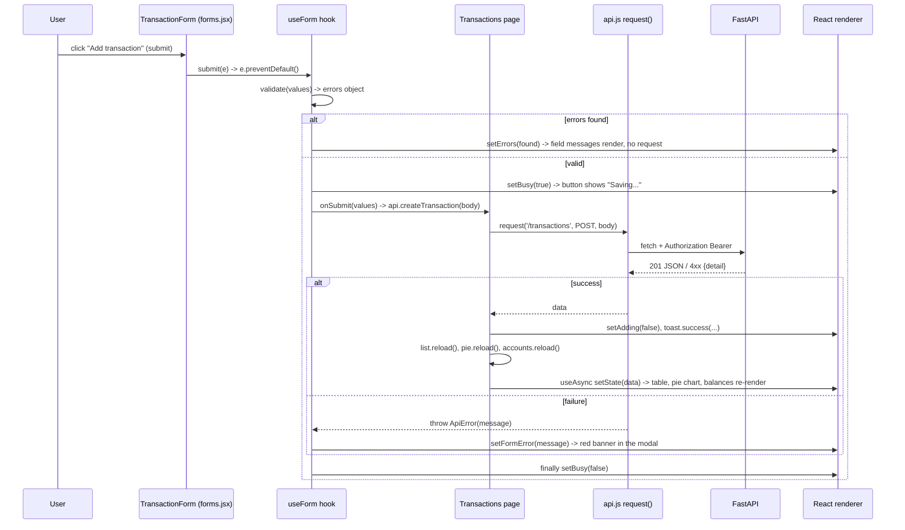

# React Architecture

Part of the [Finance Tracker documentation library](../Finance%20Tracker.md). Source: `frontend/` ([`package.json`](../../frontend/package.json), [`vite.config.js`](../../frontend/vite.config.js), [`index.html`](../../frontend/index.html), `src/`). Language: **JavaScript + JSX only** (no TypeScript).

## 1. Vite setup

```js
// frontend/vite.config.js
export default defineConfig({
  plugins: [react()],
  server: { port: 3000,
    proxy: { '/api': { target: process.env.VITE_BACKEND_URL || 'http://127.0.0.1:8000', changeOrigin: true } } },
})
```

| Script | Command | What it does |
|---|---|---|
| `npm run dev` | `vite` | dev server on :3000 with HMR and the `/api` proxy |
| `npm run build` | `vite build` | production bundle in `frontend/dist/` (listed in `.gitignore`; a build exists locally) |
| `npm run preview` | `vite preview --port 3000` | serves `dist/` for a smoke test |

Why a proxy: the SPA calls the relative base `/api/v1`; in dev Vite forwards to FastAPI, so the browser sees a single origin (no CORS preflight needed). The backend still configures CORS (`CORS_ORIGINS`, default `http://localhost:3000`) for direct cross-origin use, e.g. a built `dist/` served elsewhere with `VITE_API_BASE_URL`.

`index.html` contains `<div id="root">` and `<script type="module" src="/src/main.jsx">`.

Environment (Vite `import.meta.env`, build-time): `VITE_API_BASE_URL` (default `/api/v1`), `VITE_FAQ_URL` (default `http://localhost:8501`), `VITE_ASSISTANT_URL` (default `http://localhost:8502`); proxy target `VITE_BACKEND_URL` is read by Node in `vite.config.js`.

## 2. Application bootstrap

```jsx
// src/main.jsx
createRoot(document.getElementById('root')).render(
  <React.StrictMode>
    <BrowserRouter future={{ v7_startTransition: true, v7_relativeSplatPath: true }}>
      <ToastProvider>
        <AuthProvider>
          <App />
```

* `StrictMode` double-invokes effects in development (the `useAsync` request-id guard and `AuthProvider` logout/restore effects tolerate this).
* `BrowserRouter` is outermost so any provider could use routing hooks.
* `ToastProvider` is *outside* `AuthProvider` so auth code (and pages) can show toasts.
* `AuthProvider` is outside `App` so `Protected` and every page can `useAuth()`.
* Global CSS `./styles/index.css` is imported here.

## 3. Folder structure

| Folder | Content |
|---|---|
| `src/pages/` | route-level screens: `Dashboard`, `Accounts`, `Transactions`, `Budgets`, `Analytics`, `Assistant`, `Profile`, `AuthPages` (`Login`, `Register`) |
| `src/layouts/` | `AppLayout` (sidebar, top bar, `<Outlet/>`) |
| `src/components/` | reusable UI: `ui.jsx` (primitives), `forms.jsx` (forms + `useForm`), `BudgetBar`, `TransactionTable`, `charts/` |
| `src/contexts/` | `AuthContext`, `ToastContext` |
| `src/hooks/` | `useAsync` |
| `src/services/` | `api.js` (HTTP layer) |
| `src/utils/` | `format.js` (constants, INR/date formatting, colours) |
| `src/styles/` | `index.css` |

## 4. Architectural patterns

1. **Pages orchestrate, components render.** Pages own data loading (`useAsync`) and modal state; presentational components (`TransactionTable`, `BudgetBar`, charts) receive props.
2. **One HTTP module.** Only `services/api.js` calls `fetch`; pages call `api.<method>()`.
3. **Context for cross-cutting state only:** authentication and toast notifications. Everything else is local component state (see [State_Management](State_Management.md)).
4. **Uniform UX states.** Each data block renders one of: `<Spinner>` (loading), `<ErrorState>` with retry, `<EmptyState>` (no data), or the content.
5. **Lazy charts.** Recharts is loaded via `React.lazy` + `Suspense` in `components/charts/index.jsx` — the production build splits it into separate chunks (`generateCategoricalChart-*.js`, `IncomeExpenseChart-*.js`, `CategoryPie-*.js`).
6. **Presentation constants in one place:** `utils/format.js` (`CATEGORIES`, `BUDGET_CATEGORIES`, `ACCOUNT_TYPES`, `MONTHS`, `CATEGORY_COLORS`, `formatINR`, `formatPercent`, `formatDate`, `todayISO`, `utilizationTone`).

## 5. The React execution flow (user action → UI update)

Using "add a transaction" as the worked example (names are real):



Step by step:

1. **User action** — clicking the submit button of the `<form onSubmit={f.submit}>`.
2. **Component → hook** — `useForm.submit` (in `forms.jsx`) calls `e.preventDefault()`.
3. **State update + validation** — `validate(values)` returns an `{field: message}` object; `setErrors(found)`; if non-empty, return (submission prevented).
4. **API request** — `setBusy(true)`; `onSubmit(values)` is the closure from `pages/Transactions.jsx` that calls `api.createTransaction(body)`, which runs `request('/transactions', {method:'POST', body})`.
5. **Backend response** — FastAPI validates again, applies business rules, returns 201 or an error.
6. **State update** — success: close modal, toast, call each `useAsync().reload()`; failure: `setFormError(err.message)`.
7. **UI re-render** — React re-renders the components whose state changed (table, pie, account dropdown names).

## 6. Error boundaries and robustness

There is **no React error boundary** component; rendering exceptions would blank the app. Network/HTTP errors are handled in `api.js` and surfaced through `ErrorState`, form error banners or toasts. `useAsync` ignores out-of-order responses (see [State_Management](State_Management.md)).

## 7. Testing

There are **no frontend unit/e2e tests** in the repository (no Jest/Vitest/Playwright config). `PROJECT_PROGRESS.md` mentions a headless-Chrome flow check and `npm run build`, but no scripts for them are committed. Backend validation is covered by pytest.
