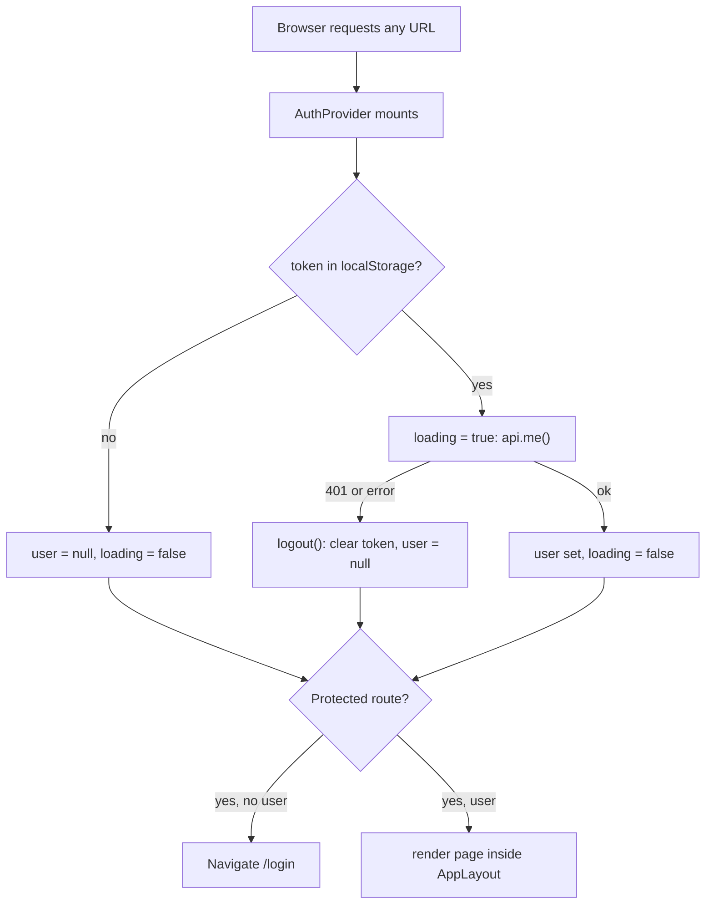

# Routing and Navigation

Part of the [Finance Tracker documentation library](../Finance%20Tracker.md). Sources: [`App.jsx`](../../frontend/src/App.jsx), [`layouts/AppLayout.jsx`](../../frontend/src/layouts/AppLayout.jsx), [`main.jsx`](../../frontend/src/main.jsx). Library: `react-router-dom` v6 (`BrowserRouter`, `Routes`, `Route`, `NavLink`, `Outlet`, `Navigate`, `Link`).

## 1. Route table

| Path | Element | Protected? |
|---|---|---|
| `/login` | `Login` | no (redirects to `/` if already signed in) |
| `/register` | `Register` | no (same redirect) |
| `/` | `Dashboard` | yes |
| `/accounts` | `Accounts` | yes |
| `/transactions` | `Transactions` | yes |
| `/budgets` | `Budgets` | yes |
| `/analytics` | `Analytics` | yes |
| `/assistant` | `Assistant` | yes |
| `/profile` | `Profile` | yes |
| `*` | `<Navigate to="/" replace />` | falls through to `/` (then to `/login` if signed out) |

## 2. Protected routes

```jsx
function Protected({ children }) {
  const { user, loading } = useAuth()
  if (loading) return <Spinner label="Restoring session…" />
  return user ? children : <Navigate to="/login" replace />
}

<Route element={<Protected><AppLayout /></Protected>}>   // layout route: no path, wraps children
  <Route path="/" element={<Dashboard />} /> …
```

* A **pathless layout route** applies `Protected` once for all seven pages; `AppLayout` renders the child via `<Outlet />`.
* `loading` is initialised to `Boolean(getToken())`, so with a stored token the app shows "Restoring session…" while `GET /users/me` runs; with no token it redirects immediately.
* `Login`/`Register` perform the inverse check (`if (user) return <Navigate to="/" replace />`).



## 3. Navigation UI

`AppLayout` defines:

```js
const NAV = [['/', 'Dashboard','📊'], ['/accounts','Accounts','🏦'], ['/transactions','Transactions','💸'],
             ['/budgets','Budgets','🎯'], ['/analytics','Analytics','📈'], ['/assistant','AI Assistant','🤖'], ['/profile','Profile','👤']]
```

* `NavLink` with `className={({isActive}) => ...}` adds the `active` class; `end={to === '/'}` prevents the dashboard link from being active on every path.
* On mobile the sidebar is off-canvas; `open` state toggles it; clicking a link or the scrim closes it.
* In-page links use `<Link>` (Dashboard → `/budgets`, `/transactions`).
* `Assistant` uses plain `<a href target="_blank">` because the Streamlit apps are different origins.

## 4. Logout and session expiry

* **Manual:** sidebar "Log out" or Profile → `logout()` → `setToken(null)` + `setUser(null)` → `Protected` re-renders and `Navigate`s to `/login`. (No backend call — JWTs are stateless.)
* **Automatic:** any authenticated request returning 401 triggers the handler registered by `AuthProvider` (`setUnauthorizedHandler(logout)`), with the same result.

## 5. Production-hosting note

`BrowserRouter` uses the HTML5 History API. A static host serving `frontend/dist/` must rewrite unknown paths to `index.html` (e.g. a reverse proxy `try_files`), otherwise refreshing `/budgets` returns 404. The Vite dev/preview servers already do this. The repository contains no production web-server config; see [Reverse_Proxy_and_Static_Hosting](../08_Deployment_and_DevOps/Reverse_Proxy_and_Static_Hosting.md).
