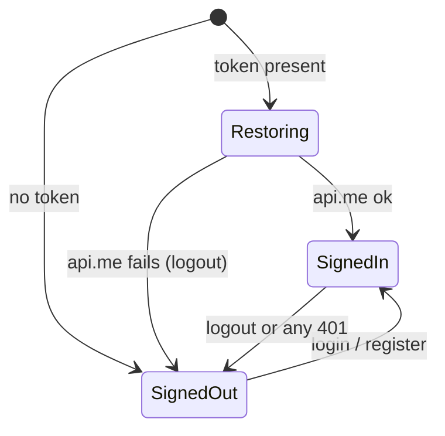

# State Management

Part of the [Finance Tracker documentation library](../Finance%20Tracker.md). No Redux/Zustand/React Query is used. State is handled with `useState`, two React contexts and one custom hook.

## 1. State categories

| Kind | Where | Examples |
|---|---|---|
| **Global/app** | `AuthContext`, `ToastContext` | `user`, `loading`, toasts |
| **Server data (fetched)** | `useAsync` per page | dashboard, accounts, budgets, transactions |
| **UI/local** | `useState` in pages | `modal`, `adding`, `period`, `filters`, `page`, `months` |
| **Form state** | `useForm` hook / local `useState` in Login, Register, Profile | `values`, `errors`, `busy`, `formError` |
| **Persistent** | `localStorage['ft_token']` | JWT only |
| **URL** | React Router | current page (no query-string state; filters are not in the URL) |

## 2. `AuthContext` ([`contexts/AuthContext.jsx`](../../frontend/src/contexts/AuthContext.jsx))

```jsx
const [user, setUser] = useState(null)
const [loading, setLoading] = useState(Boolean(getToken()))
const logout = useCallback(() => { setToken(null); setUser(null) }, [])

useEffect(() => {
  setUnauthorizedHandler(logout)
  if (!getToken()) return
  api.me().then(setUser).catch(logout).finally(() => setLoading(false))
}, [logout])
```

| Member | Behaviour |
|---|---|
| `login(email, password)` | `api.login` → `setToken(access_token)` → `setUser(await api.me())`; errors propagate to the caller (the page shows `err.message`) |
| `register(payload)` | `api.register(payload)` then `login(payload.email, payload.password)` |
| `logout()` | clear token (memory + localStorage) and user |
| `setUser` | used by `Profile` to publish the updated profile |
| `value` | memoised with `useMemo` to avoid needless consumer re-renders |

`useAuth()` is `useContext(AuthContext)`; there is no guard if used outside the provider (it would return `null`).

## 3. `ToastContext` ([`contexts/ToastContext.jsx`](../../frontend/src/contexts/ToastContext.jsx))

Holds `toasts: [{id, kind, message}]`; module-level counter `nextId`. `push(kind, message)` appends and schedules `setTimeout(dismiss, 4500)`. The provider renders the toast stack itself (`<div className="toasts" role="status" aria-live="polite">`). Exposed API: `{success, error}`.

## 4. `useAsync(loader, deps)` ([`hooks/useAsync.js`](../../frontend/src/hooks/useAsync.js))

```js
export function useAsync(loader, deps = []) {
  const [state, setState] = useState({ data: null, loading: true, error: null })
  const run = useRef(0)
  const load = useCallback(() => {
    const id = ++run.current
    setState((s) => ({ ...s, loading: true, error: null }))
    return loader()
      .then((data)  => { if (id === run.current) setState({ data, loading: false, error: null }) })
      .catch((error) => { if (id === run.current) setState({ data: null, loading: false, error }) })
  }, deps)
  useEffect(() => { load() }, [load])
  return { ...state, reload: load }
}
```

* **Why:** one reusable pattern for loading / error / data + manual refresh.
* **Stale-response protection:** each call increments `run.current`; only the latest call may update state, so a slow earlier response (e.g. previous month) cannot overwrite a newer one.
* **Re-fetch trigger:** `load` is memoised on `deps`; when a dep changes, `load` changes and the `useEffect` runs again. Pages pass primitive deps (`[period.month, period.year]`, `[f, page]` where `f = JSON.stringify(filters)`).
* **Stale-while-revalidate:** while reloading, the previous `data` stays (`{...s, loading:true}`) so tables don't flash empty; on error `data` becomes `null`. Pages therefore test `loading && !data` to show the spinner only on first load (Dashboard's `trend`/`cats` blocks use plain `loading` and show the spinner on every reload).
* **Manual refresh:** `reload()` after mutations (e.g. `accounts.reload()` after creating a transaction so balances refresh).
* The `eslint-disable` comment acknowledges that `loader` is intentionally not in the dependency list.

## 5. Local UI state patterns

* **Modal pattern (Accounts):** a single `modal` state `{kind, account?}`; `null` = closed; `close()` sets it to `null`; `done(message)` closes, toasts and reloads.
* **Period pickers:** `useState({month, year})` initialised from `new Date()`.
* **Filters (Transactions):** one `filters` object; `change(name)` handler updates it and resets `page`.
* **Derived data:** `useMemo` for `names` (id → account name) and `pieData`; plain computations for totals.

## 6. Where state is *not* shared

* Each page owns its own `useAsync` instances, so navigating between pages refetches data (no cache). Example: `/` and `/analytics` both call `incomeVsExpense` separately.
* The Streamlit assistants keep their own token and session; the SPA's token is not passed to them.

## 7. Authentication-state diagram


