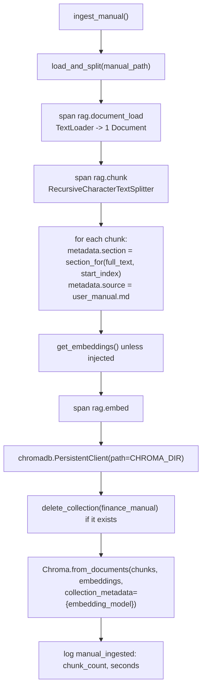

# Document Ingestion

Part of the [Finance Tracker documentation library](../Finance%20Tracker.md). Source: [`ai/rag/ingest.py`](../../ai/rag/ingest.py). Run: `.venv/bin/python ai/rag/ingest.py` (needs `GOOGLE_API_KEY` for live embeddings). Overview: [RAG_Architecture](RAG_Architecture.md).

## 1. The knowledge source

[`ai/rag/user_manual.md`](../../ai/rag/user_manual.md) — a ~22.6 KB, 407-line Markdown manual. Structure: a `###` title block, then sixteen `#### Section N: …` headings:

1 Introduction · 2 Account Types · 3 Creating and Managing Accounts · 4 Transaction Categories · 5 Recording Transactions · 6 Filtering and Searching Transactions · 7 Setting Monthly Budgets · 8 Budget Alerts · 9 Dashboard Overview · 10 Account Summary · 11 Savings Rate and Financial Health · 12 Frequently Asked Questions · 13 Troubleshooting · 14 Glossary · 15 Security and Authentication · 16 Transfers and Credit Card Payments.

A test (`test_manual_documents_transfers_and_net_balance`) checks that the manual documents transfers and the net-balance rule, which keeps RAG answers consistent with the implemented backend.

## 2. Pipeline



## 3. Loading

`TextLoader(path, encoding="utf-8").load()` returns a single LangChain `Document` containing the whole file (`document_count` = 1 recorded on the span). No HTML/PDF parsing and no preprocessing (cleaning, lower-casing, de-duplication) is performed — the Markdown text is used as written, including `**bold**` markers and tables.

## 4. Splitting (chunking)

```python
RecursiveCharacterTextSplitter(
    chunk_size=512, chunk_overlap=50,
    separators=["\n\n", "\n", ".", " "], add_start_index=True)
```

* **Chunk size 512 characters, overlap 50 characters** (matches the POC spec; spec test `test_ing_02` requires ≤ 600 chars, and `test_ing_03` requires ≥ 20 chunks).
* The splitter tries separators in order: paragraph break → newline → full stop → space, so it prefers to cut at paragraph/sentence boundaries and only falls back to word boundaries.
* `add_start_index=True` records each chunk's character offset in `metadata["start_index"]`; this offset is used to find the section.
* Current result (computed offline): **61 chunks**, lengths 25–510 characters. Largest share: *Section 12 FAQ* (16 chunks), because it is the longest section; one tiny chunk is the title/introduction block labelled `Introduction`.

Why 512/50: small enough that a retrieved chunk is focused (several are packed in one prompt: 4 × ≤ 512 chars), with a small overlap so a sentence cut at a boundary still appears in the neighbouring chunk.

## 5. Metadata enrichment (`section_for`)

```python
_HEADING = re.compile(r"^#### (Section \d+: .+)$", re.M)
def section_for(text, start):
    found = "Introduction"
    for m in _HEADING.finditer(text):
        if m.start() <= start: found = m.group(1).strip()
        else: break
    return found
```

Each chunk gets `metadata["section"]` = the last `#### Section N: …` heading at or before its `start_index` (default `"Introduction"` for text before Section 1) and `metadata["source"] = "user_manual.md"`. These fields power the citations shown in the UI and the `[Section name]` prefix in the prompt context.

*Limitation:* it is a heuristic. A chunk straddling two sections is labelled with the section where it **starts**.

## 6. Embedding and storing

1. `embeddings = get_embeddings()` → `GoogleGenerativeAIEmbeddings(model=EMBEDDING_MODEL, google_api_key=…)` (see [Gemini_Integration](Gemini_Integration.md)). `embeddings` is injectable (`ingest_manual(embeddings=…)`) — tests use `HashEmbeddings` and need no key.
2. `chromadb.PersistentClient(path=persist_dir, settings=Settings(anonymized_telemetry=False))`.
3. **Reset:** `client.delete_collection("finance_manual")` inside a `try/except` (ignored if absent). Therefore **every run rebuilds the collection from scratch — no duplicate chunks** (`test_ingest_resets_collection_no_duplicates`).
4. `Chroma.from_documents(documents=chunks, embedding=embeddings, persist_directory=persist_dir, collection_name=…, collection_metadata={"embedding_model": <id>})` embeds all chunks (network calls to Gemini) and stores vectors, texts and metadata.
5. Logs `manual_ingested` (`chunk_count`, `collection_name`, `embedding_seconds`, `operation`, `status`).

`embedding_model_id(embeddings)` returns `embeddings.model` if present, else the class name — used for the fingerprint.

## 7. Operational notes

* Re-run ingestion whenever `user_manual.md` or `EMBEDDING_MODEL` changes.
* `MANUAL_PATH` and `CHROMA_DIR` env vars override the defaults.
* Spans emitted: `rag.document_load`, `rag.chunk`, `rag.embed` (with `vectors_stored`).
* Failure modes: missing key → `MissingApiKeyError` from `get_embeddings()`; wrong/retired model id → Google API 404 (the code replaces known retired ids with the default and logs `retired_model_id_replaced`).
* The CLI prints `[ingest] Done. N chunks stored in <dir> (collection 'finance_manual').`
