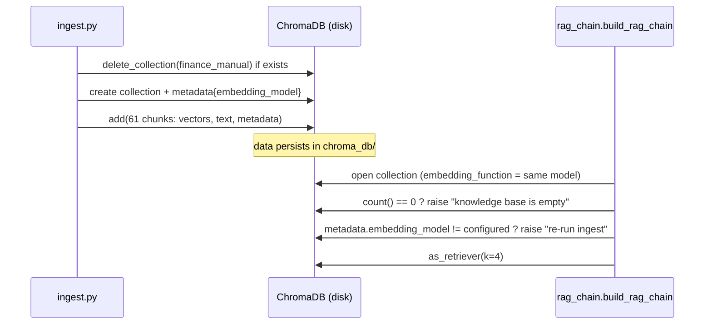

# Embeddings and Vector Database

Part of the [Finance Tracker documentation library](../Finance%20Tracker.md). Sources: [`ai/common/llm.py`](../../ai/common/llm.py), [`ai/rag/ingest.py`](../../ai/rag/ingest.py), [`ai/rag/rag_chain.py`](../../ai/rag/rag_chain.py), [`tests/testsupport/fakes.py`](../../tests/testsupport/fakes.py).

## 1. Concepts

* An **embedding** turns text into a fixed-length vector of numbers so that texts with similar *meaning* are close together. "How do I set a budget?" lands near the manual's budget section even without identical words.
* A **vector database** stores those vectors with the original text and metadata and answers "give me the k nearest vectors to this query vector" quickly (approximate nearest-neighbour index). **ChromaDB** is used here.
* The **same embedding model must embed both documents and queries**; otherwise distances are meaningless. The project enforces this with a fingerprint check (below).

## 2. Embedding model

```python
DEFAULT_EMBEDDING_MODEL = "models/gemini-embedding-001"

def embedding_model_name(): return _model_from_env("EMBEDDING_MODEL", DEFAULT_EMBEDDING_MODEL)
def get_embeddings():
    from langchain_google_genai import GoogleGenerativeAIEmbeddings
    return GoogleGenerativeAIEmbeddings(model=embedding_model_name(), google_api_key=_api_key())
```

* Configured by env `EMBEDDING_MODEL`; the default is `models/gemini-embedding-001`.
* The POC specification names `text-embedding-004`; the project documentation states it returns 404 on the current API. `RETIRED_MODELS["EMBEDDING_MODEL"]` maps `models/text-embedding-004` and `text-embedding-004` to the default and logs a `retired_model_id_replaced` warning, so a stale `.env` cannot break the app (`docs/DEPENDENCY_DEVIATIONS.md`).
* The vector dimensionality is determined by the model; the code does not hard-code it (and the local Chroma `collections` row has no dimension recorded because it is empty).
* A key is required (`MissingApiKeyError` otherwise). Embedding calls go over the network to Google; the key is never logged.

### Embeddings in tests
`HashEmbeddings` (in `fakes.py`) is a deterministic 384-dim bag-of-words hashing embedding (MD5 of each word modulo 384, L2-normalised) with `model = "hash-embeddings-test"`. It lets retrieval tests rank by word overlap with no network, and the fingerprint test uses it to prove mismatches are rejected.

## 3. ChromaDB configuration

| Setting | Value |
|---|---|
| Client | `chromadb.PersistentClient(path=CHROMA_DIR, settings=Settings(anonymized_telemetry=False))` for ingestion; `Chroma(persist_directory=…, embedding_function=…, collection_name=…)` (LangChain wrapper) for querying |
| Persistence | on disk under `CHROMA_DIR` (default `<repo>/chroma_db`; contains `chroma.sqlite3` plus HNSW segment folders once populated) |
| Collection | `finance_manual` (single collection) |
| Collection metadata | `{"embedding_model": "<model id>"}` written by `ingest_manual` |
| Distance metric | **not configured in code** → ChromaDB's default for new collections applies (L2/squared Euclidean in Chroma 0.5.x) |
| Telemetry | disabled: `ANONYMIZED_TELEMETRY=False` (env default set in `observability.py`) and `Settings(anonymized_telemetry=False)` |
| Version | `chromadb==0.5.7` (with `chroma-hnswlib 0.7.6`, `posthog 5.4.0` pinned for compatibility) |

`langchain_community.vectorstores.Chroma` is the wrapper used (the community integration, not `langchain-chroma`).

## 4. Persistence and lifecycle



* Vectors survive process restarts (`scripts/verify/verify_chroma.py` is a write-then-reopen persistence check using deterministic embeddings; it was not re-run for this documentation).
* The Streamlit app caches the built chain with `@st.cache_resource` (`load_chain`) so Chroma is opened once per server process.

## 5. Fingerprint guard

```python
built_with = (vectorstore._collection.metadata or {}).get("embedding_model")
now = str(getattr(embeddings, "model", None) or type(embeddings).__name__)
if built_with and built_with != now:
    raise RuntimeError(f"The knowledge base was built with embedding model '{built_with}' but '{now}' is configured. Re-run `python ai/rag/ingest.py`.")
```

It uses a private attribute (`_collection`) of the LangChain wrapper — functional today, but would need attention on library upgrades. An index created before the fingerprint existed (no metadata) is accepted without a check (`if built_with and …`).

## 6. Data volume

The manual is tiny (≈ 22 KB → 61 chunks), so the vector store is trivially small; HNSW approximate search is effectively exact at this size.

## 7. Current local state

`chroma_db/chroma.sqlite3` currently contains the `finance_manual` collection **with zero embeddings** (read-only query at documentation time), so `build_rag_chain()` would raise the "knowledge base is empty" error until `ingest.py` is run.
