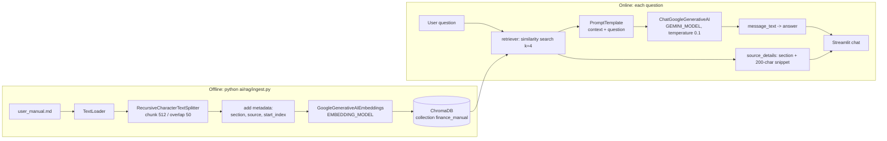

# RAG Architecture

Part of the [Finance Tracker documentation library](../Finance%20Tracker.md). Phase 2. Sources: [`ai/rag/ingest.py`](../../ai/rag/ingest.py), [`ai/rag/rag_chain.py`](../../ai/rag/rag_chain.py), [`ai/rag/chatbot.py`](../../ai/rag/chatbot.py), [`ai/rag/user_manual.md`](../../ai/rag/user_manual.md), [`ai/common/llm.py`](../../ai/common/llm.py). Detail files: [Document_Ingestion](Document_Ingestion.md) · [Embeddings_and_Vector_Database](Embeddings_and_Vector_Database.md) · [Retrieval_and_Similarity_Search](Retrieval_and_Similarity_Search.md) · [RAG_Chain_and_Prompting](RAG_Chain_and_Prompting.md) · [Gemini_Integration](Gemini_Integration.md).

## 1. What RAG is and why it is used here

An LLM on its own answers from its training data and may invent product details ("hallucinate"). **Retrieval-Augmented Generation (RAG)** adds a retrieval step: relevant passages from a trusted document are fetched first and injected into the prompt, and the model is told to answer **only** from them. In this project the trusted document is the app's own user manual (`ai/rag/user_manual.md`, 16 sections: accounts, categories, recording transactions, budgets, alerts, dashboard, FAQ, troubleshooting, glossary, security, transfers…). Benefits: answers match the real app, citations (manual section names) can be shown, and out-of-scope questions can be declined.

## 2. Two phases

## 3. Components and their files

| Component | Class / function | File |
|---|---|---|
| Loader | `TextLoader(manual_path, encoding="utf-8")` | `ingest.py::load_and_split` |
| Splitter | `RecursiveCharacterTextSplitter(512, 50, separators=["\n\n","\n","."," "], add_start_index=True)` | same |
| Section tagging | `section_for(text, start)` using regex `^#### (Section \d+: .+)$` | same |
| Index builder | `ingest_manual(...)` | same |
| Vector store | `langchain_community.vectorstores.Chroma` | `ingest.py`, `rag_chain.py` |
| Retriever | `vectorstore.as_retriever(search_kwargs={"k": 4})` | `rag_chain.py::build_rag_chain` |
| Chain | `RagChain` (`retrieve`, `generate`, `invoke`) | `rag_chain.py` |
| Entry point | `ask_question(question, chain)` (LangSmith-traced) | `rag_chain.py` |
| Models | `get_chat_model`, `get_embeddings`, `message_text` | `ai/common/llm.py` |
| UI | Streamlit `main()` — mode "Manual Q&A (RAG)" | `chatbot.py` |

`RetrievalQA` (a classic LangChain helper removed in LangChain 1.x) is **not** used; the chain is built with LCEL (`prompt | llm | RunnableLambda(message_text)`) wrapped in the small `RagChain` class, as stated in the module docstring.

## 4. Configuration values (all from source)

| Item | Value | Source |
|---|---|---|
| Collection name | `finance_manual` | `COLLECTION_NAME` |
| Persist directory | env `CHROMA_DIR`, else `<repo>/chroma_db` | `CHROMA_DIR` |
| Manual path | env `MANUAL_PATH`, else `ai/rag/user_manual.md` | `MANUAL_PATH` |
| Chunk size / overlap | 512 / 50 characters | `CHUNK_SIZE, CHUNK_OVERLAP` |
| Top-k | 4 | `TOP_K` |
| Chat model | env `GEMINI_MODEL`, default `gemini-3.5-flash-lite` | `llm.py` |
| Embedding model | env `EMBEDDING_MODEL`, default `models/gemini-embedding-001` | `llm.py` |
| RAG temperature | 0.1 (`build_rag_chain`) | `rag_chain.py` |
| LangSmith project | `AI-Readiness-POC-02-P2` | `@traceable_if_enabled` |

## 5. End-to-end trace of one question

Question: *"How do I set a monthly budget?"* in the Streamlit app (mode **Manual Q&A (RAG)**):

1. `chatbot.py::main` receives it (from `st.chat_input` or a sample-question button). In FAQ mode the question is **not** combined with chat history — the chain is stateless (history is only displayed).
2. `ask_question(question, chain)` (`@traceable_if_enabled`, LangSmith project `…-P2`): empty/blank → returns `EMPTY_QUESTION` without any call.
3. `chain.invoke(question)` → `RagChain.retrieve` → span `rag.retrieve` → `retriever.invoke(question)`:
   * the question is embedded with the same Gemini embedding model;
   * Chroma returns the 4 nearest chunks (`Document` with `page_content` and metadata `section`, `source`, `start_index`).
4. No documents → `{"answer": NO_INFO, "docs": []}` and the LLM is **not** called.
5. `RagChain.generate` builds `context = "\n\n".join(f"[{section}]\n{chunk}")` and invokes `prompt | llm | message_text` (span `rag.generate`).
6. `ask_question` builds `source_details = [{"section", "snippet": first 200 chars}]` and logs `rag_query_completed` (question[:80], answer_length, source_count, duration_ms).
7. Streamlit renders the answer and an expander "📚 Sources from the user manual" listing section names and snippets.
8. Any exception (network, quota, bad model id) → `LLM_UNAVAILABLE` ("Sorry, I couldn't reach the AI service just now…") plus `llm_call_failed` log; the app does not crash.

## 6. Startup guards (`build_rag_chain`)

* If `llm`/`embeddings` are not injected, both are created from the environment; missing `GOOGLE_API_KEY` → `MissingApiKeyError` ("GOOGLE_API_KEY is not set…"), shown by the Streamlit app via `st.error` + `st.stop()`.
* Empty collection → `RuntimeError("The knowledge base is empty. Run python ai/rag/ingest.py first.")`.
* **Embedding-model fingerprint:** at ingest time the collection metadata records `embedding_model`. At load time, if the configured model differs, it raises `RuntimeError("The knowledge base was built with embedding model '…' but '…' is configured. Re-run python ai/rag/ingest.py.")`. This prevents silently mixing vectors from different embedding spaces.

## 7. Hallucination controls and limits

| Control | Mechanism |
|---|---|
| Grounding | prompt says "using ONLY the information provided in the context" |
| Refusal | fixed sentence `I don't have information about that in the Finance Tracker user manual.` for missing/out-of-scope info |
| Transparency | sources (section + snippet) shown to the user |
| Determinism | temperature 0.1 |
| **Limits** | the instruction is advisory — the model could still paraphrase imperfectly; top-4 retrieval may miss relevant text (no re-ranking, no relevance threshold, no query rewriting); with Gemini-specific behaviour not verified live in this environment |

No relevance **score threshold** exists: top-4 chunks are always returned if the collection is non-empty, even for an unrelated question (the refusal then depends on the LLM obeying the prompt). Tests acknowledge this (`test_ret_03_irrelevant_query_scores_worse_than_relevant`).

## 8. Where RAG is reused

The Phase 3 agent exposes the same chain as the tool `search_finance_policy` ([Agent_Tools_and_Functions](../05_AI_Agent/Agent_Tools_and_Functions.md)). The MCP chat and LangGraph report do not use RAG.

## 9. Current state of the local index

At documentation time, a read-only query of `chroma_db/chroma.sqlite3` showed the `finance_manual` collection present but with **0 stored embeddings**, and the current manual splits into **61 chunks** (computed offline with `load_and_split()`; longest 510 characters). To use the chatbot, run `python ai/rag/ingest.py` with a valid `GOOGLE_API_KEY`. `chroma_db/` is listed in `.gitignore` (although `chroma_db/chroma.sqlite3` is currently tracked).
