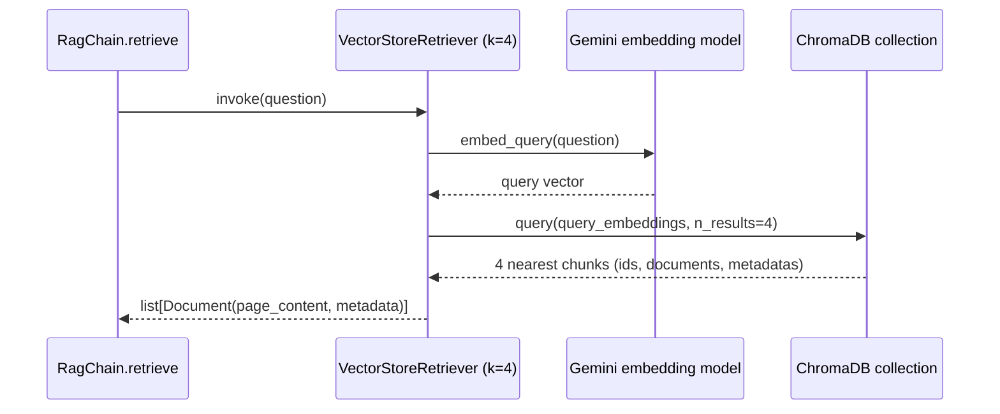

# Retrieval and Similarity Search

Part of the [Finance Tracker documentation library](../Finance%20Tracker.md). Source: [`ai/rag/rag_chain.py`](../../ai/rag/rag_chain.py) (`build_rag_chain`, `RagChain.retrieve`), tests in [`tests/phase2/test_rag_mock.py`](../../tests/phase2/test_rag_mock.py).

## 1. Strategy

Plain **dense vector similarity search, top-k = 4** — nothing more. Specifically:

```python
vectorstore = Chroma(persist_directory=persist_dir or CHROMA_DIR, embedding_function=embeddings, collection_name="finance_manual")
retriever   = vectorstore.as_retriever(search_kwargs={"k": 4})
```

`as_retriever` without `search_type` defaults to `"similarity"`. Not used: MMR (diversity re-ranking), `similarity_score_threshold`, metadata filters, hybrid/BM25 search, query rewriting, multi-query, re-ranking, parent-document retrieval.

## 2. What happens at query time



1. The question string is embedded (`embed_query`) with the **same** model used at ingestion.
2. Chroma performs an approximate nearest-neighbour (HNSW) search and returns the 4 chunks with the smallest distance to the query vector.
3. The wrapper converts them to LangChain `Document`s: `page_content` is the chunk text; `metadata` has `section`, `source`, `start_index`.
4. `RagChain.retrieve` wraps this in span `rag.retrieve` with attributes `rag.query` (first 100 chars), `rag.top_k`, `rag.retrieved_count`.

## 3. Similarity and ranking

Similarity is determined by Chroma's distance metric (not set in code → Chroma default, L2) over the embedding vectors; smaller distance = more similar. The order of returned chunks is nearest-first. The chain does not read or expose distance scores; `ask_question` returns only text snippets.

## 4. Empty and irrelevant results

| Case | Behaviour |
|---|---|
| Empty/blank question | `ask_question` returns `EMPTY_QUESTION` ("Please type a question about the Finance Tracker application.") before any retrieval |
| Retriever returns no documents | `RagChain.invoke` returns `NO_INFO` **without calling the LLM** (`test_gen_no_retrieved_context_declines_without_calling_llm`); `ask_question` also logs `retrieval_empty` |
| Irrelevant question (e.g. stock market) | Chroma still returns 4 nearest chunks (there is no threshold); the **prompt** instructs the model to answer with the fixed `NO_INFO` sentence. Safety therefore relies on the LLM following the prompt |
| Empty collection | raised at chain build time, not at query time |

## 5. Source attribution

```python
details = [{"section": d.metadata.get("section", "Manual"), "snippet": d.page_content[:200]} for d in docs]
return {"answer": …, "sources": [d["snippet"] for d in details], "source_details": details}
```

`render_sources` (Streamlit) shows each source as "**N. Section X: …**" plus a caption of the 200-char snippet (with "…" when it hit the limit). The agent tool `search_finance_policy` instead appends the **sorted unique section names**: `(Sources: Section 7: Setting Monthly Budgets; …)`.

## 6. Tests describing expected retrieval behaviour (mock tier)

| Test | Assertion |
|---|---|
| `test_ret_01_budget_question_returns_budget_content` | a budget question retrieves budget-related chunks |
| `test_ret_02_top_k_is_exactly_4` | retriever configured for k = 4 (returns 4 documents) |
| `test_ret_03_irrelevant_query_scores_worse_than_relevant` | unrelated queries have worse similarity scores |
| `test_ret_04_account_types_query_retrieves_account_section` | account-type question retrieves the account section |
| `test_ret_05_empty_query_handled_gracefully` | empty input handled |
| `test_ret_06_retrieval_latency_under_5_seconds` | retrieval is fast with the local store |

These tests use `HashEmbeddings` (word-overlap), so they validate the plumbing and configuration, **not** the semantic quality of real Gemini embeddings (live tests exist in `test_rag_live.py` but are skipped without a key).

## 7. Tuning knobs (if you need to change behaviour)

| Goal | Change |
|---|---|
| More/less context | `TOP_K` in `rag_chain.py` (and `build_rag_chain(k=…)`) |
| Avoid irrelevant context | use `search_type="similarity_score_threshold"` with `score_threshold` — *not implemented* |
| Smaller/larger passages | `CHUNK_SIZE`, `CHUNK_OVERLAP` in `ingest.py`, then re-ingest |
| Different embedding model | `EMBEDDING_MODEL`, then re-ingest (fingerprint guard enforces this) |
