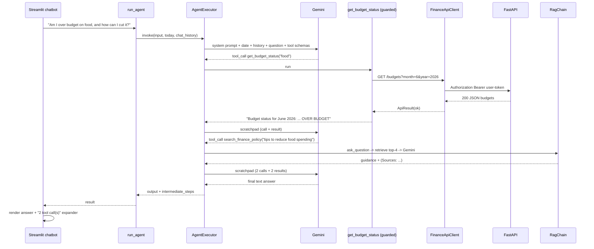

# Tool Execution Flow

Part of the [Finance Tracker documentation library](../Finance%20Tracker.md). Sources: [`agent.py::run_agent`](../../ai/agent/agent.py), LangChain `AgentExecutor` loop, [`tools.py`](../../ai/agent/tools.py), [`api_client.py`](../../ai/common/api_client.py).

## 1. The loop in words

1. The user asks a question; Streamlit calls `run_agent(question, executor, chat_history)`.
2. `run_agent` strips the question (empty → `"Please ask a question about your finances."` with no LLM call), computes today's date string from `executor.ctx.today()`, and calls `executor.invoke({"input", "today", "chat_history"})` inside span `agent.execute`.
3. `AgentExecutor` builds the prompt (system prompt, date, history, question, empty scratchpad) and calls Gemini with the tool schemas bound.
4. Gemini replies either with **tool call(s)** (function name + JSON arguments) or with a **final answer**.
5. For each tool call the executor runs the matching `@tool` function (wrapped by `guarded`), obtains a string, and appends an `AIMessage(tool_calls)` + `ToolMessage(result)` pair to the scratchpad.
6. Go to 3 with the enlarged scratchpad. Repeat until the model answers, or `max_iterations=6` is reached (`early_stopping_method="force"`).
7. `run_agent` normalises the output (a list of blocks → text), records `tool_calls_count` on the span, logs `agent_query_completed` (tool_calls, tools, output_length, duration_ms) and returns `{"output": str, "intermediate_steps": [(AgentAction, observation), …]}`.

## 2. What the UI shows

`chatbot.py` converts `intermediate_steps` into `[{"tool": a.tool, "input": str(a.tool_input)[:200], "output": str(obs)}]` and `render_tool_calls` displays them in an expander (tool name, input, first 600 chars of output). This gives users and reviewers visibility into *why* an answer contains certain numbers.

## 3. How results return to the LLM

Tools return **plain strings** (pre-formatted lines with ₹ amounts). The executor wraps each as a tool message in the scratchpad; Gemini reads them and writes the final answer. Because the system prompt demands that every figure come from tool results, the model is expected to copy numbers from these strings. Long outputs (> 2000 chars) are summarised first so the context stays small (summary prompt: "Keep every number, category name and date that matters; do not add anything that is not in the text").

## 4. Error paths

| Failure | What happens |
|---|---|
| Backend unreachable / timeout | `FinanceApiClient.request` returns `ApiResult(False, error="Finance API service unavailable…" / "…timed out…")` → the tool returns `Could not retrieve …: <error>` → the LLM tells the user |
| 401 (expired token) | message "Not authenticated: your session is missing or expired. Please sign in again." |
| 403/404 (foreign/missing id) | "Access denied…" / "Not found: …" |
| Exception inside a tool | caught by `guarded` → "Could not complete <tool>: an unexpected error occurred (<Type>)." |
| Model produces malformed tool arguments | `handle_parsing_errors=True` lets the loop continue |
| Model keeps calling tools | stopped at 6 iterations (`test_e2e_loop_guard_stops_runaway_tool_calls`) |
| LLM/network error in `executor.invoke` | `run_agent` logs `agent_query_failed` and returns `FAILURE_MESSAGE` ("Sorry, I couldn't complete that request just now. Please try again.") or, if `GOOGLE_API_KEY` is empty, `NO_KEY_MESSAGE`; result includes `"error": "<ExceptionName>"` and no steps |

## 5. Observability of one run

Logs (structlog JSON, `phase=3`): `agent_query_received` → per tool `tool_executed` → `agent_query_completed`. Spans: `agent.execute` ⊃ `agent.tool_call` ⊃ `api.call`. If LangSmith is enabled, `run_agent` is traced as `finance_agent_query` in project `AI-Readiness-POC-02-P3` (inputs reduced to the question). No tokens or passwords are logged.

## 6. Mock-testing the loop (no network)

`ScriptedChatModel` (`tests/testsupport/fakes.py`) returns a scripted sequence of `AIMessage`s, e.g. first a message with `tool_calls=[{"name": "get_budget_status", …}]`, then a final text. The test routes HTTP into the real FastAPI app with the `route_http` fixture, so tools execute against real routes/DB. Examples: `test_e2e_budget_query_calls_tool_and_final_answer_uses_tool_data`, `test_e2e_compound_query_uses_data_tool_and_rag_tool`, `test_e2e_chat_history_is_passed_to_the_model`. This proves the **wiring** (tool → API → string → LLM prompt); it does not prove how real Gemini chooses tools.

## 7. Example (illustrative, not a recorded session)

> **User:** "How much have I spent on food this month?"
> 1. LLM → `get_spending_by_category("")` (or `get_budget_status("food")`)
> 2. Tool → `GET /analytics/spending-by-category?month=6&year=2026` → "Spending by category for June 2026 (total ₹…): - Food: ₹…"
> 3. LLM → "You've spent ₹… on food in June 2026."
