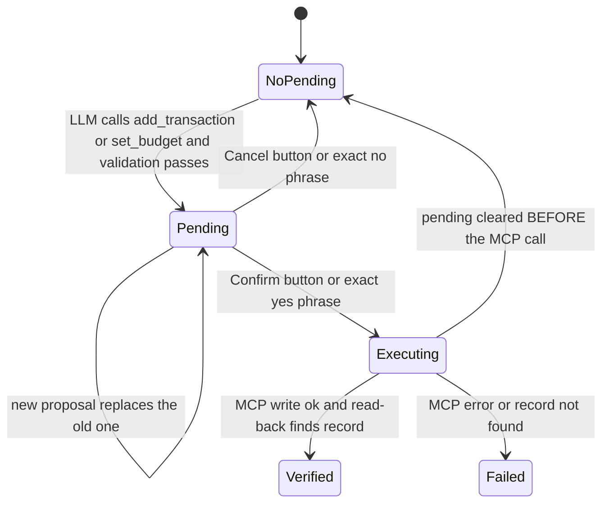
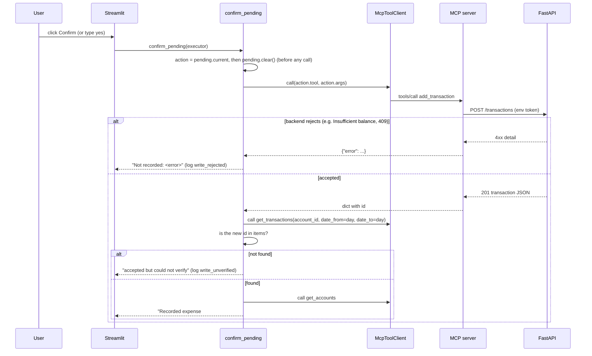

# Confirmation and Execution Flow

Part of the [Finance Tracker documentation library](../Finance%20Tracker.md). Source: [`ai/mcp_server/chat_interface.py`](../../ai/mcp_server/chat_interface.py) (`PendingAction`, `PendingActions`, `make_mcp_tools`, `is_confirmation`, `is_cancellation`, `confirm_pending`, `process_message`, `main`). Tests: `tests/phase4/test_chat_interface.py`.

## 1. The problem and the principle

An LLM can misunderstand ("500" vs "5000"), pick a wrong account, or be steered by text in the data. Letting it write financial records directly would be unsafe. The design (module docstring):

1. **The model can only *propose* a write.** The tool validates the proposal, checks the account, stores **one** pending action and returns `PENDING_CONFIRMATION …`. Nothing is recorded.
2. **Only an explicit human confirmation executes it** — the **Confirm** button or an exact "yes"-style message — **deterministically, in Python outside the model**, by calling the real MCP tool.
3. **Success is reported only after a read-back** shows the record exists.

## 2. State machine



## 3. Data structures

```python
@dataclass
class PendingAction: id: str; tool: str; args: dict; summary: str      # id = uuid4().hex[:6]
class PendingActions:                                                    # at most one per session
    current: PendingAction | None
    def set(action); def clear()
```

`McpChatExecutor.pending` is one `PendingActions` per signed-in session (not shared across users/sessions).

## 4. Step 1 — proposal (LLM-callable tools)

### `add_transaction` (LangChain proposal tool)
1. `validate_transaction_args(...)` → on problem returns `Cannot propose this transaction: <problem> Ask the user to correct it.`
2. `accounts = call("get_accounts")` (through MCP). Error → `Could not verify the account: …`.
3. The account id must be one of the user's accounts, else `Account <id> is not one of the user's accounts. Call get_accounts and ask the user which account to use.`
4. **Early balance check:** for a `debit` on a non-credit account, if `float(balance) < float(amount)` → `Insufficient balance: <name> has only ₹…, so ₹… cannot be spent from it. Tell the user.`
5. Build `args` (`account_id, amount, transaction_type, category, description, transaction_date, merchant`) and a human-readable `summary`, e.g. `Record expense (debit) of ₹500.00 in food at BigBazaar on 2026-06-18 to HDFC Savings: "Groceries"`.
6. `pending.set(PendingAction(...))`; log `write_proposed` (tool, action_id).
7. Return `PENDING_CONFIRMATION: <summary>. NOTHING has been recorded yet. Ask the user to confirm (press Confirm or reply yes).`

### `set_budget` (LangChain proposal tool)
`validate_budget_args` → summary `Set a food budget of ₹10,000.00 for 06/2026` → `pending.set(...)` → `PENDING_CONFIRMATION: … NOTHING has been saved yet. …`. (No account check; duplicates are caught at execution by the backend 409.)

The system prompt tells the model to describe what will be recorded and ask the user to confirm, and the second system message includes `pending_note` so the model knows a write is waiting. The model has **no tool that performs the write**.

## 5. Step 2 — recognising the user's decision

```python
YES_WORDS = {"yes","y","yeah","yep","yup","confirm","confirmed","ok","okay","sure","go ahead","do it","yes please","please do","proceed","yes confirm"}
NO_WORDS  = {"no","n","nope","cancel","stop","abort","dont","don't","do not","never mind","nevermind","no thanks","cancel it"}
def _normalize(text): return re.sub(r"[^a-z' ]", "", (text or "").lower()).strip()
is_confirmation(text) = _normalize(text) in YES_WORDS ;  is_cancellation(text) = _normalize(text) in NO_WORDS
```

* Normalisation lower-cases and removes everything except letters, apostrophes and spaces, so "Yes!" and "yes, please" match.
* **Exact-phrase only:** "yes, but make it 600" is *not* a confirmation; it goes to the LLM like any message (`test_only_exact_phrases_trigger_the_gate`). This avoids executing something the user is amending.
* The check happens in `process_message` **only if `executor.pending.current is not None`**; with nothing pending, "yes" is just text for the LLM, and `confirm_pending` is harmless (`test_confirm_without_pending_is_harmless`).
* The LLM never sees or decides the confirmation (`test_model_cannot_confirm_on_the_users_behalf`).

UI path: when `pending` exists, `main()` renders `st.warning("Please confirm: <summary>")` with buttons **✅ Confirm** (`confirm_pending`) and **✖ Cancel** (`pending.clear()`; message "Okay, cancelled. Nothing was recorded."). Button keys include the pending id so each proposal has fresh widgets.

## 6. Step 3 — execution and verification (`confirm_pending`)



Details:

* `pending.clear()` runs **before** executing, so a double-click or repeated "yes" cannot run the write twice (`test_yes_executes_via_mcp_and_reports_verified_result`). The trade-off: if execution fails, the proposal is gone and the user must ask again.
* `add_transaction` verification: `get_transactions` filtered to the account and the transaction date; success requires `any(t.get("id") == txn_id …)`. Then `get_accounts` to show the new balance.
* `set_budget` verification: `get_budget_status(month, year)` and match `b.get("id") == result.get("id")`; message `✅ Budget saved: food ₹10,000.00 for 06/2026 (currently 0.0% used).`
* Messages: `✅ Recorded expense #…`, `❌ Not recorded: <reason>`, `⚠️ The server accepted the request but I could not verify the transaction afterwards. Please check your transactions list.`
* The balance is **re-checked by the backend** at execution time (`test_insufficient_balance_is_caught_at_proposal_and_at_confirmation`): the proposal-time check is only a friendly early warning (the balance could change between proposal and confirmation).
* Observability: span `mcp.execute_confirmed` (`mcp.tool_name`, `mcp.session_id`), log `write_confirmed` (`operation="confirmed_write"`).

## 7. Cancellation and replacement

* Exact "no/cancel/…" or the Cancel button clears the pending action; response "Okay, I cancelled that. Nothing was recorded." (`cancelled: True`).
* A second proposal **replaces** the first (`test_new_proposal_replaces_the_old_one`); only the latest summary is shown for confirmation.
* A pending action is not auto-expired; it stays until confirmed, cancelled, replaced or the session ends.

## 8. Security properties and limits

| Property | Status |
|---|---|
| LLM cannot write without human action | ✅ no write tool exposed to the model; execution only from `confirm_pending` |
| User identity cannot be chosen by the model | ✅ environment token of the MCP subprocess |
| Backend rules still authoritative | ✅ (balance, uniqueness, validation) |
| Success claims verified | ✅ read-back |
| Idempotency on double confirm | ✅ pending cleared first |
| Confirmation is explicit | ✅ exact phrases/buttons |
| Anyone with access to the open browser session can confirm | ⚠️ no re-authentication step |
| Pending action persistence | in memory only; lost on restart/sign-out |
| LLM could *describe* a different action than what is pending | the UI shows the stored `summary` (built by code, not by the model) next to the buttons, which is what the user should read |
