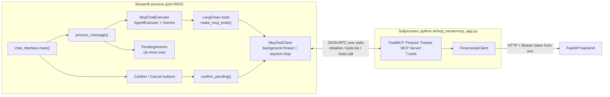
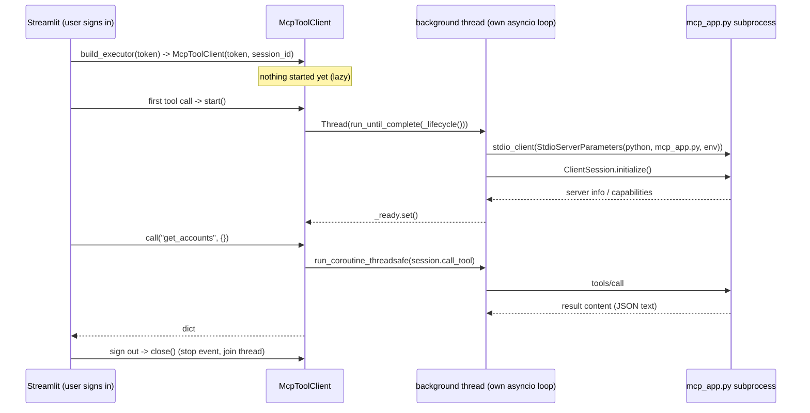

# MCP Architecture

Part of the [Finance Tracker documentation library](../Finance%20Tracker.md). Phase 4. Sources: [`ai/mcp_server/mcp_app.py`](../../ai/mcp_server/mcp_app.py), [`mcp_client.py`](../../ai/mcp_server/mcp_client.py), [`chat_interface.py`](../../ai/mcp_server/chat_interface.py). Siblings: [MCP_Server](MCP_Server.md) · [MCP_Tools](MCP_Tools.md) · [MCP_Client_and_Chat_Interface](MCP_Client_and_Chat_Interface.md) · [Confirmation_and_Execution_Flow](Confirmation_and_Execution_Flow.md).

## 1. Model Context Protocol in brief

**MCP** is an open protocol that standardises how an AI application (the *client/host*) discovers and calls capabilities (*tools*, resources, prompts) exposed by a separate *server*. Messages are JSON-RPC 2.0. Key operations used here:

| MCP method | Purpose | Used by this project |
|---|---|---|
| `initialize` | handshake / capability exchange | `ClientSession.initialize()` |
| `tools/list` | discover tool names, descriptions, JSON input schemas | `McpToolClient.list_tools()` |
| `tools/call` | invoke a tool with arguments | `McpToolClient.call()` |

Transport used: **stdio** — the client launches the server as a subprocess and exchanges JSON-RPC messages over its stdin/stdout. (FastMCP 0.4.1 supports `stdio` and `sse`; `mcp.run()` defaults to `stdio`, and this project never selects `sse`.)

## 2. Why MCP is used here (and what it buys)

* **Separation of concerns:** finance operations are packaged as a tool server independent of any particular chat UI or LLM. The Streamlit chat is one client; any MCP-capable client could attach to `ai/mcp_server/mcp_app.py`.
* **Typed tool contract:** names, docstrings and JSON schemas are generated from the Python signatures, and are visible via `tools/list`.
* **Identity isolation:** the server process has exactly one user's identity in its environment.
* **POC requirement:** Phase 4 mandates a `fastmcp` server with 6 spec tools; the project adds a 7th (`get_accounts`) because writes need an account id.

## 3. Architecture

## 4. Responsibilities

| Layer | Responsibility |
|---|---|
| **MCP server** (`mcp_app.py`) | expose 7 tools; validate obvious input errors; forward to REST with the user's token; return `dict` (never raise) |
| **MCP client** (`mcp_client.py`) | spawn the server subprocess per user session, keep one persistent `ClientSession`, expose blocking `call()`/`list_tools()` |
| **Chat layer** (`chat_interface.py`) | LangChain agent whose tools call the MCP client; the **confirmation gate** for writes; read-back verification; Streamlit UI incl. the Phase 5 report page |
| **Backend** | the actual business rules and authorization |

## 5. Key design decisions

1. **Identity from environment, not arguments.** `API_JWT_TOKEN`, `API_BASE_URL`, `MCP_SESSION_ID` are set in the subprocess env by `McpToolClient._server_env()`. No tool has a `user_id`/`token` parameter, so the model cannot select another user. Test: `test_mcp_identity_comes_from_environment_not_arguments`, `test_protocol_users_are_isolated_by_server_process`.
2. **Writes are proposals.** The model's `add_transaction`/`set_budget` *LangChain tools* only validate and store a pending action; the real MCP write tool is called by deterministic code after the user confirms. See [Confirmation_and_Execution_Flow](Confirmation_and_Execution_Flow.md).
3. **Server logs go to stderr.** stdout is the protocol channel; `configure_logging(PHASE, stream=sys.stderr)` in `mcp_app.main()` prevents log lines from corrupting JSON-RPC.
4. **Tools never raise.** Errors are returned as `{"error": "..."}` (including backend errors), so callers show readable messages and the session stays alive.
5. **Business rules stay in the backend.** The server validates only shape (positive amounts, enum values, ISO dates); insufficient balance, duplicate budgets etc. come back from REST.

## 6. Honest notes on discovery and schemas

* The server exposes tools over the protocol and `McpToolClient.list_tools()` implements `tools/list` (used in tests to verify names, descriptions and schemas).
* **The chat layer does not build its LangChain tools dynamically from `tools/list`.** `make_mcp_tools()` hand-writes LangChain `@tool` wrappers (same names/parameters) that call `client.call(name, args)`. This is what allows the write tools to be intercepted by the confirmation gate. The effect: the model's "tool discovery" is the static LangChain tool list, while true MCP discovery is available to any other MCP client and exercised in tests.
* `fastmcp==0.4.1` is the spec-pinned release; the client side uses the official `mcp` SDK 1.30.0.

## 7. Process lifecycle

One subprocess per signed-in Streamlit session; also closed via `atexit`.
