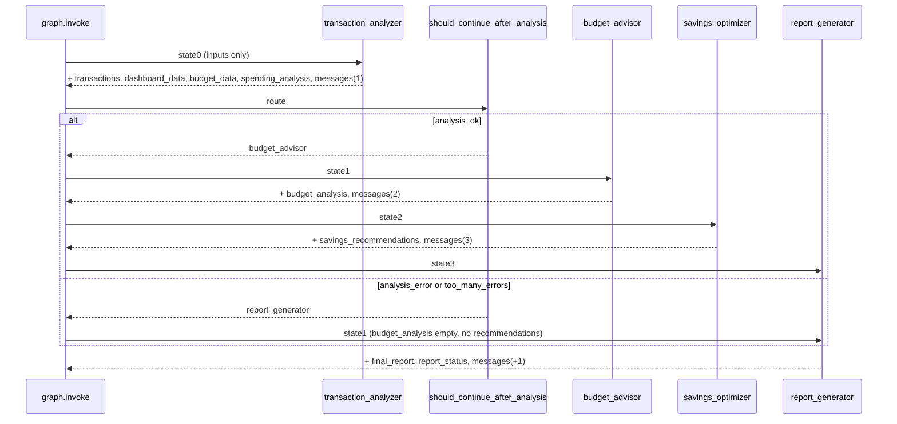
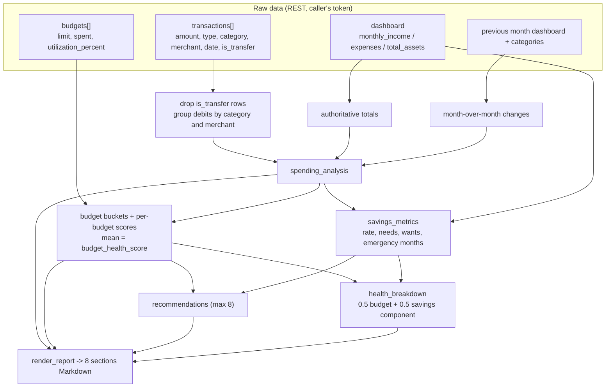

# Graph State and Workflow

Part of the [Finance Tracker documentation library](../Finance%20Tracker.md). Sources: [`state.py`](../../ai/multi_agent/state.py), [`graph.py`](../../ai/multi_agent/graph.py), [`agents.py`](../../ai/multi_agent/agents.py). Architecture: [LangGraph_Architecture](LangGraph_Architecture.md).

## 1. Shared state (`FinancialHealthState`, a `TypedDict`)

| Field | Type | Written by | Meaning |
|---|---|---|---|
| `user_id` | `int` | input (`generate_financial_report`) | the user the report is for (derived from the token if `None` was passed) |
| `report_month` | `int` | input | 1–12 |
| `report_year` | `int` | input | four-digit year |
| `transactions` | `List[Dict]` | Transaction Analyzer | all of the month's transactions (every page; transfers included) |
| `budget_data` | `List[Dict]` | Transaction Analyzer | `GET /budgets?month&year` items |
| `dashboard_data` | `Dict` | Transaction Analyzer | `GET /dashboard?month&year` response |
| `spending_analysis` | `Dict` | Transaction Analyzer | analysis from `calc.analyze_transactions` (+ optional `narrative`) |
| `budget_analysis` | `Dict` | Budget Advisor | buckets, score, recommendations (+ optional `narrative`) |
| `savings_recommendations` | `List[str]` | Savings Optimizer | up to 8 recommendation sentences |
| `final_report` | `str` | Report Generator | Markdown |
| `report_status` | `str` | Analyzer (error), Report Generator (final) | `"in_progress"` → `"complete"` or `"error"` |
| `errors` | `List[str]` | Analyzer | human-readable data problems |
| `messages` | `List[str]` | every node | audit trail of agent activations |

`initial_state(user_id, month, year)` fills the rest with empty containers, `report_status="in_progress"`, `final_report=""`.

## 2. State update pattern

LangGraph merges the dict each node returns into the state (no custom reducers are declared, so each key's latest value wins). Every node here returns **a complete copy** `{**state, <changed keys>}` and copies list fields before appending:

```python
errors, messages = list(state["errors"]), list(state["messages"])
...
return {**state, "transactions": transactions, "dashboard_data": dashboard, "spending_analysis": analysis, "errors": errors, "messages": messages}
```

This is verified by `test_nodes_never_mutate_their_input_state` and `test_state_03_04_update_pattern_does_not_mutate_and_persists`.

## 3. Execution order and state evolution



A normal run produces four `messages`, e.g.:

```
Transaction Analyzer: Processed 14 transactions for 6/2026
Budget Advisor: Analyzed 3 budget categories. Health score: 71
Savings Optimizer: Generated 5 recommendations. Current savings rate: 25.0%
Report Generator: Financial health report generated (3412 characters)
```
(Values illustrative.) The Streamlit page shows them as "Agent execution log"; the CLI prints them under "Agent Execution Log".

## 4. From transactions to a health report — the data transformation



## 5. Error handling in the workflow

| Where | Handling |
|---|---|
| API failures in the analyzer | appended to `errors`; processing continues with whatever loaded |
| Identity failure/mismatch | `report_status="error"` → router jumps to the report |
| More than 2 errors | router jumps to the report (`too_many_errors`) |
| Narrative failure / ungrounded text | silently dropped (logged) |
| Final status | Report Generator sets `"error"` if nothing at all loaded, else `"complete"` (even if some non-fatal errors are listed under "Data notes") |
| Callers | CLI exit code 1 if status ≠ `complete`; Streamlit shows a warning "The report is partial because some data could not be loaded." |

## 6. Configuration and runtime context

`ReportContext` (passed in `config["configurable"]["report_ctx"]`): `base_url`, `token`, `llm`, `use_llm`. If a node is invoked without it (e.g. in tests), `get_context(config)` falls back to `env_context()` (`API_BASE_URL`, `API_JWT_TOKEN`). The LLM is created lazily on first narrative (`get_chat_model(temperature=0.2)`); if creation fails (no key) `use_llm` is turned off for the rest of the run.

## 7. Observability

* Spans: `graph.execute` ⊃ `agent.transaction_analyzer.activate` / `supervisor.route` / `agent.budget_advisor.activate` / `agent.savings_optimizer.activate` / `agent.report_generator.activate`.
* Logs: `report_generation_started`, `agent_activated` (agent-specific fields), `supervisor_route`, `report_generation_completed` (`status`, `agents_activated`, `duration_ms`).
* LangSmith: top-level run `financial_health_report` and one child per node, project `AI-Readiness-POC-02-P5`; the live trace test (skipped here) checks the four child runs.

## 8. Tests

`tests/phase5/test_multi_agent.py` (53 mock tests): state (`test_state_*`), calculations, agents (`test_agent_*`), routing (`test_route_01_02_03_conditional_edges`, `test_route_04_05_06_compiled_graph_structure`, `test_supervisor_routing_is_logged`), narrative guard, full pipeline (`test_e2e_full_pipeline_complete_report`). `test_multi_agent_live.py` has 2 live tests (skipped without keys).
