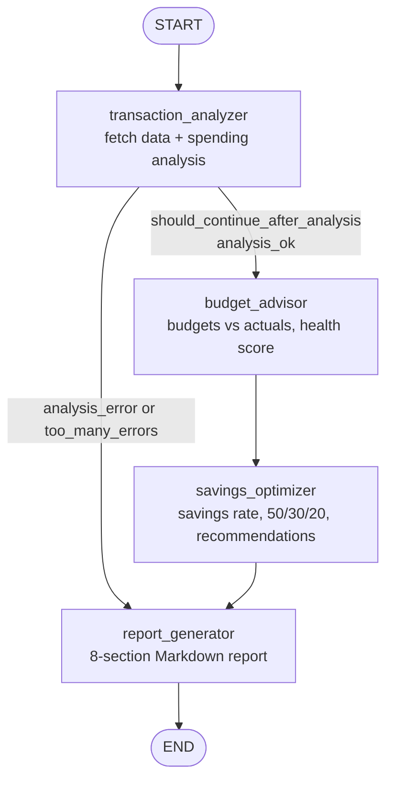

# LangGraph Architecture

Part of the [Finance Tracker documentation library](../Finance%20Tracker.md). Phase 5. Sources: [`ai/multi_agent/graph.py`](../../ai/multi_agent/graph.py), [`agents.py`](../../ai/multi_agent/agents.py), [`calculations.py`](../../ai/multi_agent/calculations.py), [`state.py`](../../ai/multi_agent/state.py), [`report_runner.py`](../../ai/multi_agent/report_runner.py). Siblings: [Graph_State_and_Workflow](Graph_State_and_Workflow.md) · [Transaction_Analyzer](Transaction_Analyzer.md) · [Budget_Advisor](Budget_Advisor.md) · [Savings_Optimizer](Savings_Optimizer.md) · [Report_Generator](Report_Generator.md).

## 1. What LangGraph is and why it is used

**LangGraph** models an AI workflow as a **graph**: *nodes* are functions that read a shared *state* and return updates; *edges* define what runs next (including conditional edges). Compared with a single prompt, it makes multi-step pipelines explicit, testable and traceable. Phase 5 uses the "sequential supervisor" pattern: four specialised "agents" run in a fixed order, with one conditional edge that skips to the report if data loading failed.

> Important honesty note: the "agents" here are **graph nodes (Python functions)**, not autonomous LLM agents with tools and reasoning loops. Their *numbers* come from deterministic Python (`calculations.py`); an LLM is optionally used only to write 2–3 sentence commentary per section.

## 2. Graph definition (actual code)

```python
workflow = StateGraph(FinancialHealthState)
workflow.add_node("transaction_analyzer", transaction_analyzer)
workflow.add_node("budget_advisor", budget_advisor)
workflow.add_node("savings_optimizer", savings_optimizer)
workflow.add_node("report_generator", report_generator)
workflow.set_entry_point("transaction_analyzer")
workflow.add_conditional_edges("transaction_analyzer", should_continue_after_analysis,
    {"budget_advisor": "budget_advisor", "report_generator": "report_generator"})
workflow.add_edge("budget_advisor", "savings_optimizer")
workflow.add_edge("savings_optimizer", "report_generator")
workflow.add_edge("report_generator", END)
return workflow.compile()
```



* **Nodes:** 4. **Edges:** 1 conditional (from `transaction_analyzer`) + 3 fixed. **Entry:** `transaction_analyzer`. **Compiled without a checkpointer** (no persistence/resume).
* Each node has signature `(state, config=None) -> state-dict` and is decorated with `@traceable_if_enabled(name=<node>, project_name="AI-Readiness-POC-02-P5")`.

## 3. The routing function

```python
def should_continue_after_analysis(state):
    if state["report_status"] == "error":   target, reason = "report_generator", "analysis_error"
    elif len(state["errors"]) > 2:          target, reason = "report_generator", "too_many_errors"
    else:                                   target, reason = "budget_advisor", "analysis_ok"
    # span supervisor.route + log supervisor_route (from_agent, to_agent, reason)
    return target
```

The function returns a node name; the mapping dict validates it. The decision is logged with a span (`supervisor.route`: `supervisor.from_agent`, `supervisor.to_agent`, `supervisor.routing_reason`). When it skips ahead, `budget_analysis` and `savings_recommendations` stay empty (initial values) and the report generator still renders a full document with the available data and a "Data notes" section listing the errors.

## 4. Entry point: `generate_financial_report`

```python
@traceable_if_enabled(name="financial_health_report", project_name=PROJECT)
def generate_financial_report(user_id, report_month, report_year, token=None, base_url=None, llm=None, use_llm=True) -> FinancialHealthState
```

1. Build `ReportContext(base_url, token, llm, use_llm)`; defaults come from `API_BASE_URL` / `API_JWT_TOKEN`.
2. If `user_id is None`, call `GET /users/me` to get it (0 on failure).
3. `build_financial_report_graph().invoke(initial_state(...), config={"configurable": {"report_ctx": ctx}, "tags": ["phase-5"]})` inside span `graph.execute`.
4. Return the final state (use `final_report`, `report_status`, `messages`, `errors`).

The `ReportContext` travels through LangGraph's `config["configurable"]["report_ctx"]`, so nodes can call the backend with the caller's token without putting secrets in the state.

## 5. Who calls it

| Caller | How |
|---|---|
| CLI | `python ai/multi_agent/report_runner.py --email … --password … [--month M --year Y] [--no-llm] [--output report.md]` (prompts for the password if omitted; or `API_JWT_TOKEN`); exit code 0 only if `report_status == "complete"`, 2 for missing/failed sign-in |
| Streamlit | "Financial health report" view in `chat_interface.py::render_report_page(token)`: month/year inputs, "Generate report", agent execution log, rendered Markdown, download button |
| Tests | `tests/phase5/test_multi_agent.py` with fake LLMs and the in-process FastAPI app |

## 6. Design properties

| Property | How it is achieved |
|---|---|
| No hallucinated numbers | all figures from `calculations.py` using `Decimal`; LLM text rejected if it contains numbers not present in the facts (`narrative_is_grounded`) |
| Works offline / without key | `ReportContext.use_llm=False` or no `GOOGLE_API_KEY` → deterministic mode, still a complete 8-section report |
| Per-user safety | token from caller; Transaction Analyzer refuses when `/users/me` id ≠ requested `user_id`; read-only (GET only) |
| Graceful degradation | fetch failures are collected in `state["errors"]`; routing + "honest error report" |
| Immutability pattern | every node returns `{**state, …}` and copies lists before appending (tests: `test_nodes_never_mutate_their_input_state`) |
| Observability | spans `agent.<name>.activate`, `supervisor.route`, `graph.execute`; logs `agent_activated`, `report_generation_started/completed`; LangSmith project `AI-Readiness-POC-02-P5` |

## 7. Limitations

* Fixed linear pipeline; no loops/retries/human-in-the-loop; no persistence.
* LLM contribution is minor by design; the "multi-agent" label describes the specialisation of nodes.
* Calculations embed simplified assumptions (50/30/20 category mapping, emergency-fund heuristics, health score weights) — documented in [Savings_Optimizer](Savings_Optimizer.md) and [Report_Generator](Report_Generator.md).
* Live Gemini narratives not verified in this environment (2 live tests skipped).
