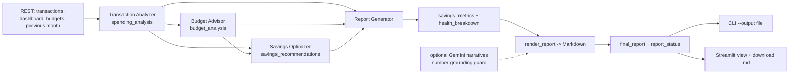

# Report Generator

Part of the [Finance Tracker documentation library](../Finance%20Tracker.md). Node 4 (last) of the [LangGraph pipeline](LangGraph_Architecture.md). Code: `agents.py::{report_generator, render_report, narrate}` and `calculations.py::{health_breakdown, rating, financial_risks, action_items, narrative_is_grounded}`.

## 1. Purpose

Consolidate all findings into one structured **8-section Markdown financial health report** with a 0–100 health score, and set the final `report_status`.

## 2. Inputs and outputs

| | |
|---|---|
| **Reads from state** | `spending_analysis`, `budget_analysis`, `savings_recommendations`, `dashboard_data`, `errors`, `report_status`, `report_month`, `report_year`, `messages` |
| **Writes to state** | `final_report` (Markdown string), `report_status` (`"complete"` or `"error"`), `messages` (+1 line) |
| **LLM** | optional executive-summary narrative (temperature 0.2) |
| **API / tools** | none |

Audit message: `"Report Generator: Financial health report generated (<N> characters)"`.

## 3. Processing

1. `metrics = calc.savings_metrics(spending, dashboard)` (recomputed).
2. `breakdown = calc.health_breakdown(int(budget.get("budget_health_score", 50)), metrics["savings_rate"], budget.get("has_budgets", True))`.
3. If there are no errors **or** at least one transaction was processed, ask the LLM for an executive summary using facts `{income, expenses, savings_rate, health_score, over_budget[], recommendations[:3]}`.
4. `render_report(...)` builds the Markdown.
5. Status: `"error"` if **no transactions were processed, no dashboard data exists and there are errors**, or the state was already `"error"`; otherwise `"complete"`.

## 4. Health score

```python
SAVINGS_TARGET_PERCENT = 30
savings_component = int(round(clamp(rate / 30 * 100, 0, 100)))
if has_budgets:  score = int(round(0.5 * budget_score + 0.5 * savings_component))
else:            score = savings_component        # no budgets -> savings component alone
```

| Score | Rating (`calc.rating`) |
|---|---|
| ≥ 80 | Excellent |
| 60–79 | Good |
| 40–59 | Fair |
| < 40 | Needs attention |

Worked example: budget health 60, savings rate 24 % → savings component `24/30×100 = 80` → score `0.5×60 + 0.5×80 = 70` → "Good". The report prints the **exact formula** (`"50% x budget health 60 + 50% x savings component 80 = 70"`) and the note `"savings component = savings rate 24% / 30% target, capped at 100"`; regression tests recompute the displayed score from the displayed components (`test_report_score_always_matches_its_displayed_formula`, `test_health_breakdown_exposes_every_component`). This was added after an earlier version showed a score whose components were not visible (see `PROJECT_PROGRESS.md`).

Python's `round()` is round-half-to-even (e.g. `round(68.5) == 68`); the code uses plain `round`, so exact .5 cases follow that rule.

## 5. Grounded narratives (the LLM guard)

`narrate(ctx, agent, instruction, facts)`:

1. Returns `None` if the LLM is unavailable (`use_llm=False`, no key → logs `llm_unavailable` and disables LLM for the run).
2. Prompt: *"You are the {agent} in a personal finance report for an Indian user (amounts in rupees). {instruction} Rules: write 2 to 3 plain sentences; use ONLY numbers that appear in the facts below; do not add new numbers, percentages or dates; do not give investment advice. Facts (JSON): …"*
3. On exception → log `narrative_failed`, return `None`.
4. `calc.narrative_is_grounded(text, facts)`: extract numbers with regex; a number is *significant* if it has decimals or ≥ 3 integer digits (years 2000–2100 are ignored); each significant number must match some number in the facts (within 0.005, or equal to a rounded fact value). Any offender → log `narrative_rejected` (`ungrounded_numbers`) and **discard the narrative**.
5. Accepted text appears in the report as `*AI commentary:* …`.

So the LLM **cannot change any figure** — it can only add prose that passes the number check (`test_llm_never_changes_the_calculated_numbers`, `test_grounded_narrative_is_included_and_ungrounded_is_discarded`, `test_llm_failure_or_missing_key_still_produces_full_report`). Limits: small numbers (< 100 without decimals) are not checked, and wrong *claims* with correct numbers are not detected.

## 6. Report structure (`render_report`)

```
# Financial Health Report — <Month> <Year>
## 1. Executive Summary          income, expenses, saved, savings rate, score/100 (rating) [+ AI commentary]
## 2. Income & Expense Overview  table: income, expenses, net savings, savings rate, last month's expenses (+% change), total assets
## 3. Spending Analysis          category table (spent, share %), largest expense, top merchant, notable patterns [+ AI commentary]
## 4. Budget Performance         budget health score, utilization, 🔴 over / 🟠 warning / 🟢 on track bullets, advice [+ AI commentary]
## 5. Savings Optimizer Recommendations   numbered list + "50/30/20 check" line
## 6. Financial Risks            from calc.financial_risks
## 7. Action Items for Next Month   from calc.action_items (budget advice first 2 + savings recs, max 5)
## 8. Financial Health Score     score, formula, savings note, budget note; "Data notes" listing errors; disclaimer footer
```

Footer: *"Figures are calculated from your recorded transactions; transfers between your own accounts are excluded. This report is informational, not financial advice."*

### `financial_risks` rules
Negative cash flow; low savings rate (< 10 %); each over-budget category; emergency cushion < 3 months; spending up > 20 % vs. last month; up to 3 unusual patterns; "No budgets are set, so overspending would not trigger alerts."

## 7. Report generation flow



## 8. Failure and edge behaviour

* LLM off → identical report minus "AI commentary" lines.
* Data failures → `"### Data notes"` lists each error; `report_status="error"` if nothing at all could be loaded.
* **Observation (verified by running `report_generator` offline on an error-state input):** when the router skips Budget Advisor/Savings Optimizer after an analyzer error, `budget_analysis` is `{}`, so the generator falls back to its defaults (`budget_health_score=50`, `has_budgets=True`). The output was `25/100 (Needs attention)` with "Calculation: 50% x budget health 50 + 50% x savings component 0 = 25", while section 4 says "No budgets were set for this period…". The default budget component of 50 is therefore an artefact of the skipped path, not analysed budget data; the report is still flagged `report_status="error"`.
* No income and no expenses → text "No income or expenses were recorded for <Month> <Year>… based on limited data."

## 9. Tests

`test_agent_07_08_report_generator_markdown_sections_and_score`, `test_report_for_failed_data_is_an_honest_error_report`, `test_e2e_full_pipeline_complete_report`, the narrative tests above, `test_health_score_bounds_and_rating`.
