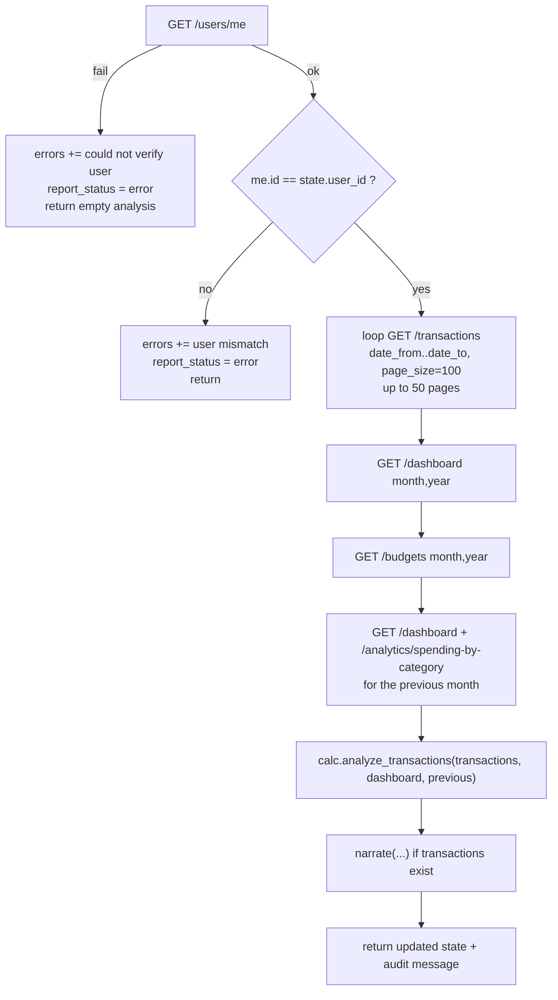

# Transaction Analyzer

Part of the [Finance Tracker documentation library](../Finance%20Tracker.md). Node 1 of the [LangGraph pipeline](LangGraph_Architecture.md). Code: `agents.py::transaction_analyzer` and `calculations.py::analyze_transactions`.

## 1. Purpose

Load the month's data for the signed-in user through the REST API and analyse spending patterns: totals, spending by category, largest expense, top merchant, unusual patterns, and comparison with the previous month.

## 2. Inputs and outputs

| | Fields |
|---|---|
| **Reads from state** | `user_id`, `report_month`, `report_year`, `errors`, `messages` |
| **Reads from context** | `ReportContext` (`base_url`, `token`, `llm`, `use_llm`) via `config["configurable"]["report_ctx"]` |
| **Writes to state** | `transactions`, `dashboard_data`, `budget_data`, `spending_analysis`, `errors`, `messages`, and (on failure) `report_status="error"` |
| **LLM** | optional narrative only (temperature 0.2), if there are transactions |
| **Tools** | none (plain `FinanceApiClient` calls) |

## 3. Processing, step by step



1. **Identity check.** `GET /users/me`. Failure → `errors: "Could not verify the user: <error>"`, message `"Transaction Analyzer: could not load data (user verification failed)"`, `report_status="error"` (the router then jumps to the Report Generator). If `me.id != state.user_id` → `"The authenticated user does not match the requested user; no data was loaded."`, `report_status="error"`, log `report_user_mismatch` (`test_analyzer_refuses_to_report_on_another_users_id`).
2. **Transactions.** `calc.month_bounds(year, month)` → `YYYY-MM-01` … `YYYY-MM-<last day>`. Loop `GET /transactions?date_from&date_to&page=N&page_size=100` while `page <= pages and page <= 50` (so at most 5,000 transactions). A failed page adds `"Transaction fetch failed: …"` and breaks. `test_analyzer_fetches_every_page_of_transactions` checks pagination.
3. **Dashboard and budgets** for the month: failures append `"Dashboard fetch failed: …"` / `"Budget fetch failed: …"` (non-fatal).
4. **Previous period** (`calc.previous_period`): dashboard + spending-by-category of the prior month; only used if **both** calls succeed.
5. **Analysis** — `analyze_transactions(transactions, dashboard, previous)`.
6. **Narrative** (optional) — facts: `month`, `total_spent`, `total_income`, `spending_by_category`, `largest_expense`, `top_merchant`, `unusual_patterns`, `previous_period`; instruction "Summarise the spending pattern and anything unusual."; stored as `analysis["narrative"]` only if grounded.
7. Append message `"Transaction Analyzer: Processed <N> transactions for <month>/<year>"` and log `agent_activated` (`transaction_count`, `errors`).

## 4. `analyze_transactions` logic

Authoritative rule: **totals come from the dashboard** (which already applies the backend's income/expense definitions); the transaction list supplies detail.

| Output key | Computation |
|---|---|
| `total_transactions` | count of **non-transfer** transactions |
| `transfer_legs_excluded` | `len(all) − len(non-transfer)` |
| `total_spent` / `total_income` | `dashboard.monthly_expenses` / `monthly_income`; if the dashboard failed, fall back to summing non-transfer debits/credits |
| `spending_by_category` | sum of non-transfer **debits** per category (`Decimal`), sorted descending, rounded to 2 dp |
| `largest_expense` | the max debit: `{description, amount, category, date}` |
| `top_merchant` | merchant with the highest summed debit amount |
| `unusual_patterns` | list of strings (below) |
| `previous_period` | `{month, year, total_spent, total_income, spent_change, spent_change_percent, category_changes[]}` or `None` |

**Unusual-pattern rules** (all deterministic):

1. *Single dominant expense:* if there is more than one debit, `total_spent > 0` and `largest >= 40 % × total_spent` → "One expense (₹… on <date>: <description>) makes up X% of the month's spending."
2. *Possible duplicates:* same `(merchant or description, amount, date)` seen more than once → "Possible duplicate: N identical expenses of ₹… at <name> on <date>."
3. *Category spike:* versus last month, if the previous amount > 0, current ≥ 2× previous **and** the increase ≥ ₹1,000 → "<Category> spending more than doubled versus last month (₹a to ₹b)."

`category_changes[]` items: `{category, current, previous, change, change_percent|None}` (percent is `None` when previous was 0).

## 5. Error behaviour

Never raises for data problems; collects messages in `errors`. Severity routing: `report_status="error"` (identity problems) or more than 2 errors → the router skips Budget Advisor and Savings Optimizer.

## 6. Example (illustrative values)

```
messages: ["Transaction Analyzer: Processed 14 transactions for 6/2026"]
spending_analysis.spending_by_category: {"food": 9800.0, "utilities": 3200.0, "transport": 2500.0}
spending_analysis.unusual_patterns: ["Food spending more than doubled versus last month (₹4,000.00 to ₹9,800.00)."]
```

## 7. Tests

`test_agent_01_transaction_analyzer_fetches_and_analyzes`, `test_analyzer_fetches_every_page_of_transactions`, `test_agent_02_analyzer_handles_api_unavailable_without_raising`, `test_analyzer_refuses_to_report_on_another_users_id`, `test_analyze_transactions_excludes_transfers_and_flags_patterns`.
