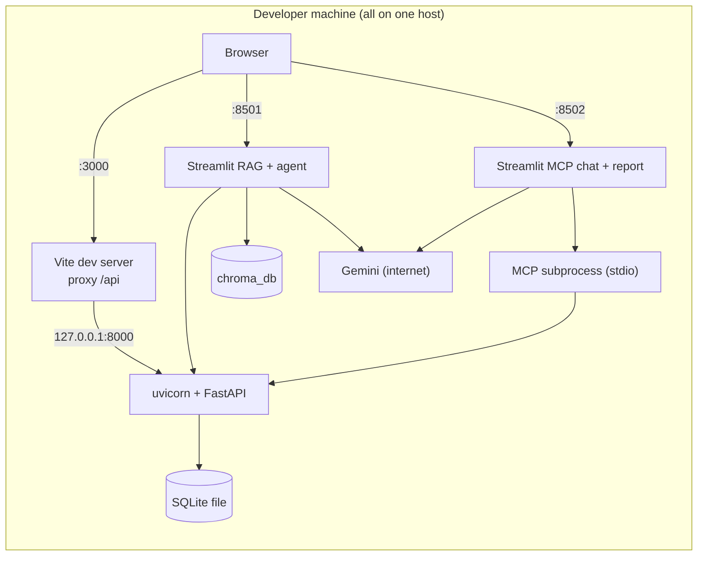
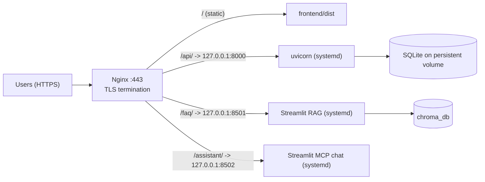

# Production Deployment

Part of the [Finance Tracker documentation library](../Finance%20Tracker.md). **Read this first:** the repository contains **no deployment configuration** — no Dockerfile/docker-compose, no Nginx config, no systemd unit files, no EC2/Terraform/CloudFormation, no CI/CD workflow (`.github/` holds only `copilot-instructions.md` and a prompt file). A search of the repository for `nginx`, `systemd`, `ec2` and `docker` (excluding `node_modules`, `.venv`, `.git`, `dist`) found nothing. The POC specification in `extras/` also does not describe a deployment target.

So this document separates:

* **A. What is implemented and relevant to deployment** (verified in code), and
* **B. A suggested, clearly *unimplemented* production design** (a planning aid, not part of the project).

## A. What is implemented

| Capability | Evidence |
|---|---|
| Backend launcher bound to loopback | `backend/run.py`: `uvicorn.run("app.main:app", host="127.0.0.1", port=int(os.getenv("PORT","8000")), reload=False)` — so it is reachable only from the same host (suitable behind a local reverse proxy; **not** reachable from other machines as-is) |
| Single ASGI process | no `--workers`; SQLite single-writer |
| Health endpoint | `GET /api/v1/health` → `{"status":"ok"}` (usable by a load balancer / monitor) |
| Environment-driven configuration | `SECRET_KEY`, `DATABASE_URL`, `CORS_ORIGINS`, `ACCESS_TOKEN_EXPIRE_MINUTES`, `PORT`, `API_BASE_URL`, … ([Environment_Variables](../09_Data_Flow_and_Reference/Environment_Variables.md)) |
| CORS allow-list | `CORS_ORIGINS` (default `http://localhost:3000`) |
| Structured JSON logs to stdout | structlog (collectable by journald/CloudWatch agents — none configured here) |
| Static frontend build | `npm run build` → `frontend/dist/` (a built copy exists locally); `npm run preview --port 3000` serves it |
| API base URL for the SPA | build-time `VITE_API_BASE_URL` (default relative `/api/v1`) |
| Streamlit apps | `streamlit run … --server.port 8501/8502` (dev style launch) |
| Dev proxy | Vite `server.proxy` for `/api` (development only) |

### Local topology (what actually runs today)



### Known deployment limitations of the current code

| Area | Limitation |
|---|---|
| TLS | none handled by the app |
| Process management | none (no supervisor, no auto-restart) |
| Database | SQLite file, relative default path, no migrations, no backups |
| Scaling | single process / single writer; Streamlit apps hold per-session state in memory |
| Streamlit exposure | apps listen on Streamlit defaults; the SPA links to `http://localhost:8501/8502` unless `VITE_FAQ_URL` / `VITE_ASSISTANT_URL` are set at build time |
| Secrets | `.env` file; see [Security_and_Configuration](Security_and_Configuration.md) (including a repository-state warning) |
| Rate limiting, WAF, monitoring | not implemented |
| `uvicorn` `127.0.0.1` | must be changed (or proxied) for remote access |

---

## B. Suggested production design (NOT implemented — for planning only)

A modest single-host deployment (for example one Linux VM such as an EC2 instance) would match the project's size. Everything below is a *proposal*; none of these files exist in the repository.



Suggested steps (illustrative):

1. Provision a host with Python 3.13.1 and Node; clone the repo; create `.venv` from `requirements.lock`.
2. Create a **production** `.env` outside the repo (or inject variables via the service manager) with a fresh `SECRET_KEY`, absolute `DATABASE_URL`, `CORS_ORIGINS` set to the public origin, and the Gemini key.
3. Build the frontend with `VITE_API_BASE_URL=/api/v1`, `VITE_FAQ_URL`, `VITE_ASSISTANT_URL` pointing at the public paths; publish `dist/`.
4. Run `ai/rag/ingest.py` once.
5. Run backend and Streamlit apps as supervised services (example unit below) behind Nginx ([Reverse_Proxy_and_Static_Hosting](Reverse_Proxy_and_Static_Hosting.md)).
6. Add: HTTPS certificates, firewall rules (only 80/443 public; 8000/8501/8502 loopback), log shipping, DB backups, and consider moving from SQLite to a server database if concurrency grows (would require Alembic migrations).

### Illustrative systemd unit (template, not a repository file)

```ini
# /etc/systemd/system/finance-backend.service   (EXAMPLE ONLY)
[Unit]
Description=Finance Tracker API
After=network.target

[Service]
User=finance
WorkingDirectory=/opt/finance-tracker
EnvironmentFile=/etc/finance-tracker/backend.env      # holds SECRET_KEY, DATABASE_URL, CORS_ORIGINS (not in repo)
ExecStart=/opt/finance-tracker/.venv/bin/python backend/run.py
Restart=on-failure
RestartSec=3

[Install]
WantedBy=multi-user.target
```
Analogous units would run `streamlit run ai/rag/chatbot.py --server.port 8501 --server.address 127.0.0.1` and `streamlit run ai/mcp_server/chat_interface.py --server.port 8502 --server.address 127.0.0.1`. `Restart=on-failure` restarts crashed processes; `EnvironmentFile` keeps secrets out of the unit file.

### Production readiness checklist (gaps to close)

- [ ] TLS + HSTS
- [ ] Rotate/replace the development `SECRET_KEY`; remove any committed secrets from history
- [ ] Absolute `DATABASE_URL`, scheduled backups of the SQLite file (it uses WAL: back up with the SQLite backup API or while quiescent)
- [ ] Login rate limiting / lockout
- [ ] Reverse-proxy WebSocket support for Streamlit
- [ ] Centralised logs and alerting using the existing JSON logs and `/health`
- [ ] CI pipeline running `pytest` (mock tier) and `npm run build`
- [ ] Decide how Streamlit apps authenticate users (today: each user enters credentials into the Streamlit sidebar, which call the API)
