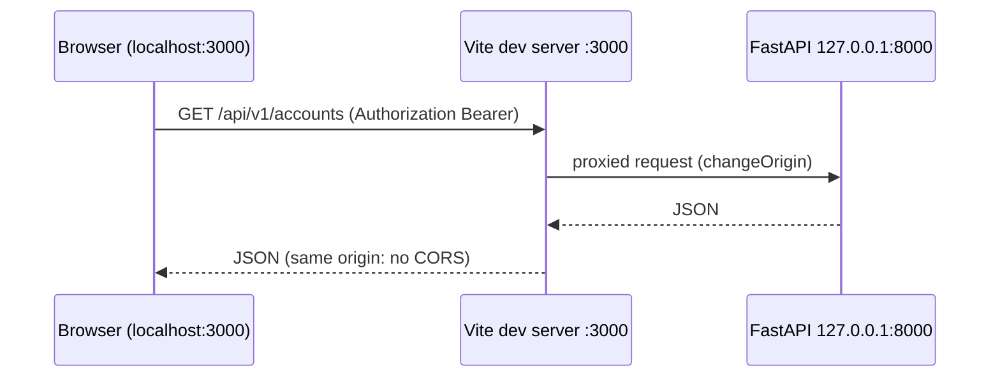

# Reverse Proxy and Static Hosting

Part of the [Finance Tracker documentation library](../Finance%20Tracker.md). **There is no Nginx configuration in the repository** (and no systemd units). The only reverse proxy that exists is **Vite's dev-server proxy**. This file documents that, then gives a clearly-labelled *illustrative* Nginx template for a future deployment. See [Production_Deployment](Production_Deployment.md) for the overall deployment status.

## 1. Implemented: Vite dev proxy (development only)

```js
// frontend/vite.config.js
server: { port: 3000,
  proxy: { '/api': { target: process.env.VITE_BACKEND_URL || 'http://127.0.0.1:8000', changeOrigin: true } } }
```



* The SPA's default API base is the **relative** path `/api/v1` (`services/api.js`), so the browser only talks to port 3000 and no CORS preflight occurs.
* `changeOrigin: true` rewrites the `Host` header to the target.
* Everything not under `/api` is served by Vite (HMR, JSX transform, `index.html` fallback for client-side routes).
* The backend nevertheless enables CORS for `CORS_ORIGINS` (default `http://localhost:3000`), needed only for direct cross-origin calls.
* `npm run preview --port 3000` serves the built `dist/` with Vite's preview server (a smoke-test tool, not a production server). Vite documents that `preview.proxy` defaults to `server.proxy`.

## 2. Static frontend hosting facts you need for any production host

| Requirement | Why |
|---|---|
| Serve `frontend/dist/` (hashed assets under `assets/`, entry `index.html`) | output of `vite build` |
| Rewrite unknown paths to `/index.html` | `BrowserRouter` client-side routes (`/budgets`, `/login`, …) must survive a refresh |
| Route `/api/` to the backend | SPA uses relative `/api/v1` unless built with `VITE_API_BASE_URL` |
| Long-cache hashed assets, no-cache `index.html` | standard SPA practice (assets are content-hashed, e.g. `index-BgiP_-Wx.js`) |
| Build-time URLs | `VITE_FAQ_URL`, `VITE_ASSISTANT_URL`, `VITE_API_BASE_URL` are baked into the bundle at build time |

## 3. Illustrative Nginx template (NOT in the repository)

```nginx
# EXAMPLE ONLY - adapt before use
server {
    listen 443 ssl;
    server_name finance.example.com;
    # ssl_certificate / ssl_certificate_key ...

    root /opt/finance-tracker/frontend/dist;
    index index.html;

    location /api/ {                       # FastAPI (uvicorn bound to 127.0.0.1:8000)
        proxy_pass http://127.0.0.1:8000;
        proxy_set_header Host $host;
        proxy_set_header X-Forwarded-For $proxy_add_x_forwarded_for;
        proxy_set_header X-Forwarded-Proto $scheme;
        proxy_set_header X-Request-ID $request_id;   # the backend honours an incoming x-request-id header
    }

    location / {
        try_files $uri /index.html;        # SPA fallback
    }

    # Streamlit needs WebSocket upgrade; serving under a sub-path also needs --server.baseUrlPath
    location /faq/ {
        proxy_pass http://127.0.0.1:8501/faq/;
        proxy_http_version 1.1;
        proxy_set_header Upgrade $http_upgrade;
        proxy_set_header Connection "upgrade";
        proxy_set_header Host $host;
    }
}
```

Notes grounded in the code:

* `request_context` middleware uses an incoming `x-request-id` header as the log `request_id` when present, so a proxy-generated id correlates proxy and application logs.
* `backend/run.py` passes no proxy options to `uvicorn.run`; uvicorn's defaults (`proxy_headers=True`, trusted forwarded addresses `127.0.0.1`) mean a same-host Nginx's `X-Forwarded-*` headers would be honoured by uvicorn itself. The application's own log lines do not record client IPs.
* If the SPA and API share an origin through the proxy, `CORS_ORIGINS` can stay default/narrow.
* The Assistant page's links must point to the proxied Streamlit URLs (`VITE_FAQ_URL`, `VITE_ASSISTANT_URL` at build time).
* Streamlit: `--server.address 127.0.0.1` keeps it loopback-only; the proxy must allow WebSocket upgrades.

## 4. systemd

No systemd files exist in the repository; see the illustrative unit in [Production_Deployment §B](Production_Deployment.md) and the status note there.
