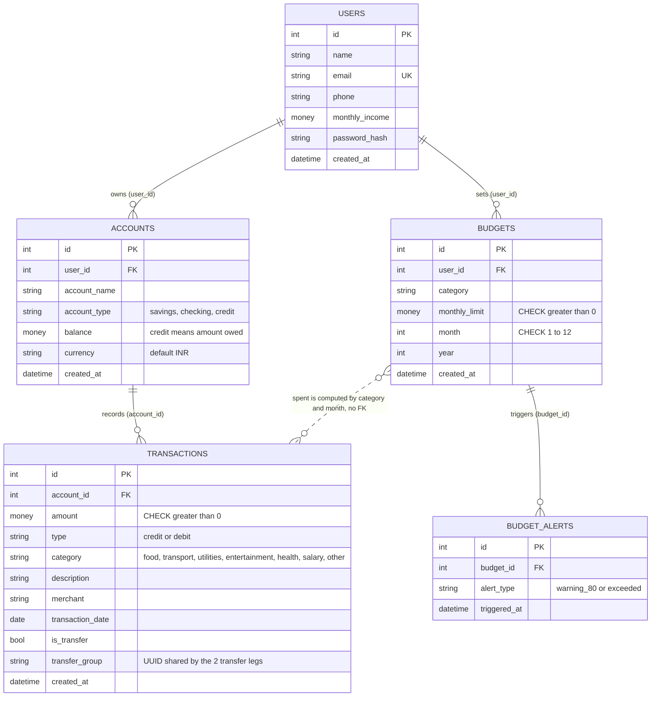

# Database ER Diagram

Part of the [Finance Tracker documentation library](../Finance%20Tracker.md). Derived from the actual models in `backend/app/models/*.py` and the DDL generated from them (see [Database_and_SQLAlchemy](../02_Backend/Database_and_SQLAlchemy.md)). Column details: [Models_and_Schemas](../02_Backend/Models_and_Schemas.md). No columns or relationships have been added beyond the code.

## 1. Entity-relationship diagram



`money` is the custom SQLAlchemy `Money` type: a `Decimal` in Python stored as an integer number of paise (BIGINT) in SQLite.

## 2. Relationships in words

| Relationship | Cardinality | Implemented by | On delete |
|---|---|---|---|
| User → Accounts | 1 : N | `accounts.user_id` FK; `User.accounts` | ORM cascade (no API deletes users) |
| User → Budgets | 1 : N | `budgets.user_id` FK; `User.budgets` | ORM cascade |
| Account → Transactions | 1 : N | `transactions.account_id` FK; `Account.transactions` | **ORM cascade delete-orphan** → deleting an account deletes its transactions |
| Budget → BudgetAlerts | 1 : N | `budget_alerts.budget_id` FK; `Budget.alerts` | **ORM cascade** → deleting a budget deletes its alerts |
| Budget ↔ Transactions | logical only | `spent_in_month(user, category, year, month)` | — |
| Transfer legs | pair | two `transactions` rows with equal `transfer_group`, `is_transfer = 1` | deleting one leg's account leaves the other leg |

Note: **transactions reference accounts, not users**; the owner is found through `transaction.account.user_id`.

## 3. Constraint summary

| Table | Primary key | Unique | Check | Foreign keys |
|---|---|---|---|---|
| users | id | `email` | — | — |
| accounts | id | — | — | `user_id → users.id` |
| transactions | id | — | `amount > 0` | `account_id → accounts.id` |
| budgets | id | `(user_id, category, month, year)` | `month BETWEEN 1 AND 12`; `monthly_limit > 0` | `user_id → users.id` |
| budget_alerts | id | `(budget_id, alert_type)` | — | `budget_id → budgets.id` |

## 4. Typical query shapes

```sql
-- budget "spent" (conceptually; the code uses SQLAlchemy)
SELECT SUM(t.amount) FROM transactions t JOIN accounts a ON a.id = t.account_id
WHERE a.user_id = :uid AND t.type = 'debit' AND t.category = :cat AND t.is_transfer = 0
  AND t.transaction_date >= :first_of_month AND t.transaction_date < :first_of_next_month;
```
(`amount` values are paise in the database.)

## 5. Not in the schema

No `refresh_tokens`, `audit_log`, `categories` table (categories are an enum), `currency` table, `transfers` table (transfers are two flagged transactions), or user-deletion API.
