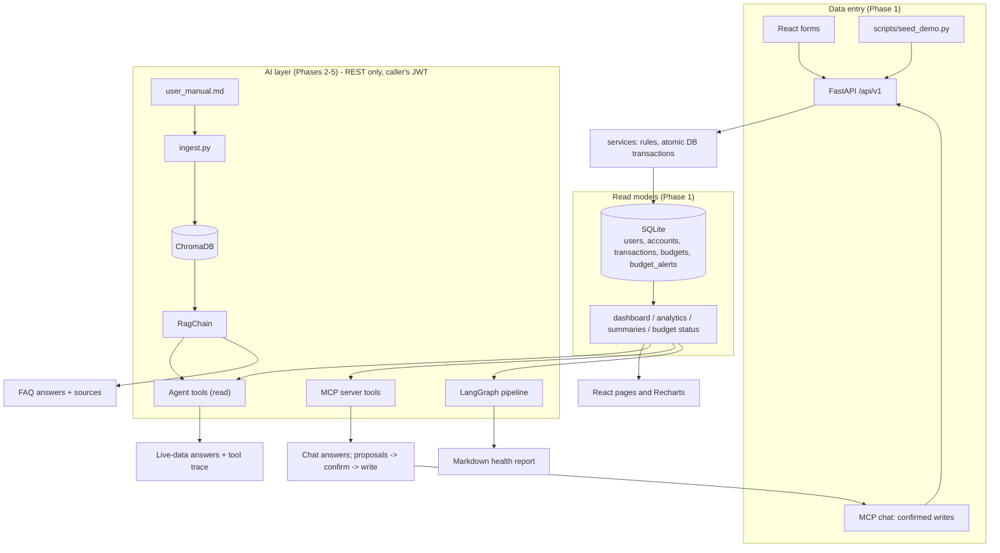
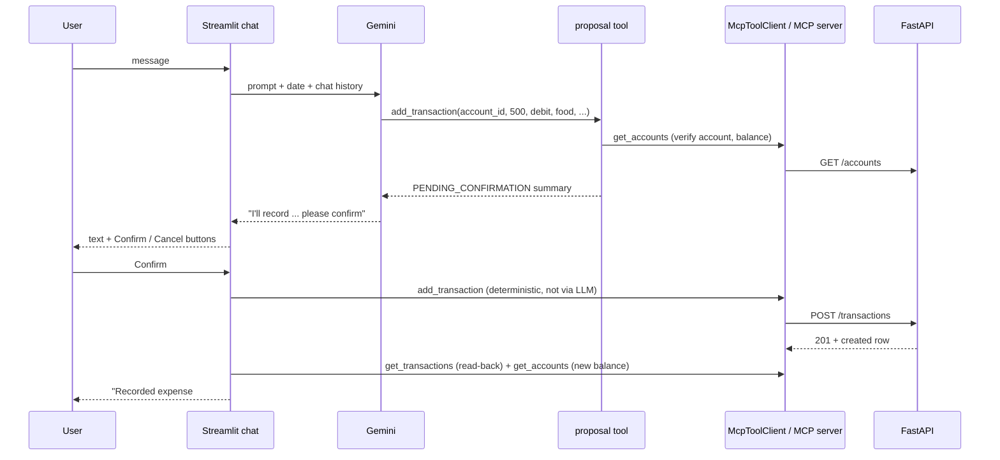
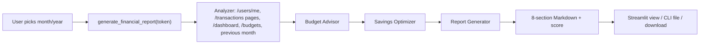

# End-to-End Data Flow

Part of the [Finance Tracker documentation library](../Finance%20Tracker.md). Follows the data from first entry to AI-generated insight, showing how the phases connect. Per-request detail: [Request_Response_Lifecycle](Request_Response_Lifecycle.md).

## 1. One diagram, all phases

The loop closes at the MCP chat: the *only* AI path that can change data does so by calling the same REST endpoints (`POST /transactions`, `POST /budgets`) after a human confirmation, so every AI-created record passes the same validation as one created in the UI.

## 2. Scenario A — a debit crosses a budget threshold

1. User sets a food budget ₹10,000 for June (`POST /budgets` → `budgets` row; `spent=0`, no alerts).
2. User records an expense of ₹8,500 on a savings account (`POST /transactions`):
   * `UPDATE accounts` guarded balance change; `INSERT transactions`;
   * `check_and_create_alerts`: spent 8,500 ≥ 80 % × 10,000 → insert `budget_alerts(warning_80)`;
   * commit.
3. Frontend reloads lists; `GET /budgets` now returns `utilization_percent = 85.0`, `has_alert = true`; `GET /dashboard` returns `budget_alerts_count = 1`; the Budgets page shows an orange bar and a ⚠️ alert; the Dashboard shows the banner "1 budget alert this period".
4. Later, another debit takes spent ≥ 10,000 → `exceeded` alert added (the warning is not duplicated).
5. Phase 3 agent asked "Am I over budget on food?" → `get_budget_status` → `GET /budgets` → text "… OVER BUDGET - alert triggered".
6. Phase 5 report → Budget Advisor lists food under *over budget*, recommends "raise the limit or cut spending", the health score drops.

## 3. Scenario B — "Add a ₹500 grocery expense for today" in the MCP chat

Details: [Confirmation_and_Execution_Flow](../06_MCP/Confirmation_and_Execution_Flow.md).

## 4. Scenario C — "How do I set a budget?" (RAG)

Manual → (offline) chunks + embeddings → ChromaDB; online: question embedding → top-4 chunks → grounded prompt → Gemini → answer + section sources. No financial data involved. Details: [RAG_Architecture](../04_RAG/RAG_Architecture.md).

## 5. Scenario D — Financial health report

Details: [Graph_State_and_Workflow](../07_LangGraph_Multi_Agent/Graph_State_and_Workflow.md).

## 6. Where each datum lives and who may touch it

| Data | Store | Writers | Readers |
|---|---|---|---|
| Users/credentials | `users` | backend (`register`, `PATCH /users/me`) | backend |
| Accounts/balances | `accounts` | backend services only (guarded updates) | React, agent, MCP, report (via REST) |
| Transactions | `transactions` | backend `create_transaction`/`create_transfer` (UI, or MCP after confirmation) | same |
| Budgets/alerts | `budgets`, `budget_alerts` | backend (`create_budget`, alert service) | same |
| Manual embeddings | ChromaDB | `ingest.py` | `RagChain` |
| JWT | browser `localStorage`; Streamlit `session_state`; MCP subprocess env | issued by `/auth/login` | sent as Bearer |
| Chat history / pending action | Streamlit `session_state` | Streamlit | Streamlit / agent prompt |
| Report | in-memory state → Markdown | LangGraph run | UI/CLI |

## 7. Consistency guarantees

* **Single source of truth:** only the backend writes finance data; every consumer reads through REST, so UI, chat, agent and report agree.
* **Atomicity:** balance + transaction + alert rows commit together or not at all.
* **Same definitions everywhere:** the report's totals come from `/dashboard`, so they match the UI (the analyzer explicitly prefers dashboard totals for income/expenses).
* **Eventual freshness:** nothing is cached server-side; the SPA refetches after each mutation; chat/agent fetch on every question.
