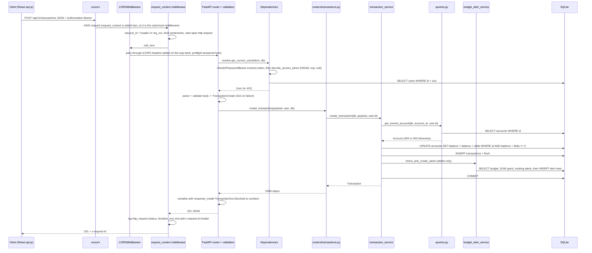

# Request / Response Lifecycle

Part of the [Finance Tracker documentation library](../Finance%20Tracker.md). This traces **one HTTP request** through the real code path, using `POST /api/v1/transactions` (a debit) as the example, and then notes where other endpoints differ. Overview of layers: [Backend_Architecture](../02_Backend/Backend_Architecture.md).

## 1. Sequence



## 2. Stage by stage

| # | Stage | Code | Outcome on failure |
|---|---|---|---|
| 1 | **Request context** | `@app.middleware("http") request_context` (registered after CORS, hence outermost in Starlette's stack) | exceptions logged as `unhandled_exception` and re-raised |
| 2 | **CORS** | `CORSMiddleware(allow_origins=settings.cors_origins, …)` | cross-origin preflight answered; disallowed origins get no CORS headers (browser blocks). Same-origin dev traffic (Vite proxy) is unaffected |
| 3 | **Authentication** | `get_current_user` (`core/deps.py`) | 401 `Not authenticated` / `Could not validate credentials` |
| 4 | **DB session** | `get_db` yields a `SessionLocal()`; closed in `finally` | — |
| 5 | **Body validation** | Pydantic `TransactionCreate` (types, `gt=0`, lengths, enums, validators) | 422 `{"detail":[{loc,msg,type}]}` via custom handler |
| 6 | **Authorization** | `get_owned_account` | 404 / 403 |
| 7 | **Business rules** | salary-credit-only, guarded balance update | 422 / 400 `Insufficient balance` |
| 8 | **Persistence** | `INSERT`, `flush`, alert rows, `commit` | any exception → `rollback()` and re-raise → 500 unless it is an `AppError` |
| 9 | **Serialisation** | `response_model=TransactionOut` (`from_attributes`, `MoneyOut`) | — |
| 10 | **Logging** | `http_request` line with `request_id`, `status_code`, `duration_ms`, `status` | — |

Domain exceptions (`AppError` subclasses) raised in stages 6–8 are converted to `{"detail": "<message>"}` with the exception's `status_code` by the registered handler.

## 3. Response shapes

* **201 Created** `TransactionOut`: `{id, account_id, amount, type, category, description, merchant, transaction_date, is_transfer, transfer_group, created_at}`.
* **Errors:** see [Validation_and_Error_Handling §4](../02_Backend/Validation_and_Error_Handling.md).
* Every response carries `x-request-id`; the same id appears in all log lines for that request (contextvars).

## 4. Variations

| Endpoint kind | Difference |
|---|---|
| `POST /auth/login` | no `get_current_user`; body is a form; returns `Token` |
| `GET` list/dashboard endpoints | no commit; aggregations via `queries.py`; `Depends(get_today)` provides the date |
| `DELETE` endpoints | `204` with empty body (`Response(status_code=204)`), ORM cascades |
| `POST /transfers` | two accounts, two guarded updates, two inserts, one commit |
| Health | no auth, no DB |

## 5. Frontend side of the same request

`TransactionForm` (validation) → `useForm.submit` → `api.createTransaction(body)` → `request('/transactions', {method:'POST', body})` → `fetch` → response → either `data` (page closes modal, reloads lists) or `ApiError(status, describe(detail))` (form banner). See [React_Architecture §5](../03_Frontend/React_Architecture.md).

## 6. Timing and observability

Typical log pair for the request (illustrative):

```json
{"event":"balance_updated","account_id":3,"old_balance":10000.0,"new_balance":7500.0,"request_id":"req_…"}
{"event":"transaction_created","transaction_id":41,"type":"debit","amount":2500.0,"category":"food","request_id":"req_…"}
{"event":"http_request","method":"POST","path":"/api/v1/transactions","status_code":201,"duration_ms":14,"status":"success","request_id":"req_…"}
```
(plus `budget_alert_triggered` at warning level if a threshold was crossed). With `OTEL_CONSOLE=true` spans `http.request`, `auth.validate`, `db.query` are printed.
