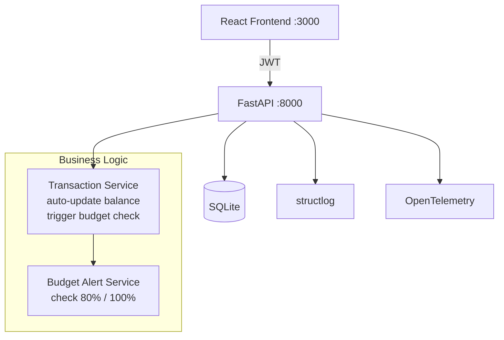

# Phase 1: Full Stack CRUD Application
## POC-02 — Personal Finance Tracker & Analytics

**Phase Weight:** 15% | **Duration:** 5 days | **Test Cases:** 20

---

## 1. Phase Overview

Build a complete personal finance tracking system with REST API, React frontend, and SQLite database. Key features: multi-account management, transaction recording with automatic balance updates, monthly budget setting, budget alerts at 80% and 100% utilization, and a dashboard showing spending by category.

### 5-Day Schedule
| Day | Focus |
|-----|-------|
| Day 1 | Setup, data models (User, Account, Transaction, Budget, BudgetAlert) |
| Day 2 | API endpoints — transactions with auto-balance update, account summary |
| Day 3 | Budget alert logic, dashboard aggregations, unit tests |
| Day 4 | React frontend — transaction list, budget dashboard, add transaction form |
| Day 5 | Second frontend, integration tests, fix failures |

---

## 2. Prerequisites
- Python 3.11+ / .NET 8 / JDK 21
- Node.js 18+ (for React)
- VS Code with GitHub Copilot
- `.env` file configured with `DATABASE_URL`, `SECRET_KEY`

---

## 3. Concepts to Self-Learn
| Concept | Search Term |
|---------|-------------|
| SQLAlchemy relationships | "SQLAlchemy relationships tutorial" |
| Pydantic validators | "Pydantic field validators v2" |
| React useEffect for data fetching | "React useEffect API call tutorial" |
| Chart.js or Recharts in React | "Recharts tutorial React" |

---

## 4. Project Structure (Python)

```
poc-02-finance-tracker/
├── backend/
│   ├── app/
│   │   ├── main.py
│   │   ├── models/
│   │   │   ├── user.py
│   │   │   ├── account.py
│   │   │   ├── transaction.py
│   │   │   ├── budget.py
│   │   │   └── budget_alert.py
│   │   ├── routers/
│   │   │   ├── auth.py
│   │   │   ├── accounts.py
│   │   │   ├── transactions.py
│   │   │   ├── budgets.py
│   │   │   └── dashboard.py
│   │   └── services/
│   │       ├── budget_alert_service.py
│   │       └── transaction_service.py
│   └── tests/
└── frontend/  (React)
```

---

## 5. User Stories

### US-02-P1-01: Create Account
**Priority:** Must Have | **Story Points:** 2

> As a user, I want to create a financial account (savings/checking/credit) so that I can track transactions per account.

**Given** valid account details with name, type, and initial balance, **When** POST `/api/v1/accounts`, **Then** account created with 201, balance stored correctly.
**Given** invalid account_type (not savings/checking/credit), **When** POST attempted, **Then** 422 returned.
**Given** no JWT token, **When** POST attempted, **Then** 401 returned.

**Definition of Done:** Account created, balance stored, type validated

---

### US-02-P1-02: Record Debit Transaction
**Priority:** Must Have | **Story Points:** 5

> As a user, I want to record a debit transaction so that my account balance decreases automatically and my spending is tracked by category.

**Given** valid debit transaction (amount, category, description, merchant, date), **When** POST `/api/v1/transactions`, **Then** transaction created, account balance decreased by amount, 201 returned.
**Given** debit transaction that would make balance negative on a savings account, **When** posted, **Then** 400 returned with "Insufficient balance" message.
**Given** valid transaction, **When** recorded, **Then** budget alert check is triggered (see US-02-P1-05).

**Technical Constraints:** amount must be > 0; category must be valid enum; auto-updates account balance.

---

### US-02-P1-03: Record Credit Transaction
**Priority:** Must Have | **Story Points:** 2

> As a user, I want to record income transactions so that my account balance increases and I can track income sources.

**Given** valid credit transaction (e.g., salary), **When** POST `/api/v1/transactions`, **Then** account balance increases by amount, type="credit" stored.
**Given** same date credit transactions, **When** listed, **Then** all appear in transaction history.

---

### US-02-P1-04: Filter Transactions
**Priority:** Must Have | **Story Points:** 3

> As a user, I want to filter transactions by category, date range, and type so that I can analyze specific spending patterns.

**Given** GET `/api/v1/transactions?account_id=1&category=food&date_from=2026-06-01&date_to=2026-06-30`, **When** called, **Then** only matching transactions returned with pagination.
**Given** no filters, **When** called, **Then** all transactions for the user's accounts returned.
**Given** invalid date format, **When** called, **Then** 422 returned.

---

### US-02-P1-05: Budget Alert at 80% and 100%
**Priority:** Must Have | **Story Points:** 5

> As a user, I want to be alerted when I reach 80% or 100% of my monthly budget for a category so that I can adjust spending.

**Given** a food budget of ₹10,000 for June 2026, **When** total food spending reaches ₹8,000 (80%), **Then** a BudgetAlert record with type=warning_80 is created.
**Given** same budget, **When** total food spending reaches ₹10,000 (100%), **Then** a BudgetAlert record with type=exceeded is created.
**Given** no budget set for a category, **When** transactions are recorded, **Then** no alert generated.

**Technical Constraints:** Alert check runs after every debit transaction recording; same alert type not duplicated (only one warning_80 per budget per month).

---

### US-02-P1-06: Get Account Summary
**Priority:** Must Have | **Story Points:** 3

> As a user, I want to see a summary of an account showing total credits, total debits, spending by category, and monthly trend.

**Given** an account with transactions, **When** GET `/api/v1/accounts/{id}/summary`, **Then** response includes: total_credit, total_debit, balance, spending_by_category (dict), monthly_trend (last 6 months).
**Given** empty account, **When** summary requested, **Then** all values are 0 / empty (not error).

---

### US-02-P1-07: Set Monthly Budget
**Priority:** Must Have | **Story Points:** 2

> As a user, I want to set a spending limit for a category in a specific month so that I can control my spending.

**Given** valid budget data (category, limit, month, year), **When** POST `/api/v1/budgets`, **Then** budget created with 201.
**Given** duplicate budget (same user, category, month, year), **When** POST attempted, **Then** 409 Conflict returned.

---

### US-02-P1-08: Get Budget Status
**Priority:** Must Have | **Story Points:** 2

> As a user, I want to see all my budgets with current spending and remaining amount for the current month.

**Given** GET `/api/v1/budgets`, **When** called, **Then** each budget shows: category, monthly_limit, spent (sum of debit transactions in that category this month), remaining, utilization_percent.
**Given** current month budgets with alerts triggered, **When** listed, **Then** each budget shows has_alert=true if alert exists.

---

### US-02-P1-09: Dashboard Summary
**Priority:** Must Have | **Story Points:** 3

> As a user, I want a dashboard showing total balance across accounts, monthly income, monthly expenses, top spending categories, and savings rate.

**Given** GET `/api/v1/dashboard`, **When** called, **Then** returns: total_balance, monthly_income (current month credits), monthly_expenses (current month debits), savings_rate, top_3_categories, budget_alerts_count.
**Given** no transactions, **When** called, **Then** returns zeroed values (not error).

---

### US-02-P1-10: React Transaction List with Charts
**Priority:** Must Have | **Story Points:** 3

> As a user, I want a React UI showing my transactions in a table with a pie chart of spending by category.

**Given** React app loads, **When** Transactions page visited, **Then** table shows: date, description, category, merchant, amount, type (color-coded: red=debit, green=credit).
**Given** category filter selected, **When** applied, **Then** table and pie chart both update.

---

### US-02-P1-11: React Budget Dashboard
**Priority:** Must Have | **Story Points:** 3

> As a user, I want a React budget dashboard showing each category's budget utilization as a progress bar.

**Given** budgets exist, **When** Budget page loaded, **Then** each budget shown as a progress bar: green (<80%), orange (80-99%), red (>=100%).
**Given** budget exceeded, **When** displayed, **Then** alert icon shown and bar is red.

---

### US-02-P1-12: Second Frontend
**Priority:** Should Have | **Story Points:** 3

> As an associate, I want to implement the same app in my secondary frontend framework.

**Given** same REST API, **When** second frontend loads, **Then** transaction list, add transaction form, and budget dashboard functional.

---

## 6. Architecture Diagram



---

## 7. Key Implementation Details

### Transaction Model with Balance Update

```python
# app/models/transaction.py
from sqlalchemy import Column, Integer, String, Float, DateTime, Enum, ForeignKey, Date
from sqlalchemy.orm import relationship
from sqlalchemy.sql import func
from app.database import Base
import enum

class TransactionType(str, enum.Enum):
    credit = "credit"
    debit = "debit"

class TransactionCategory(str, enum.Enum):
    food = "food"
    transport = "transport"
    utilities = "utilities"
    entertainment = "entertainment"
    health = "health"
    salary = "salary"
    other = "other"

class Transaction(Base):
    __tablename__ = "transactions"
    id = Column(Integer, primary_key=True, index=True)
    account_id = Column(Integer, ForeignKey("accounts.id"), nullable=False)
    amount = Column(Float, nullable=False)
    type = Column(Enum(TransactionType), nullable=False)
    category = Column(Enum(TransactionCategory), nullable=False)
    description = Column(String(500), nullable=False)
    merchant = Column(String(200), nullable=True)
    transaction_date = Column(Date, nullable=False)
    created_at = Column(DateTime(timezone=True), server_default=func.now())
    
    account = relationship("Account", back_populates="transactions")
```

### Transaction Service with Budget Alert Trigger

```python
# app/services/transaction_service.py
import structlog
from sqlalchemy.orm import Session
from app.models.account import Account
from app.models.transaction import Transaction, TransactionType
from app.services.budget_alert_service import check_and_create_alerts

logger = structlog.get_logger()

def create_transaction(db: Session, transaction_data, user_id: int):
    account = db.query(Account).filter(Account.id == transaction_data.account_id).first()
    
    # Create transaction
    transaction = Transaction(**transaction_data.model_dump())
    db.add(transaction)
    
    # Auto-update balance
    if transaction_data.type == TransactionType.debit:
        account.balance -= transaction_data.amount
    else:
        account.balance += transaction_data.amount
    
    db.flush()
    
    # Check budget alerts for debit transactions
    if transaction_data.type == TransactionType.debit:
        check_and_create_alerts(db, user_id, transaction_data.category,
                                transaction_data.transaction_date)
    
    db.commit()
    db.refresh(transaction)
    
    logger.info("transaction_created",
                transaction_id=transaction.id,
                type=transaction_data.type,
                amount=transaction_data.amount,
                category=transaction_data.category,
                poc_id="POC-02", phase=1)
    return transaction
```

### Budget Alert Service

```python
# app/services/budget_alert_service.py
from sqlalchemy.orm import Session
from sqlalchemy import func, and_
from app.models.transaction import Transaction, TransactionType
from app.models.budget import Budget
from app.models.budget_alert import BudgetAlert, AlertType

def check_and_create_alerts(db: Session, user_id: int, category: str, transaction_date):
    month = transaction_date.month
    year = transaction_date.year
    
    budget = db.query(Budget).filter(
        and_(Budget.user_id == user_id, Budget.category == category,
             Budget.month == month, Budget.year == year)
    ).first()
    
    if not budget:
        return
    
    # Calculate total spending for this category this month
    from app.models.account import Account
    user_account_ids = [a.id for a in db.query(Account).filter(Account.user_id == user_id).all()]
    
    total_spent = db.query(func.sum(Transaction.amount)).filter(
        and_(Transaction.account_id.in_(user_account_ids),
             Transaction.category == category,
             Transaction.type == TransactionType.debit,
             func.strftime('%Y', Transaction.transaction_date) == str(year),
             func.strftime('%m', Transaction.transaction_date) == f'{month:02d}')
    ).scalar() or 0
    
    utilization = total_spent / budget.monthly_limit
    
    # Check 80% threshold
    if utilization >= 0.8:
        existing_80 = db.query(BudgetAlert).filter(
            and_(BudgetAlert.budget_id == budget.id,
                 BudgetAlert.alert_type == AlertType.warning_80)
        ).first()
        if not existing_80:
            db.add(BudgetAlert(budget_id=budget.id, alert_type=AlertType.warning_80))
    
    # Check 100% threshold
    if utilization >= 1.0:
        existing_100 = db.query(BudgetAlert).filter(
            and_(BudgetAlert.budget_id == budget.id,
                 BudgetAlert.alert_type == AlertType.exceeded)
        ).first()
        if not existing_100:
            db.add(BudgetAlert(budget_id=budget.id, alert_type=AlertType.exceeded))
    
    db.flush()
```

---

## 8. Logging & Observability Requirements

| Event | Level | Required Fields |
|-------|-------|----------------|
| Transaction created | INFO | transaction_id, type, amount, category, poc_id, phase |
| Balance updated | INFO | account_id, old_balance, new_balance |
| Budget alert triggered | WARN | budget_id, category, alert_type, utilization_percent |
| HTTP request | INFO | method, path, status_code, duration_ms |
| Auth failure | WARN | reason, path |

---

## 9. Test Case Summary

| # | ID | Category | Description |
|---|-----|---------|-------------|
| 1 | TC-02-P1-UNIT-01 | Unit | Create transaction debit updates balance |
| 2 | TC-02-P1-UNIT-02 | Unit | Create transaction credit updates balance |
| 3 | TC-02-P1-UNIT-03 | Unit | Budget alert triggered at 80% |
| 4 | TC-02-P1-UNIT-04 | Unit | Budget alert triggered at 100% |
| 5 | TC-02-P1-UNIT-05 | Unit | Duplicate alert not created |
| 6 | TC-02-P1-UNIT-06 | Unit | Category enum validation |
| 7 | TC-02-P1-UNIT-07 | Unit | Monthly summary calculation correct |
| 8 | TC-02-P1-UNIT-08 | Unit | Savings rate calculation |
| 9 | TC-02-P1-API-01 | API | POST /transactions debit returns 201 |
| 10 | TC-02-P1-API-02 | API | POST /transactions invalid account returns 404 |
| 11 | TC-02-P1-API-03 | API | GET /accounts/{id}/summary returns aggregations |
| 12 | TC-02-P1-API-04 | API | GET /transactions with category filter |
| 13 | TC-02-P1-API-05 | API | POST /budgets success |
| 14 | TC-02-P1-API-06 | API | POST /budgets duplicate returns 409 |
| 15 | TC-02-P1-API-07 | API | GET /budgets returns utilization data |
| 16 | TC-02-P1-API-08 | API | GET /dashboard returns all metrics |
| 17 | TC-02-P1-DB-01 | DB | Transaction persisted with correct fields |
| 18 | TC-02-P1-DB-02 | DB | Account balance updated in DB |
| 19 | TC-02-P1-DB-03 | DB | Budget created in DB |
| 20 | TC-02-P1-DB-04 | DB | Budget alert created in DB at threshold |

---

## 10. Submission Checklist

- [ ] All 10 REST endpoints working with correct status codes
- [ ] Debit transaction automatically decreases account balance
- [ ] Credit transaction automatically increases account balance
- [ ] Budget alert created at 80% utilization (warning_80)
- [ ] Budget alert created at 100% utilization (exceeded)
- [ ] Duplicate alerts not created
- [ ] Dashboard returns savings_rate, top_3_categories
- [ ] React transaction list with category pie chart
- [ ] React budget dashboard with progress bars (color-coded)
- [ ] structlog configured with poc_id=POC-02 and phase=1
- [ ] At least 14 of 20 test cases pass

---

## 11. Common Mistakes & Tips

| Mistake | Fix |
|---------|-----|
| Forgetting to flush before commit | Use `db.flush()` after `db.add()` to get ID before commit |
| Budget alert fires multiple times | Add duplicate check before creating alert |
| Negative balance allowed | Add validation in transaction service |
| Month/year filter not matching SQLite strftime format | Use `%Y` for year, `%m` for month (zero-padded) |
| React pie chart not updating on filter change | Include filter state in useEffect dependency array |
