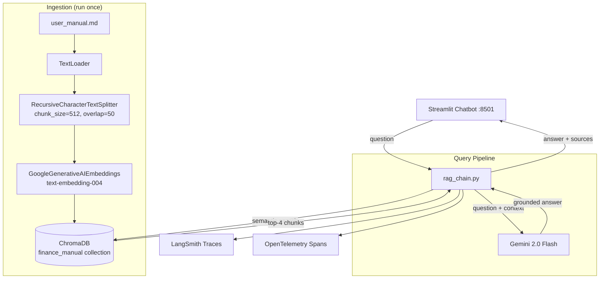

# Phase 2: RAG Application
## POC-02 — Personal Finance Tracker & Analytics

**Phase Weight:** 20% | **Duration:** 5 days | **Test Cases:** 20

---

## 1. Phase Overview

Build a Q&A chatbot trained on the Personal Finance Tracker user manual. Users ask questions like "How do I set a monthly budget?" or "What happens when I exceed my food budget?" and receive accurate answers grounded in the documentation. The chatbot must NOT hallucinate — it should only answer from the provided manual.

### 5-Day Schedule
| Day | Focus |
|-----|-------|
| Day 1 | Understand RAG pipeline, set up LangChain + ChromaDB + Gemini |
| Day 2 | Write `ingest.py` — load, chunk, embed, store the user manual |
| Day 3 | Write `rag_chain.py` — retrieval + generation with LangSmith tracing |
| Day 4 | Build Streamlit chatbot UI with source document display |
| Day 5 | Add OpenTelemetry spans, write and run all 20 tests |

---

## 2. Prerequisites
- Phase 1 backend running (for Phase 3 tool calls)
- Google AI Studio API key (`GOOGLE_API_KEY`)
- LangSmith account (`LANGCHAIN_API_KEY`, `LANGCHAIN_TRACING_V2=true`)
- ChromaDB installed (`pip install chromadb==0.5.3`)

---

## 3. Concepts to Self-Learn
| Concept | Search Term |
|---------|-------------|
| RAG pipeline architecture | "Retrieval Augmented Generation explained" |
| ChromaDB getting started | "ChromaDB persistent client tutorial" |
| LangChain RetrievalQA | "LangChain RetrievalQA chain tutorial" |
| Text chunking strategies | "LangChain text splitter chunk size overlap" |
| LangSmith tracing | "LangSmith tracing LangChain Python" |

---

## 4. Project Structure

```
poc-02-finance-tracker/
├── rag/
│   ├── user_manual.md         ← The RAG corpus (included in this document)
│   ├── ingest.py              ← Load → chunk → embed → store
│   ├── rag_chain.py           ← Retrieve → generate with tracing
│   └── chatbot.py             ← Streamlit UI
├── tests/
│   └── phase2/
│       └── test_rag.py
└── .env
```

---

## 5. User Manual — Personal Finance Tracker (RAG Corpus)

> Save this content as `rag/user_manual.md`. This is the knowledge base for your chatbot.

---

### PERSONAL FINANCE TRACKER — COMPLETE USER MANUAL

**Version 1.0 | Application: POC-02 Finance Tracker**

---

#### Section 1: Introduction

The Personal Finance Tracker is a web application that helps you take control of your money. It allows you to track income and expenses across multiple bank accounts, set monthly spending budgets for different categories, and visualize where your money goes through charts and dashboards.

This application is designed for individuals who want to understand their spending habits, build savings goals, and receive automatic alerts before they overspend on any category.

**Key Benefits:**
- Track all transactions in one place across savings, checking, and credit accounts
- Automatic balance updates when you record income or expenses
- Monthly budget limits per spending category with automatic alert notifications
- Visual dashboard showing income vs. expenses and spending breakdown
- Spending trends over the last 6 months

---

#### Section 2: Account Types

The application supports three types of financial accounts:

**Savings Account:**
A savings account is used to store money and earn interest. In this application, a savings account cannot go into a negative balance. If a debit transaction would cause the balance to drop below zero, the transaction is rejected with an "Insufficient balance" error. Examples: SBI Savings Account, HDFC Savings Account.

**Checking Account (Current Account):**
A checking account is used for everyday transactions — paying bills, making purchases, receiving salary deposits. In this application, checking accounts follow the same rule as savings accounts: the balance cannot go negative. Examples: Business current accounts, salary accounts.

**Credit Account:**
A credit account represents a credit card or line of credit. Unlike savings and checking accounts, a credit account tracks how much you owe. When you spend on a credit card (debit transaction), the balance increases (more debt). When you make a payment (credit transaction), the balance decreases (debt repaid). Credit accounts can carry a positive balance representing money owed.

---

#### Section 3: Creating and Managing Accounts

**To create a new account:**
1. Log in to the application using your email and password
2. Navigate to the Accounts section
3. Click "Add Account"
4. Enter the account name (e.g., "HDFC Savings"), select the account type (savings/checking/credit), and enter the initial balance
5. Click "Create Account"
6. The account is created and appears in your account list

**Account fields:**
- Account Name: A label for your account (e.g., "Primary Savings", "Office Current Account")
- Account Type: savings, checking, or credit
- Initial Balance: The starting balance when you first add the account
- Currency: Default is INR (Indian Rupee)

**Editing an account:**
Currently, you can update the account name but cannot change the account type after creation. To change the type, delete the account and recreate it (note: this will delete all associated transactions).

**Viewing account balance:**
The current balance is shown on the account card. The balance automatically updates every time you record a transaction.

---

#### Section 4: Transaction Categories

Every transaction must be assigned a category. The available categories are:

| Category | Type | Description |
|----------|------|-------------|
| food | Debit | Groceries, restaurants, food delivery (Swiggy, Zomato) |
| transport | Debit | Petrol, auto/taxi, metro, flight tickets |
| utilities | Debit | Electricity, water, gas, internet, phone bills |
| entertainment | Debit | Movies, OTT subscriptions, games, events |
| health | Debit | Doctor visits, medicines, gym membership, health insurance |
| salary | Credit | Monthly salary, bonus, incentive payments |
| other | Both | Any expense or income that does not fit the above categories |

**Important:** You cannot create custom categories. Only these 7 categories are supported. If your expense doesn't fit neatly, use "other".

**Which categories can have budgets?**
You can set monthly budgets for: food, transport, utilities, entertainment, health, and other. The "salary" category is for income tracking only and does not support budget limits.

---

#### Section 5: Recording Transactions

**What is a transaction?**
A transaction is any movement of money — either money coming in (income/credit) or money going out (expense/debit).

**Transaction Types:**
- **Debit (Expense):** Money leaving the account. Examples: buying groceries, paying electricity bill, booking a cab. For debit transactions, the account balance decreases automatically.
- **Credit (Income):** Money entering the account. Examples: receiving salary, freelance payment, interest credited. For credit transactions, the account balance increases automatically.

**Required fields for a transaction:**
- Account: Which account to record this transaction against
- Amount: Must be greater than 0 (INR)
- Type: debit or credit
- Category: One of the 7 supported categories
- Description: A short description of the transaction (up to 500 characters)
- Date: The date the transaction occurred (can be a past date)

**Optional fields:**
- Merchant: The shop/service name (e.g., "Big Bazaar", "BSES Electricity", "Swiggy")

**Balance Update Rules:**
- Debit transaction → Account balance DECREASES by the transaction amount
- Credit transaction → Account balance INCREASES by the transaction amount
- For savings and checking accounts: if a debit would cause balance < 0, the transaction is rejected (HTTP 400)
- Credit accounts do not have this restriction

**Example:**
Account "HDFC Savings" starts with ₹50,000.
- Record debit ₹2,000 (food/grocery) → New balance: ₹48,000
- Record credit ₹80,000 (salary) → New balance: ₹1,28,000
- Record debit ₹1,500 (transport/Ola) → New balance: ₹1,26,500

---

#### Section 6: Filtering and Searching Transactions

The transaction list supports multiple filters:

**Filter by account:** Show only transactions from one specific account.

**Filter by category:** Show only transactions of one category (e.g., show only "food" transactions for the month).

**Filter by date range:** Use date_from and date_to parameters to see transactions between specific dates.

**Filter by type:** Show only debits or only credits.

**Pagination:** The API returns up to 20 transactions per page by default. Use the page parameter to navigate.

**Combining filters:**
You can combine any filters. Example: Show all food debit transactions from June 1 to June 30 for account #2. Invalid date formats (not YYYY-MM-DD) return a 422 Validation Error.

---

#### Section 7: Setting Monthly Budgets

**What is a budget?**
A budget sets a maximum spending limit for a specific category in a specific month. It helps you control how much you spend on, for example, food in June 2026.

**To set a budget:**
1. Navigate to the Budgets section
2. Click "Set Budget"
3. Select a category (food, transport, utilities, entertainment, health, or other)
4. Enter the monthly limit (in INR)
5. Select the month and year
6. Click "Save Budget"

**Budget rules:**
- One budget per user per category per month. You cannot set two food budgets for June 2026.
- If you try to create a duplicate budget (same category + same month + same year), the application returns a 409 Conflict error.
- To change a budget limit, you need to delete the existing budget and create a new one.
- Budgets are tracked by calendar month (not rolling 30 days).

**Example:**
Setting a food budget of ₹10,000 for June 2026 means: if your total food spending in June 2026 reaches ₹10,000, you have used 100% of your budget.

---

#### Section 8: Budget Alerts

**What are budget alerts?**
The system automatically generates alerts when your spending approaches or exceeds the budget limit for a category. There are two alert types:

**Warning Alert (80% threshold):**
When your total spending in a category reaches 80% of the monthly budget, a "warning_80" alert is automatically created. Example: Food budget = ₹10,000. When food spending reaches ₹8,000, a warning alert is triggered.

**Exceeded Alert (100% threshold):**
When your total spending reaches or exceeds 100% of the monthly budget, an "exceeded" alert is created. Example: Food budget = ₹10,000. When food spending reaches ₹10,000 or more, the budget exceeded alert fires.

**Alert deduplication:**
The system creates each alert type only ONCE per budget per month. If you already have a warning_80 alert for food in June 2026, recording another food transaction will NOT create a second warning_80 alert. The same applies to the exceeded alert.

**When do alerts trigger?**
Alerts are checked automatically every time you record a DEBIT transaction. Credit transactions do not trigger budget alerts.

**What if I have no budget for a category?**
If you haven't set a budget for a category (e.g., no entertainment budget for June), recording entertainment transactions will not generate any alerts.

**Viewing alerts:**
The Budget Dashboard shows each category's progress bar with its current spending and alert status. An alert icon appears next to categories that have triggered alerts.

---

#### Section 9: Dashboard Overview

The main dashboard gives you a financial snapshot for the current month.

**Dashboard metrics:**
- **Total Balance:** Sum of balances across all your accounts
- **Monthly Income:** Total credit transactions for the current month
- **Monthly Expenses:** Total debit transactions for the current month
- **Savings Rate:** Calculated as (Monthly Income - Monthly Expenses) / Monthly Income × 100. Expressed as a percentage.
- **Top 3 Categories:** The three categories with highest spending this month
- **Budget Alerts Count:** Number of active budget alerts

**Example Dashboard:**
If your salary this month is ₹80,000 and you've spent ₹55,000 total:
- Monthly Income: ₹80,000
- Monthly Expenses: ₹55,000
- Savings Rate: (80,000 - 55,000) / 80,000 × 100 = 31.25%

**If no transactions exist:**
The dashboard shows 0 for all numeric values — it does not return an error for empty data.

---

#### Section 10: Account Summary

The account summary endpoint provides a detailed breakdown for a single account.

**Summary contents:**
- **total_credit:** Total amount of all credit transactions in this account (all time)
- **total_debit:** Total amount of all debit transactions in this account (all time)
- **balance:** Current balance
- **spending_by_category:** A dictionary showing total spending per category (e.g., {"food": 12500, "transport": 4200})
- **monthly_trend:** Spending totals for each of the last 6 months (useful for charts)

**Empty account:**
For an account with no transactions, all values are 0 and spending_by_category is an empty dictionary. This is not an error.

---

#### Section 11: Savings Rate and Financial Health

**Understanding Savings Rate:**
Savings Rate = (Income - Expenses) / Income × 100

- Above 30%: Excellent — you are building wealth effectively
- 20–30%: Good — following the 50/30/20 rule
- 10–20%: Moderate — there is room to optimize
- Below 10%: Low — review discretionary spending

**The 50/30/20 Rule:**
A popular budgeting framework:
- 50% of income goes to needs (rent, utilities, groceries)
- 30% to wants (dining out, entertainment, travel)
- 20% to savings and debt repayment

**Zero-Based Budgeting:**
Assign every rupee of income to a category before the month begins. Total budgeted = Total income. This application supports this by allowing you to set budgets across all spending categories.

---

#### Section 12: Frequently Asked Questions

**Q1: What account types are supported?**
The application supports three account types: savings, checking, and credit. You select the type when creating the account.

**Q2: Can I have multiple accounts?**
Yes. You can create as many accounts as you need — for example, one for your HDFC savings account, one for your SBI current account, and one for your ICICI credit card.

**Q3: What categories are available for transactions?**
The seven supported categories are: food, transport, utilities, entertainment, health, salary, and other. These cannot be customized.

**Q4: How do I set a food budget for June?**
Navigate to Budgets → Set Budget → Select category "food" → Enter your monthly limit → Select month "June" and year "2026" → Save. You can only have one food budget per month.

**Q5: What happens when I exceed my budget?**
When your spending reaches 80% of the budget limit, a warning alert is created. When it reaches 100%, a budget exceeded alert is created. These appear in the Budget Dashboard as colored progress bars (orange at 80%, red at 100%).

**Q6: Will the system alert me again if I keep spending after exceeding the budget?**
No. Each alert type (warning_80 and exceeded) is created only once per budget per month. You will not receive repeated alerts.

**Q7: Can I set a budget for the "salary" category?**
No. The salary category is for tracking income sources only. Budget limits are only applicable to spending categories: food, transport, utilities, entertainment, health, and other.

**Q8: How is the savings rate calculated?**
Savings Rate = (Total Monthly Credits - Total Monthly Debits) / Total Monthly Credits × 100. If your total income is ₹0 for the month, the savings rate is shown as 0% to avoid division by zero.

**Q9: What happens if a debit transaction would make my savings account balance negative?**
The transaction is rejected with a 400 Bad Request error and the message "Insufficient balance". The account balance is not changed. This rule applies to savings and checking accounts.

**Q10: Does the credit card (credit account) type have the same negative balance restriction?**
No. Credit accounts do not have the negative balance restriction, since a credit card balance represents money owed and can legitimately increase through spending.

**Q11: How does the transaction date work?**
You specify the transaction date when recording a transaction. This can be a past date (e.g., you forgot to enter a grocery bill from last week). The date you set affects which month's budget is checked for alerts.

**Q12: Can I delete a transaction?**
Currently, transactions cannot be deleted once recorded. This is to maintain an accurate audit trail of your financial history.

**Q13: Can I edit a transaction?**
No. Transactions are immutable once saved. If you made a mistake, contact your system administrator.

**Q14: What is the difference between a debit and credit transaction?**
A debit transaction is an expense — money leaving your account (buying groceries, paying a bill). A credit transaction is income — money entering your account (receiving salary, a refund). The terms reflect the effect on your bank balance, not the payment method.

**Q15: How many months of data does the monthly trend show?**
The account summary shows the last 6 months of spending trends. For example, if you request the summary in June 2026, you'll see monthly totals from January to June 2026.

**Q16: What does the "top 3 categories" in the dashboard mean?**
These are the three expense categories (debits) with the highest total spending in the current calendar month. For example, if your top 3 are food (₹8,000), transport (₹4,500), and utilities (₹3,200), those three appear in the dashboard.

**Q17: Can I see last month's transactions?**
Yes. Use the date filter with date_from and date_to parameters. For example, to see May 2026 transactions, set date_from=2026-05-01 and date_to=2026-05-31.

**Q18: Why do I see a 409 error when setting a budget?**
A 409 Conflict error means a budget already exists for that category in that month and year for your account. You can only have one budget per category per month. Delete the existing budget first if you need to change the limit.

**Q19: What is the merchant field on a transaction?**
The merchant field is optional. It records where the transaction took place — for example, "BigBazaar", "Swiggy", "BSES Electricity". It helps you analyze spending at specific vendors but is not required.

**Q20: How do I view my spending by category?**
Go to the account summary for any account (GET /api/v1/accounts/{id}/summary). The spending_by_category field shows a breakdown of total spending per category. The React frontend also shows this as a pie chart on the Transactions page.

**Q21: What happens if I don't have any budgets set?**
You can still record transactions and view your spending. However, no budget alerts will be generated since there are no budget limits to compare against. The budget dashboard will be empty.

**Q22: How do I see which budgets have been exceeded?**
Go to the Budget Dashboard page. Each budget is shown as a progress bar — green means under 80%, orange means 80-99% utilized, and red means 100% or more. An alert icon appears next to budgets that have triggered alerts.

**Q23: Can two people share the same account?**
No. Each account belongs to a single user. If two family members want to track shared expenses, each person should log in with their own account.

**Q24: Is there a mobile app?**
Currently, the application is available as a web application only (React frontend). There is no dedicated mobile app.

**Q25: What currency does the application use?**
The application uses Indian Rupees (INR) as the default currency. All amounts are stored and displayed in INR.

---

#### Section 13: Troubleshooting

**Problem: Transaction rejected with "Insufficient balance"**
Cause: You are trying to record a debit transaction that would make a savings or checking account balance go negative.
Solution: Either reduce the transaction amount, record a credit transaction first to increase the balance, or use a credit account for this transaction.

**Problem: Budget creation fails with 409 Conflict**
Cause: A budget already exists for that category and month.
Solution: Check your existing budgets. If you want to change the limit, delete the old budget first, then create a new one.

**Problem: No budget alerts despite exceeding the limit**
Cause 1: You may not have a budget set for that category.
Cause 2: The alert may already exist (alerts are not duplicated).
Solution: Check your budget list to confirm a budget exists. Check the BudgetAlert records to see if an alert was already created.

**Problem: Date filter returns no results**
Cause: The date format may be incorrect. The API expects YYYY-MM-DD format.
Solution: Use dates in YYYY-MM-DD format (e.g., 2026-06-01, not 01/06/2026).

**Problem: Dashboard shows 0 for savings rate**
Cause: There are no credit (income) transactions recorded for the current month.
Solution: Record your salary or other income transactions first. The savings rate requires income data to calculate.

**Problem: Pie chart not updating after filter change**
Cause: This is a known React frontend issue where the chart doesn't re-render when filter state changes.
Solution: Ensure the filter state variable is included in the useEffect dependency array in the React component.

---

#### Section 14: Glossary

| Term | Definition |
|------|-----------|
| Account | A financial account linked to your user profile (savings, checking, or credit) |
| Transaction | A record of money moving in (credit) or out (debit) of an account |
| Debit | A transaction where money leaves the account (expense) |
| Credit | A transaction where money enters the account (income) |
| Category | Classification of a transaction: food, transport, utilities, entertainment, health, salary, other |
| Budget | A monthly spending limit set for a specific category |
| Budget Alert | An automatic notification created when spending reaches 80% or 100% of a budget |
| Balance | The current amount of money in an account |
| Savings Rate | Percentage of income saved: (income - expenses) / income × 100 |
| Monthly Trend | Spending totals for each of the last 6 months for an account |
| Dashboard | The main summary page showing total balance, income, expenses, and top categories |
| Utilization | How much of a budget has been used: (spent / limit) × 100 |
| warning_80 | An alert type created when budget utilization reaches 80% |
| exceeded | An alert type created when budget utilization reaches 100% or more |

---

#### Section 15: Security and Authentication

**Login:**
The application uses JWT (JSON Web Token) authentication. You must log in with your email and password to receive a token. All API requests must include this token in the Authorization header.

**Token expiry:**
JWT tokens expire after 24 hours. After expiry, log in again to get a new token.

**Unauthorized access:**
Any API request without a valid token returns a 401 Unauthorized error. Any request with a valid token but attempting to access another user's data returns a 403 Forbidden error.

**Password security:**
Passwords are hashed using bcrypt before storage. Plain text passwords are never stored.

---

*End of User Manual*

---

## 6. User Stories

### US-02-P2-01: Finance Q&A Chatbot
**Priority:** Must Have | **Story Points:** 5

> As a user, I want to ask questions about how the finance tracker works and get accurate answers based on the user manual.

**Given** the user manual is ingested into ChromaDB, **When** user asks "How do I set a monthly budget?", **Then** chatbot answers with correct steps from Section 7.
**Given** user asks about budget alerts, **When** response generated, **Then** answer mentions 80% warning and 100% exceeded thresholds.
**Given** out-of-scope question (e.g., "What is the stock market?"), **When** asked, **Then** chatbot says it doesn't have information about that topic.

---

### US-02-P2-02: Source Document Display
**Priority:** Must Have | **Story Points:** 3

> As a user, I want to see which sections of the manual the answer came from so I can verify the information.

**Given** a relevant question asked, **When** response returned, **Then** source document sections displayed below the answer.
**Given** no relevant content found, **When** asked, **Then** chatbot indicates no relevant information found.

---

### US-02-P2-03: Manual Ingestion Pipeline
**Priority:** Must Have | **Story Points:** 3

> As a developer, I want the user manual to be automatically chunked and stored in ChromaDB so the chatbot can retrieve relevant sections.

**Given** `ingest.py` is run, **When** complete, **Then** user_manual.md is loaded, chunked into pieces of ≤600 characters, embedded using Gemini embeddings, and stored in ChromaDB.
**Given** ChromaDB already has data, **When** ingest runs again, **Then** collection is reset (no duplicate chunks).

---

### US-02-P2-04: Conversation History
**Priority:** Should Have | **Story Points:** 2

> As a user, I want my chat history to persist within a session so I can ask follow-up questions.

**Given** user has asked 3 questions, **When** session is active, **Then** all previous questions and answers visible in the chat interface.

---

### US-02-P2-05: LangSmith Tracing
**Priority:** Must Have | **Story Points:** 2

> As a developer, I want every chatbot query traced in LangSmith so I can debug retrieval quality.

**Given** LANGCHAIN_TRACING_V2=true is set, **When** a question is asked, **Then** a trace appears in LangSmith project "AI-Readiness-POC-02-P2" with retrieval and generation spans.

---

## 7. Architecture Diagram



---

## 8. Implementation Guide

### Step 1: Create the `.env` file

```bash
GOOGLE_API_KEY=your_google_ai_studio_key
LANGCHAIN_API_KEY=your_langsmith_key
LANGCHAIN_TRACING_V2=true
LANGCHAIN_PROJECT=AI-Readiness-POC-02-P2
```

### Step 2: Install dependencies

```bash
pip install langchain==0.2.6 langchain-google-genai==1.0.6 chromadb==0.5.3 \
            langsmith==0.1.77 streamlit==1.36.0 opentelemetry-sdk==1.24.0 \
            opentelemetry-exporter-otlp-proto-grpc==1.24.0 python-dotenv==1.0.1
```

### Step 3: Write `rag/ingest.py`

```python
# rag/ingest.py
import os
from dotenv import load_dotenv
from langchain_community.document_loaders import TextLoader
from langchain.text_splitter import RecursiveCharacterTextSplitter
from langchain_google_genai import GoogleGenerativeAIEmbeddings
from langchain_community.vectorstores import Chroma
from opentelemetry import trace
from opentelemetry.sdk.trace import TracerProvider
from opentelemetry.sdk.trace.export import ConsoleSpanExporter, SimpleSpanProcessor

load_dotenv()

provider = TracerProvider()
provider.add_span_processor(SimpleSpanProcessor(ConsoleSpanExporter()))
trace.set_tracer_provider(provider)
tracer = trace.get_tracer("poc-02-rag")

MANUAL_PATH = os.path.join(os.path.dirname(__file__), "user_manual.md")
CHROMA_DIR = os.path.join(os.path.dirname(__file__), "..", "chroma_db")
COLLECTION_NAME = "finance_manual"

def ingest_manual():
    # Load
    with tracer.start_as_current_span("rag.document_load") as span:
        loader = TextLoader(MANUAL_PATH, encoding="utf-8")
        documents = loader.load()
        span.set_attribute("document_count", len(documents))
        span.set_attribute("poc_id", "POC-02")
        print(f"[ingest] Loaded {len(documents)} document(s)")

    # Chunk
    with tracer.start_as_current_span("rag.chunk") as span:
        splitter = RecursiveCharacterTextSplitter(
            chunk_size=512,
            chunk_overlap=50,
            separators=["\n\n", "\n", ".", " "]
        )
        chunks = splitter.split_documents(documents)
        span.set_attribute("chunk_count", len(chunks))
        span.set_attribute("chunk_size", 512)
        print(f"[ingest] Created {len(chunks)} chunks")

    # Embed + Store
    with tracer.start_as_current_span("rag.embed") as span:
        embeddings = GoogleGenerativeAIEmbeddings(
            model="models/text-embedding-004",
            google_api_key=os.getenv("GOOGLE_API_KEY")
        )
        
        # Reset collection if exists
        import chromadb
        client = chromadb.PersistentClient(path=CHROMA_DIR)
        try:
            client.delete_collection(COLLECTION_NAME)
            print(f"[ingest] Deleted existing collection: {COLLECTION_NAME}")
        except Exception:
            pass
        
        vectorstore = Chroma.from_documents(
            documents=chunks,
            embedding=embeddings,
            persist_directory=CHROMA_DIR,
            collection_name=COLLECTION_NAME
        )
        span.set_attribute("vectors_stored", len(chunks))
        print(f"[ingest] Stored {len(chunks)} vectors in ChromaDB at {CHROMA_DIR}")

    return len(chunks)

if __name__ == "__main__":
    count = ingest_manual()
    print(f"[ingest] Done. {count} chunks stored.")
```

### Step 4: Write `rag/rag_chain.py`

```python
# rag/rag_chain.py
import os
import structlog
from dotenv import load_dotenv
from langchain_google_genai import GoogleGenerativeAIEmbeddings, ChatGoogleGenerativeAI
from langchain_community.vectorstores import Chroma
from langchain.chains import RetrievalQA
from langchain.prompts import PromptTemplate
from langsmith import traceable
from opentelemetry import trace

load_dotenv()

logger = structlog.get_logger()
tracer = trace.get_tracer("poc-02-rag")

CHROMA_DIR = os.path.join(os.path.dirname(__file__), "..", "chroma_db")
COLLECTION_NAME = "finance_manual"

RAG_PROMPT_TEMPLATE = """You are a helpful assistant for the Personal Finance Tracker application.
Answer the user's question using ONLY the information provided in the context below.
If the context does not contain enough information to answer the question, say:
"I don't have information about that in the Finance Tracker user manual."

Do NOT make up information. Do NOT answer questions about topics outside the Finance Tracker application.

Context:
{context}

Question: {question}

Answer:"""

def build_rag_chain():
    embeddings = GoogleGenerativeAIEmbeddings(
        model="models/text-embedding-004",
        google_api_key=os.getenv("GOOGLE_API_KEY")
    )
    
    vectorstore = Chroma(
        persist_directory=CHROMA_DIR,
        embedding_function=embeddings,
        collection_name=COLLECTION_NAME
    )
    
    retriever = vectorstore.as_retriever(search_kwargs={"k": 4})
    
    llm = ChatGoogleGenerativeAI(
        model="gemini-2.0-flash",
        google_api_key=os.getenv("GOOGLE_API_KEY"),
        temperature=0.1
    )
    
    prompt = PromptTemplate(
        template=RAG_PROMPT_TEMPLATE,
        input_variables=["context", "question"]
    )
    
    chain = RetrievalQA.from_chain_type(
        llm=llm,
        chain_type="stuff",
        retriever=retriever,
        return_source_documents=True,
        chain_type_kwargs={"prompt": prompt}
    )
    
    return chain

@traceable(name="finance_rag_query", project_name="AI-Readiness-POC-02-P2")
def ask_question(question: str, chain) -> dict:
    with tracer.start_as_current_span("rag.retrieve") as span:
        span.set_attribute("question", question[:100])
        span.set_attribute("poc_id", "POC-02")
        span.set_attribute("phase", 2)
    
    with tracer.start_as_current_span("rag.generate") as span:
        result = chain.invoke({"query": question})
        answer = result["result"]
        sources = result.get("source_documents", [])
        
        span.set_attribute("answer_length", len(answer))
        span.set_attribute("source_count", len(sources))
    
    logger.info("rag_query_completed",
                question=question[:80],
                answer_length=len(answer),
                source_count=len(sources),
                poc_id="POC-02",
                phase=2)
    
    return {
        "answer": answer,
        "sources": [doc.page_content[:200] for doc in sources]
    }
```

### Step 5: Write `rag/chatbot.py`

```python
# rag/chatbot.py
import streamlit as st
import os
import sys
sys.path.append(os.path.join(os.path.dirname(__file__), ".."))

from rag.rag_chain import build_rag_chain, ask_question

st.set_page_config(page_title="Finance Tracker Assistant", page_icon="💰")
st.title("💰 Finance Tracker Assistant")
st.caption("Ask me anything about the Personal Finance Tracker application")

# Initialize session state
if "messages" not in st.session_state:
    st.session_state.messages = []
if "chain" not in st.session_state:
    with st.spinner("Loading knowledge base..."):
        st.session_state.chain = build_rag_chain()

# Display chat history
for msg in st.session_state.messages:
    with st.chat_message(msg["role"]):
        st.markdown(msg["content"])
        if msg.get("sources"):
            with st.expander("📚 Sources"):
                for i, src in enumerate(msg["sources"], 1):
                    st.text(f"Source {i}: {src[:150]}...")

# Sample questions
with st.sidebar:
    st.header("💡 Try these questions")
    sample_questions = [
        "How do I set a monthly budget?",
        "What account types are supported?",
        "What happens when I exceed my budget?",
        "How is the savings rate calculated?",
        "What transaction categories are available?",
        "Can I have multiple accounts?",
    ]
    for q in sample_questions:
        if st.button(q, key=q):
            st.session_state.pending_question = q

# Handle sidebar button clicks
if "pending_question" in st.session_state:
    question = st.session_state.pending_question
    del st.session_state.pending_question
    st.session_state.messages.append({"role": "user", "content": question})
    
    with st.chat_message("assistant"):
        with st.spinner("Searching the manual..."):
            result = ask_question(question, st.session_state.chain)
        st.markdown(result["answer"])
        if result["sources"]:
            with st.expander("📚 Sources"):
                for i, src in enumerate(result["sources"], 1):
                    st.text(f"Source {i}: {src[:150]}...")
    
    st.session_state.messages.append({
        "role": "assistant",
        "content": result["answer"],
        "sources": result["sources"]
    })
    st.rerun()

# Chat input
if question := st.chat_input("Ask about the Finance Tracker..."):
    st.session_state.messages.append({"role": "user", "content": question})
    with st.chat_message("user"):
        st.markdown(question)
    
    with st.chat_message("assistant"):
        with st.spinner("Searching the manual..."):
            result = ask_question(question, st.session_state.chain)
        st.markdown(result["answer"])
        if result["sources"]:
            with st.expander("📚 Sources"):
                for i, src in enumerate(result["sources"], 1):
                    st.text(f"Source {i}: {src[:150]}...")
    
    st.session_state.messages.append({
        "role": "assistant",
        "content": result["answer"],
        "sources": result["sources"]
    })
```

---

## 9. Logging & Observability Requirements

| Event | Level | Required Fields |
|-------|-------|----------------|
| Manual ingested | INFO | chunk_count, collection_name, poc_id, phase |
| RAG query completed | INFO | question (truncated), answer_length, source_count, poc_id, phase |
| Retrieval empty | WARN | question, poc_id, phase |
| LLM call failed | ERROR | error_type, question, poc_id, phase |

**OTel spans required:**
- `rag.document_load` — attributes: document_count
- `rag.chunk` — attributes: chunk_count, chunk_size
- `rag.embed` — attributes: vectors_stored
- `rag.retrieve` — attributes: question (truncated to 100 chars)
- `rag.generate` — attributes: answer_length, source_count

---

## 10. Test Case Summary

| # | ID | Category | Description |
|---|-----|---------|-------------|
| 1 | TC-02-P2-ING-01 | Ingestion | User manual loads successfully |
| 2 | TC-02-P2-ING-02 | Ingestion | Chunks are ≤600 characters each |
| 3 | TC-02-P2-ING-03 | Ingestion | At least 20 chunks created |
| 4 | TC-02-P2-ING-04 | Ingestion | ChromaDB stores chunks correctly |
| 5 | TC-02-P2-RET-01 | Retrieval | Budget question returns budget content |
| 6 | TC-02-P2-RET-02 | Retrieval | Top-k=4 returns exactly 4 documents |
| 7 | TC-02-P2-RET-03 | Retrieval | Irrelevant query has low relevance |
| 8 | TC-02-P2-RET-04 | Retrieval | Account types query retrieves correct section |
| 9 | TC-02-P2-RET-05 | Retrieval | Empty query handled gracefully |
| 10 | TC-02-P2-RET-06 | Retrieval | Retrieval latency under 5 seconds |
| 11 | TC-02-P2-GEN-01 | Generation | Budget alert answer mentions 80% threshold |
| 12 | TC-02-P2-GEN-02 | Generation | Account types answer lists all 3 types |
| 13 | TC-02-P2-GEN-03 | Generation | Savings rate formula answer is correct |
| 14 | TC-02-P2-GEN-04 | Generation | Out-of-scope question declined gracefully |
| 15 | TC-02-P2-GEN-05 | Generation | Answer is a non-empty string |
| 16 | TC-02-P2-GEN-06 | Generation | Categories answer lists all 7 categories |
| 17 | TC-02-P2-OBS-01 | Observability | LangSmith trace created for query |
| 18 | TC-02-P2-OBS-02 | Observability | OTel spans present in output |
| 19 | TC-02-P2-OBS-03 | Observability | Structured log fields correct |
| 20 | TC-02-P2-OBS-04 | Observability | Source documents returned with answer |

---

## 11. Submission Checklist

- [ ] `rag/user_manual.md` created with all 15 sections
- [ ] `ingest.py` runs without errors and stores chunks in ChromaDB
- [ ] ChromaDB collection named `finance_manual` exists with >20 chunks
- [ ] `rag_chain.py` uses Gemini 2.0 Flash and returns source documents
- [ ] Chatbot answers "How do I set a monthly budget?" with correct steps
- [ ] Chatbot declines out-of-scope questions gracefully
- [ ] Streamlit UI shows chat history and source documents
- [ ] LangSmith project `AI-Readiness-POC-02-P2` has traces
- [ ] OTel spans `rag.document_load`, `rag.chunk`, `rag.embed`, `rag.retrieve`, `rag.generate` present
- [ ] At least 14 of 20 test cases pass

---

## 12. Common Mistakes & Tips

| Mistake | Fix |
|---------|-----|
| GOOGLE_API_KEY not loaded | Call `load_dotenv()` before importing LangChain modules |
| ChromaDB duplicate data | Delete the collection before re-ingesting (`client.delete_collection()`) |
| Answer hallucinating beyond manual | Tighten the prompt: add "ONLY use the provided context" |
| Chunk size too large | Keep chunk_size=512 so each chunk covers one topic section |
| LangSmith traces not appearing | Verify `LANGCHAIN_TRACING_V2=true` is set before chain creation |
| Source documents not returned | Use `return_source_documents=True` in `RetrievalQA.from_chain_type()` |
