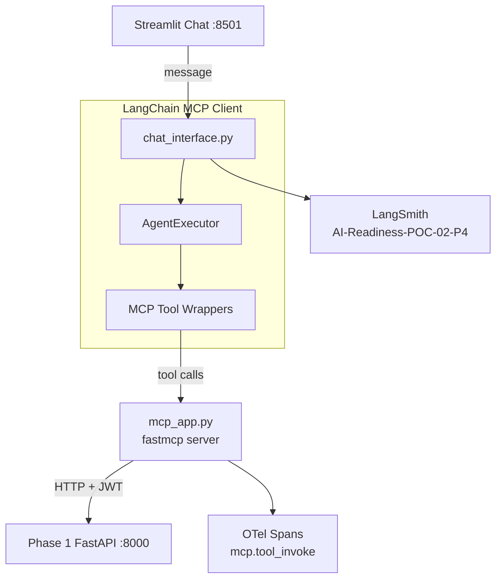

# Phase 4: MCP Server & Chat Interface
## POC-02 — Personal Finance Tracker & Analytics

**Phase Weight:** 25% | **Duration:** 5 days | **Test Cases:** 25

---

## 1. Phase Overview

Convert the Phase 1 REST API into an MCP (Model Context Protocol) server using `fastmcp`, then build a conversational Streamlit chat interface. Users can type natural language commands like "Add a ₹500 grocery expense for today" or "What is my savings rate this month?" and the assistant records transactions or fetches data through the MCP tools.

### 5-Day Schedule
| Day | Focus |
|-----|-------|
| Day 1 | Understand MCP protocol, fastmcp library, tool schemas |
| Day 2 | Write `mcp_server/mcp_app.py` — 6 MCP tools wrapping Phase 1 endpoints |
| Day 3 | Write `mcp_server/chat_interface.py` — LangChain MCP client + agent |
| Day 4 | Build Streamlit UI with conversation history and tool call visualization |
| Day 5 | Add full observability, run all 25 test cases |

---

## 2. Prerequisites
- Phase 1 API running on `http://localhost:8000`
- `fastmcp==0.4.1` installed
- `API_JWT_TOKEN` in `.env`
- LangSmith project `AI-Readiness-POC-02-P4`

---

## 3. Concepts to Self-Learn
| Concept | Search Term |
|---------|-------------|
| MCP protocol basics | "Model Context Protocol MCP explained" |
| fastmcp Python tutorial | "fastmcp Python MCP server tutorial" |
| LangChain MCP integration | "LangChain tools from MCP server" |
| Streamlit chat components | "Streamlit st.chat_input st.chat_message tutorial" |

---

## 4. Project Structure

```
poc-02-finance-tracker/
├── mcp_server/
│   ├── mcp_app.py           ← 6 MCP tools
│   └── chat_interface.py    ← LangChain agent + Streamlit UI
├── tests/phase4/
└── .env
```

---

## 5. User Stories

### US-02-P4-01: Add Transaction via Chat
**Priority:** Must Have | **Story Points:** 5

> As a user, I want to type "Add a ₹800 food expense today from BigBazaar" and have the assistant record the transaction.

**Given** user sends natural language transaction command, **When** processed, **Then** assistant calls `add_transaction` MCP tool and confirms "Transaction recorded: ₹800 debit on food".
**Given** invalid category mentioned, **When** processed, **Then** assistant asks for clarification.

---

### US-02-P4-02: Check Budget via Chat
**Priority:** Must Have | **Story Points:** 3

> As a user, I want to ask "How much have I spent on food this month?" and get a live answer.

**Given** budget exists for food, **When** asked, **Then** assistant calls get_budget_status and reports spending vs limit.

---

### US-02-P4-03: View Dashboard via Chat
**Priority:** Must Have | **Story Points:** 2

> As a user, I want to say "Show my financial summary" and see total balance, income, expenses, and savings rate.

**Given** dashboard data available, **When** asked, **Then** assistant calls get_dashboard_summary and formats the response conversationally.

---

### US-02-P4-04: Conversation History
**Priority:** Must Have | **Story Points:** 2

> As a user, I want my conversation history to persist within the session so I can refer back to earlier answers.

**Given** 5 messages exchanged, **When** user scrolls up, **Then** all previous messages with tool calls visible.

---

### US-02-P4-05: Tool Call Visualization
**Priority:** Should Have | **Story Points:** 2

> As a developer, I want to see which MCP tools were called for each response so I can debug the agent's reasoning.

**Given** assistant uses a tool, **When** response rendered, **Then** tool name and input/output shown in an expandable section.

---

## 6. Architecture Diagram



---

## 7. Implementation Guide

### Step 1: Write `mcp_server/mcp_app.py`

```python
# mcp_server/mcp_app.py
import os
import requests
import structlog
from fastmcp import FastMCP
from opentelemetry import trace
from dotenv import load_dotenv

load_dotenv()

logger = structlog.get_logger()
tracer = trace.get_tracer("poc-02-mcp")

API_BASE = os.getenv("API_BASE_URL", "http://localhost:8000/api/v1")
JWT_TOKEN = os.getenv("API_JWT_TOKEN", "")

mcp = FastMCP("Finance Tracker MCP Server")

def _headers():
    return {"Authorization": f"Bearer {JWT_TOKEN}", "Content-Type": "application/json"}

def _get(path: str) -> dict:
    try:
        r = requests.get(f"{API_BASE}{path}", headers=_headers(), timeout=10)
        r.raise_for_status()
        return r.json()
    except requests.exceptions.ConnectionError:
        return {"error": "API service unavailable"}
    except requests.exceptions.HTTPError as e:
        return {"error": f"HTTP {r.status_code}: {r.text[:200]}"}
    except Exception as e:
        return {"error": str(e)}

def _post(path: str, body: dict) -> dict:
    try:
        r = requests.post(f"{API_BASE}{path}", headers=_headers(), json=body, timeout=10)
        r.raise_for_status()
        return r.json()
    except requests.exceptions.ConnectionError:
        return {"error": "API service unavailable"}
    except requests.exceptions.HTTPError as e:
        return {"error": f"HTTP {r.status_code}: {r.text[:200]}"}
    except Exception as e:
        return {"error": str(e)}

@mcp.tool()
def add_transaction(
    account_id: int,
    amount: float,
    transaction_type: str,
    category: str,
    description: str,
    transaction_date: str,
    merchant: str = ""
) -> dict:
    """Add a new financial transaction. transaction_type must be 'debit' or 'credit'.
    category must be one of: food, transport, utilities, entertainment, health, salary, other.
    transaction_date format: YYYY-MM-DD. Returns the created transaction or an error."""
    with tracer.start_as_current_span("mcp.tool_invoke") as span:
        span.set_attribute("tool", "add_transaction")
        span.set_attribute("amount", amount)
        span.set_attribute("category", category)
        span.set_attribute("poc_id", "POC-02")
        
        body = {
            "account_id": account_id,
            "amount": amount,
            "type": transaction_type,
            "category": category,
            "description": description,
            "transaction_date": transaction_date,
        }
        if merchant:
            body["merchant"] = merchant
        
        result = _post("/transactions", body)
        
        logger.info("mcp_tool_invoked",
                    tool="add_transaction",
                    amount=amount,
                    category=category,
                    poc_id="POC-02",
                    phase=4)
        
        span.set_attribute("success", "error" not in result)
        return result

@mcp.tool()
def get_transactions(
    account_id: int = 0,
    category: str = "",
    date_from: str = "",
    date_to: str = "",
    transaction_type: str = ""
) -> dict:
    """Get a list of transactions with optional filters. Returns up to 20 transactions.
    category options: food, transport, utilities, entertainment, health, salary, other.
    date format: YYYY-MM-DD."""
    with tracer.start_as_current_span("mcp.tool_invoke") as span:
        span.set_attribute("tool", "get_transactions")
        span.set_attribute("poc_id", "POC-02")
        
        params = []
        if account_id:
            params.append(f"account_id={account_id}")
        if category:
            params.append(f"category={category}")
        if date_from:
            params.append(f"date_from={date_from}")
        if date_to:
            params.append(f"date_to={date_to}")
        if transaction_type:
            params.append(f"type={transaction_type}")
        
        query = "&".join(params)
        path = f"/transactions?{query}" if query else "/transactions"
        
        result = _get(path)
        logger.info("mcp_tool_invoked", tool="get_transactions", poc_id="POC-02", phase=4)
        return result

@mcp.tool()
def get_budget_status() -> dict:
    """Get all budget categories with current spending, remaining amounts, and utilization percentages.
    Returns has_alert=true for categories that have triggered alerts."""
    with tracer.start_as_current_span("mcp.tool_invoke") as span:
        span.set_attribute("tool", "get_budget_status")
        span.set_attribute("poc_id", "POC-02")
        
        result = _get("/budgets")
        logger.info("mcp_tool_invoked", tool="get_budget_status", poc_id="POC-02", phase=4)
        return result if isinstance(result, dict) else {"budgets": result}

@mcp.tool()
def get_dashboard_summary() -> dict:
    """Get the financial dashboard: total balance across all accounts, monthly income,
    monthly expenses, savings rate, top 3 spending categories, and budget alert count."""
    with tracer.start_as_current_span("mcp.tool_invoke") as span:
        span.set_attribute("tool", "get_dashboard_summary")
        span.set_attribute("poc_id", "POC-02")
        
        result = _get("/dashboard")
        logger.info("mcp_tool_invoked", tool="get_dashboard_summary", poc_id="POC-02", phase=4)
        return result

@mcp.tool()
def set_budget(
    category: str,
    monthly_limit: float,
    month: int,
    year: int
) -> dict:
    """Set a monthly spending budget for a category.
    category must be: food, transport, utilities, entertainment, health, or other.
    Returns the created budget or 409 if a budget for that category/month already exists."""
    with tracer.start_as_current_span("mcp.tool_invoke") as span:
        span.set_attribute("tool", "set_budget")
        span.set_attribute("category", category)
        span.set_attribute("poc_id", "POC-02")
        
        body = {
            "category": category,
            "monthly_limit": monthly_limit,
            "month": month,
            "year": year
        }
        
        result = _post("/budgets", body)
        logger.info("mcp_tool_invoked",
                    tool="set_budget",
                    category=category,
                    monthly_limit=monthly_limit,
                    poc_id="POC-02",
                    phase=4)
        return result

@mcp.tool()
def get_account_summary(account_id: int) -> dict:
    """Get summary for a specific account: total credits, total debits, current balance,
    spending breakdown by category, and monthly trend for the last 6 months."""
    with tracer.start_as_current_span("mcp.tool_invoke") as span:
        span.set_attribute("tool", "get_account_summary")
        span.set_attribute("account_id", account_id)
        span.set_attribute("poc_id", "POC-02")
        
        result = _get(f"/accounts/{account_id}/summary")
        logger.info("mcp_tool_invoked",
                    tool="get_account_summary",
                    account_id=account_id,
                    poc_id="POC-02",
                    phase=4)
        return result

if __name__ == "__main__":
    mcp.run()
```

### Step 2: Write `mcp_server/chat_interface.py`

```python
# mcp_server/chat_interface.py
import os
import uuid
import json
import streamlit as st
import structlog
from langchain_google_genai import ChatGoogleGenerativeAI
from langchain.agents import AgentExecutor, create_react_agent
from langchain.prompts import PromptTemplate
from langchain.tools import Tool
from langsmith import traceable
from opentelemetry import trace
from dotenv import load_dotenv

load_dotenv()

logger = structlog.get_logger()
tracer = trace.get_tracer("poc-02-chat")

# Import MCP tools as Python callables
from mcp_server.mcp_app import (
    add_transaction, get_transactions, get_budget_status,
    get_dashboard_summary, set_budget, get_account_summary
)

# Wrap MCP functions as LangChain tools
MCP_TOOLS = [
    Tool(
        name="add_transaction",
        func=lambda x: str(add_transaction(**json.loads(x))),
        description="Add a new transaction. Input: JSON with account_id, amount, transaction_type (debit/credit), category (food/transport/utilities/entertainment/health/salary/other), description, transaction_date (YYYY-MM-DD), optional merchant."
    ),
    Tool(
        name="get_transactions",
        func=lambda x: str(get_transactions(**json.loads(x)) if x.strip().startswith("{") else get_transactions()),
        description="Get transactions with optional filters. Input: JSON with optional fields: account_id, category, date_from, date_to, transaction_type."
    ),
    Tool(
        name="get_budget_status",
        func=lambda x: str(get_budget_status()),
        description="Get all budgets with current spending and utilization. No input needed."
    ),
    Tool(
        name="get_dashboard_summary",
        func=lambda x: str(get_dashboard_summary()),
        description="Get financial dashboard: total balance, monthly income/expenses, savings rate, top categories. No input needed."
    ),
    Tool(
        name="set_budget",
        func=lambda x: str(set_budget(**json.loads(x))),
        description="Set a monthly budget. Input: JSON with category, monthly_limit, month (number), year."
    ),
    Tool(
        name="get_account_summary",
        func=lambda x: str(get_account_summary(int(x.strip()))),
        description="Get detailed summary for one account. Input: account ID as a number string."
    ),
]

CHAT_PROMPT = PromptTemplate.from_template("""You are a conversational personal finance assistant.
You help users manage their finances through natural conversation.
Today's date context: Use the user's messages to determine dates (e.g., "today", "this month").
For "today", use 2026-06-17. For "this month", use month=6 and year=2026.

Available tools:
{tools}

Tool names: {tool_names}

Format:
Question: the user's message
Thought: what to do
Action: tool name
Action Input: tool input
Observation: result
Thought: I know what to say
Final Answer: conversational response with the data

Question: {input}
Thought: {agent_scratchpad}""")

def build_executor() -> AgentExecutor:
    llm = ChatGoogleGenerativeAI(
        model="gemini-2.0-flash",
        google_api_key=os.getenv("GOOGLE_API_KEY"),
        temperature=0.1
    )
    
    agent = create_react_agent(llm=llm, tools=MCP_TOOLS, prompt=CHAT_PROMPT)
    return AgentExecutor(
        agent=agent,
        tools=MCP_TOOLS,
        verbose=True,
        return_intermediate_steps=True,
        max_iterations=5,
        handle_parsing_errors=True
    )

@traceable(project_name="AI-Readiness-POC-02-P4")
def process_message(message: str, session_id: str, executor: AgentExecutor) -> dict:
    with tracer.start_as_current_span("chat.message") as span:
        span.set_attribute("session_id", session_id)
        span.set_attribute("message_length", len(message))
        span.set_attribute("poc_id", "POC-02")
        
        logger.info("chat_message_received",
                    session_id=session_id,
                    message=message[:80],
                    poc_id="POC-02",
                    phase=4)
        
        result = executor.invoke({"input": message})
        
        logger.info("chat_message_processed",
                    session_id=session_id,
                    output_length=len(result.get("output", "")),
                    tool_calls=len(result.get("intermediate_steps", [])),
                    poc_id="POC-02",
                    phase=4)
        
        return result

# Streamlit UI
def main():
    st.set_page_config(page_title="Finance Assistant", page_icon="💰", layout="wide")
    st.title("💰 Personal Finance Assistant")
    
    if "session_id" not in st.session_state:
        st.session_state.session_id = str(uuid.uuid4())[:8]
    if "messages" not in st.session_state:
        st.session_state.messages = []
    if "executor" not in st.session_state:
        with st.spinner("Starting assistant..."):
            st.session_state.executor = build_executor()
    
    # Sidebar
    with st.sidebar:
        st.header("Session Info")
        st.code(f"Session: {st.session_state.session_id}")
        st.divider()
        st.header("💡 Try These")
        examples = [
            "Show my financial summary",
            "How much have I spent on food this month?",
            "Add a ₹500 grocery expense today at BigBazaar",
            "Set a food budget of ₹10000 for June 2026",
            "Show my recent transactions",
        ]
        for q in examples:
            if st.button(q, key=f"btn_{q[:20]}"):
                st.session_state.quick_message = q
    
    # Chat history display
    for msg in st.session_state.messages:
        with st.chat_message(msg["role"]):
            st.markdown(msg["content"])
            if msg.get("tool_calls"):
                with st.expander("🔧 Tools Used"):
                    for tc in msg["tool_calls"]:
                        st.text(f"Tool: {tc['tool']}")
                        st.text(f"Input: {str(tc['input'])[:200]}")
                        st.text(f"Output: {str(tc['output'])[:300]}")
    
    # Handle quick message from sidebar
    incoming = st.session_state.pop("quick_message", None)
    
    # Chat input
    if user_input := (st.chat_input("Ask about your finances...") or incoming):
        st.session_state.messages.append({"role": "user", "content": user_input})
        with st.chat_message("user"):
            st.markdown(user_input)
        
        with st.chat_message("assistant"):
            with st.spinner("Thinking..."):
                result = process_message(
                    user_input,
                    st.session_state.session_id,
                    st.session_state.executor
                )
            
            output = result.get("output", "I couldn't process that request.")
            st.markdown(output)
            
            steps = result.get("intermediate_steps", [])
            tool_calls = []
            if steps:
                with st.expander(f"🔧 {len(steps)} Tool Call(s)"):
                    for action, observation in steps:
                        st.text(f"Tool: {action.tool}")
                        st.text(f"Input: {str(action.tool_input)[:200]}")
                        st.text(f"Output: {str(observation)[:300]}")
                        tool_calls.append({
                            "tool": action.tool,
                            "input": str(action.tool_input)[:200],
                            "output": str(observation)[:300]
                        })
        
        st.session_state.messages.append({
            "role": "assistant",
            "content": output,
            "tool_calls": tool_calls
        })

if __name__ == "__main__":
    main()
```

---

## 8. Logging & Observability Requirements

| Event | Level | Required Fields |
|-------|-------|----------------|
| MCP tool invoked | INFO | tool, poc_id, phase, (tool-specific fields) |
| Chat message received | INFO | session_id, message (truncated), poc_id, phase |
| Chat message processed | INFO | session_id, output_length, tool_calls, poc_id, phase |

**OTel spans required:**
- `mcp.tool_invoke` — attributes: tool name, poc_id
- `chat.message` — attributes: session_id, message_length, poc_id, phase

**LangSmith:** Every `process_message()` call creates a trace with session_id in metadata.

---

## 9. Test Case Summary

| # | ID | Category | Description |
|---|-----|---------|-------------|
| 1 | TC-02-P4-MCP-01 | MCP Server | MCP server starts without error |
| 2 | TC-02-P4-MCP-02 | MCP Server | All 6 tools discoverable |
| 3 | TC-02-P4-MCP-03 | MCP Server | add_transaction tool works |
| 4 | TC-02-P4-MCP-04 | MCP Server | get_dashboard_summary tool works |
| 5 | TC-02-P4-MCP-05 | MCP Server | get_budget_status tool works |
| 6 | TC-02-P4-MCP-06 | MCP Server | set_budget tool works |
| 7 | TC-02-P4-MCP-07 | MCP Server | get_account_summary tool works |
| 8 | TC-02-P4-MCP-08 | MCP Server | Invalid input returns error dict |
| 9 | TC-02-P4-CHAT-01 | Chat Interface | Executor builds successfully |
| 10 | TC-02-P4-CHAT-02 | Chat Interface | Message processed and response returned |
| 11 | TC-02-P4-CHAT-03 | Chat Interface | Session ID assigned |
| 12 | TC-02-P4-CHAT-04 | Chat Interface | Conversation history tracked |
| 13 | TC-02-P4-CHAT-05 | Chat Interface | Tool calls extracted from intermediate_steps |
| 14 | TC-02-P4-CHAT-06 | Chat Interface | Error handled gracefully |
| 15 | TC-02-P4-INT-01 | Integration | LangChain discovers 6 MCP tools |
| 16 | TC-02-P4-INT-02 | Integration | MCP tool invoked via chat query |
| 17 | TC-02-P4-INT-03 | Integration | Correct tool selected for budget query |
| 18 | TC-02-P4-INT-04 | Integration | Response routed back to user |
| 19 | TC-02-P4-INT-05 | Integration | Multi-turn context maintained |
| 20 | TC-02-P4-INT-06 | Integration | Tool chain for complex query |
| 21 | TC-02-P4-INT-07 | Integration | add_transaction tool reachable |
| 22 | TC-02-P4-OBS-01 | Observability | LangSmith trace with session metadata |
| 23 | TC-02-P4-OBS-02 | Observability | Session ID in trace metadata |
| 24 | TC-02-P4-OBS-03 | Observability | OTel span for MCP tool invocation |
| 25 | TC-02-P4-OBS-04 | Observability | Structured log includes session_id |

---

## 10. Submission Checklist

- [ ] All 6 MCP tools defined with `@mcp.tool()` decorator
- [ ] `add_transaction` successfully records a transaction via Phase 1 API
- [ ] `get_dashboard_summary` returns total_balance and savings_rate
- [ ] Streamlit chat interface shows conversation history
- [ ] Tool calls visible in expandable sections per message
- [ ] `process_message()` decorated with `@traceable` and passes session_id
- [ ] LangSmith project `AI-Readiness-POC-02-P4` has traces
- [ ] `mcp.tool_invoke` OTel span present for each tool call
- [ ] `chat_message_received` log contains session_id field
- [ ] At least 18 of 25 test cases pass

---

## 11. Common Mistakes & Tips

| Mistake | Fix |
|---------|-----|
| Lambda captures wrong variable | Use default arg pattern in lambda: `lambda x, f=fn: f(x)` |
| Tool input parsing fails | Add `.strip().startswith("{")` check before `json.loads()` |
| MCP server not importing cleanly | Keep `mcp_app.py` importable — no `mcp.run()` at module level |
| add_transaction creates wrong type | Validate "debit"/"credit" — common error is passing "expense" |
| Session state lost between reruns | Always initialize in `if "key" not in st.session_state:` block |
| LangSmith not capturing traces | Ensure `LANGCHAIN_TRACING_V2=true` is set before `build_executor()` |
